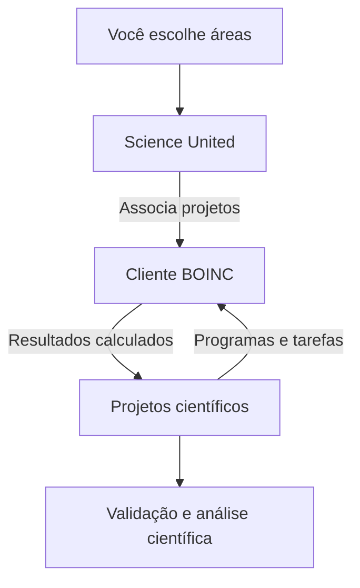

+++
title = "BOINC: doando CPU e GPU para a ciência, com limites no Kubernetes"
description = "Como contribuir com ciência usando BOINC e Science United, resultados publicados e um tutorial com CPU, GPU, persistência e controle de recursos no Kubernetes."
language = "pt-BR"
authors = ["Guilherme de Castro"]
publishedAt = "2026-10-29T23:00:00-03:00"
tags = ["boinc", "ciencia", "homelab", "kubernetes", "gpu", "gitops"]
draft = false
cover = "./assets/cover-cartoon.png"
cover_alt = "Mini servidor oferece modelos de um átomo, uma molécula e uma estrela enquanto um radar acompanha a atividade, representando computação doada à ciência sob monitoramento."
margo = { imageViewer = true }
+++

Meu homelab passa o dia guardando fotos, servindo mídia e executando os programas que uso e desenvolvo. Entre essas atividades, sobra capacidade de processamento. Resolvi ceder uma parte dela a pesquisas científicas usando [BOINC](https://boinc.berkeley.edu/).

A ideia é simples. Uma equipe de pesquisa divide um cálculo em tarefas, computadores voluntários processam essas partes e devolvem os resultados. Posso ajudar sem escolher uma pergunta de pesquisa nem escrever uma simulação. Minha contribuição é manter um cliente funcionando, com recursos e tempo suficientes para entregar o trabalho recebido.

No meu caso, isso virou também um exercício de operação no Kubernetes. Quero contribuir, mas os serviços que já uso continuam tendo prioridade. Aqui vou explicar o que essa computação já ajudou a produzir, como começar no computador de casa e como montei uma contribuição limitada de CPU e GPU no cluster.

## BOINC executa as tarefas; Science United escolhe os projetos

BOINC é a plataforma de computação voluntária. O cliente baixa os programas e os dados dos projetos, executa as tarefas e envia os resultados. O BOINC Manager é a interface para acompanhar esse cliente e configurar quando ele pode trabalhar. O código-fonte está no [repositório oficial do BOINC no GitHub](https://github.com/boinc/boinc).

É possível escolher projetos diretamente na [lista oficial](https://www.boinc.org/projects.php). Eles têm objetivos e requisitos diferentes. Um programa pode precisar apenas de CPU; outro, de determinada GPU, sistema operacional ou quantidade de memória. Estar na lista não garante que haverá tarefas compatíveis disponíveis naquele momento.

Escolhi o [Science United](https://scienceunited.org/), um gerenciador de contas operado pelo projeto BOINC na Universidade da Califórnia em Berkeley. Em vez de selecionar cada projeto, escolho as áreas científicas que quero apoiar. O gerenciador associa o cliente aos projetos conforme essas preferências e a demanda. Essa seleção pode mudar com o tempo, como explica a [introdução do Science United](https://scienceunited.org/intro.php).

Marquei as sete áreas oferecidas e deixei a localização das pesquisas sem restrição. Preferi contribuir onde houver trabalho compatível. Isso não significa executar sete projetos simultaneamente, nem receber tarefas de todos eles.



Um resultado calculado ainda passa pelas regras de validação do projeto. Ele pode integrar uma busca enorme, confirmar um cálculo ou ser descartado. Terminar uma tarefa não equivale a descobrir algo, e crédito de processamento não mede impacto científico individual.

## O que já saiu desse trabalho coletivo

Há resultados publicados que permitem ir além da promessa de "ajudar a ciência". Estes exemplos mostram contribuições diferentes. São resultados dos projetos e de seus voluntários ao longo dos anos, anteriores à minha instalação.

### Encontrar pulsares em dados de telescópios

O Einstein@Home procura sinais de estrelas de nêutrons, entre outras buscas. Em um [artigo publicado na Science Advances em 2018](https://doi.org/10.1126/sciadv.aao7228), os pesquisadores descrevem a descoberta de dois pulsares de milissegundos isolados em dados de raios gama do telescópio Fermi. Um deles continuava sem detecção em rádio nas observações relatadas no estudo.

A busca usou os computadores de dezenas de milhares de voluntários para testar padrões de pulsação nos dados. A contribuição distribuída foi o processamento necessário para encontrar sinais que depois receberam análise científica. O [manuscrito dos autores](https://arxiv.org/abs/1803.06855) descreve essa relação de forma direta.

### Priorizar moléculas para investigar o vírus Zika

O OpenZika, do World Community Grid, contou com uma equipe que inclui pesquisadores da Universidade Federal de Goiás. Os computadores voluntários fizeram cálculos de encaixe molecular para selecionar compostos que mereciam investigação experimental.

O trabalho culminou em um [artigo de 2022 no Journal of Chemical Information and Modeling](https://doi.org/10.1021/acs.jcim.2c00596). Na [atualização publicada pelo projeto em fevereiro de 2023](https://worldcommunitygrid.org/about_us/article.s?articleId=779), a equipe relata quase 404 milhões de resultados computacionais e 61 compostos priorizados para testes, seguidos por ensaios enzimáticos e celulares.

Esse é um avanço na seleção de candidatos e no estudo de proteínas virais. O relato não demonstra um medicamento aprovado ou benefício clínico em pacientes. Entre uma molécula promissora e um tratamento há muita pesquisa adicional.

### Investigar mudanças no risco de enchentes

O climateprediction.net usa computação distribuída para executar conjuntos de simulações climáticas. Em um [artigo de 2016 na Nature Climate Change](https://doi.org/10.1038/nclimate2927), pesquisadores investigaram a influência humana no clima das enchentes do inverno de 2013/2014 no sul da Inglaterra e seus impactos.

Os participantes do projeto cederam processamento para criar grandes conjuntos de modelos. A [Universidade de Oxford descreve o experimento](https://eng.ox.ac.uk/climateprediction/conduct-a-study/projects/2014-uk-winter-floods): comparar simulações do mundo observado com um cenário sem a alteração humana da composição atmosférica permite estimar mudanças na probabilidade de um inverno muito chuvoso.

O estudo encontrou aumento no risco de chuvas intensas e mudanças no risco de inundação, com incertezas relevantes. A contribuição foi permitir essa comparação estatística. Ela não transforma uma enchente específica em um evento com causa única, nem funciona como previsão meteorológica de uma cidade.

Esses projetos ilustram astronomia, biomedicina e clima. Participar hoje depende dos projetos ativos e das tarefas disponíveis. Folding@home, Foldit e AlphaFold têm suas próprias histórias e mecanismos; não atribuo seus resultados ao BOINC.

## O que estou doando de verdade

Capacidade ociosa não é energia gratuita. Quando uma CPU ou GPU sai do repouso e começa a calcular, aumenta o consumo, o calor e, conforme o equipamento, o ruído. Também há uso de memória, disco e rede.

Uma conta ilustrativa ajuda a dimensionar. Se a contribuição acrescentasse 20 W medidos na tomada durante oito horas por dia, seriam `0,020 kW × 8 h × 30 dias = 4,8 kWh` no mês. Esse número é uma hipótese, não uma medição do meu cluster. O custo depende da tarifa local e do aumento real de potência. Um medidor na tomada, comparando períodos equivalentes com e sem BOINC, dá uma resposta melhor que o TDP do processador.

Meu ponto de partida é uma parcela pequena de uma máquina que já está ligada. Observo temperatura e uso normal antes de ampliar qualquer coisa. Não vale acumular tarefas com prazo se o computador só vai ficar disponível por alguns minutos por semana.

## Começar sem Kubernetes

Para contribuir, basta um computador compatível. GPU e cluster são opcionais.

1. Crie sua conta no Science United e escolha as áreas de interesse. Se quiser escolher projetos individualmente, use a lista do BOINC e siga o cadastro de cada projeto.
2. Baixe o cliente na [página oficial de instalação](https://www.boinc.org/download.php). Instale a versão oferecida para seu sistema.
3. Abra o BOINC Manager. Para uma instalação já existente, use a opção de gerenciador de contas e informe Science United, conforme a [ajuda oficial](https://scienceunited.org/su_help.php).
4. Nas preferências de computação, comece com uma fração dos processadores, suspenda durante o uso do computador e mantenha GPU suspensa enquanto estiver trabalhando. Em notebook, confira também a opção de funcionamento com bateria.
5. Observe uma tarefa real, consumo e temperatura. Ajuste os horários e a parcela de CPU depois desse primeiro teste.

As [preferências do BOINC](https://github.com/BOINC/boinc/wiki/Preferences) distinguem a quantidade de processadores usados da porcentagem de tempo de CPU. Usar metade dos processadores não significa impor metade da potência elétrica. O controle de tempo de CPU alterna períodos de execução e pausa. Nenhuma dessas opções equivale a um limite genérico de utilização da GPU.

Se algo atrapalhar o computador, suspenda a computação pelo Manager. Evite abortar tarefas só para pausar. Elas podem continuar depois, desde que o prazo permita.

## Meu arranjo no homelab

Já descrevi o hardware na [primeira parte da série Homelab K8s](/blogs/homelab-hardware-custos/) e o fluxo de [operação com GitOps](/blogs/homelab-operacao/). Para BOINC, separei dois clientes, cada um com sua identidade e volume persistente.

| Controle | Cliente com GPU | Cliente somente CPU |
| --- | --- | --- |
| Controlador | StatefulSet com uma réplica | Deployment com uma réplica e Recreate |
| Nó escolhido | worker-01, Intel N100 | worker-02, Intel N100 |
| Limite do container | 2 CPUs e 2 GiB | 2 CPUs e 2 GiB |
| Request de CPU | 25m | 25m |
| Request de memória | 2 GiB | 2 GiB |
| CPUs anunciadas ao BOINC | 1 | 2 |
| GPU | Um acesso Intel i915 | Desabilitada |
| Volume próprio | 8 GiB | 8 GiB |

O cliente com GPU anuncia menos CPU para deixar margem no pacote do N100, onde CPU e GPU compartilham recursos térmicos e elétricos. O limite de duas CPUs continua existindo para o container inteiro, incluindo o trabalho auxiliar da aplicação GPU.

A tabela resume a configuração do meu ambiente. Nomes de nós, StorageClass e a imagem Intel são escolhas dessa instalação; o tutorial abaixo oferece um exemplo independente para começar com CPU.

### O que cada limite controla

`requests.cpu: 25m` participa da reserva para agendamento e do peso relativo de CPU quando há disputa. Não limita o cliente a 2,5% de um núcleo. `limits.cpu: "2"` impõe uma cota de tempo de CPU pelo mecanismo de controle do runtime.

Memória funciona de outra maneira. O request de 2 GiB entra no orçamento do scheduler, enquanto ultrapassar o limite de 2 GiB pode provocar encerramento por falta de memória no container. Também ajusto o orçamento interno do BOINC, deixando 256 MiB para o próprio cliente. Essa versão do BOINC enxerga a RAM do host, por isso o script de inicialização converte o orçamento do container para a porcentagem esperada pelo programa.

Os pods são Burstable. Uma PriorityClass com valor `-1000` e `preemptionPolicy: Never` reduz a prioridade de agendamento e impede que o BOINC expulse outros pods para conseguir lugar. Ela não retira CPU de um cliente já em execução nem detecta que outro serviço ficou lento.

Também não uso a detecção de atividade do desktop para decidir se um nó Kubernetes está ocioso. Dentro de um container, essa leitura não representa bem o conjunto dos serviços. Aqui a contribuição tem orçamento fixo e exige observação do host.

## Tutorial de um cliente CPU persistente

Preparei um [manifesto completo de exemplo](./assets/boinc-cpu.yaml) para um cliente CPU-only no namespace `boinc-example`. Ele começa menor que meu deployment: uma CPU, 1 GiB de RAM e um PVC de 8 GiB. A memória pode ser insuficiente para alguns projetos; nesses casos, escolha trabalho compatível ou revise o orçamento antes de aumentar.

O exemplo usa o cliente oficial BOINC 8.0.4 fixado por digest, testado aqui em Linux AMD64. Ele não depende do runtime OpenCL Intel. Reavalie versão, arquitetura e atualizações de segurança ao adotar a configuração.

### 1. Escolher nó e armazenamento

Salve o manifesto em uma pasta do seu repositório GitOps, por exemplo `k8s/boinc-example/`. Substitua `REPLACE_WITH_NODE` pelo nó que pode receber a carga e `REPLACE_WITH_STORAGE_CLASS` por uma StorageClass adequada. Confira capacidade livre, permissões do volume para UID 1000 e comportamento de retenção do armazenamento.

O cliente guarda identidade, programas, downloads e checkpoints em `/var/lib/boinc`. Cada cliente precisa de um diretório persistente exclusivo. Não copie o PVC de um cliente para iniciar outro em paralelo, nem aumente réplicas para compartilhar essa identidade.

### 2. Selar a conta para o seu cluster

Se você já usa [Sealed Secrets](https://github.com/bitnami-labs/sealed-secrets), o [script de exemplo](./assets/seal-account.py) solicita email e senha no terminal local e passa o Secret ao `kubeseal` pela entrada padrão. Ele não grava o XML em texto aberto. Revise o script antes de executar.

```sh
python3 seal-account.py \
  --context SEU_CONTEXTO \
  --controller-name sealed-secrets-controller \
  --controller-namespace sealed-secrets \
  --output k8s/boinc-example/account.sealed.yaml
```

Os nomes do controlador dependem da sua instalação. O script usa escopo estrito para o Secret `boinc-science-united` no namespace `boinc-example`. Se mudar o namespace, use também `--namespace` e ajuste todos os manifestos. O hash exigido pelo protocolo do gerenciador de contas continua sendo uma credencial. Não o publique, nem publique o conteúdo do PVC.

Gere o SealedSecret para seu próprio cluster e sua própria conta. Se usa outro gerenciador de segredos, produza o mesmo arquivo `acct_mgr_login.xml` dentro de um Secret pelo fluxo seguro da sua instalação.

### 3. Entregar a pasta ao Argo CD

Crie um `kustomization.yaml` junto dos arquivos:

```yaml
apiVersion: kustomize.config.k8s.io/v1beta1
kind: Kustomization
resources:
  - boinc-cpu.yaml
  - account.sealed.yaml
```

Renderize e revise antes de ativar:

```sh
kubectl kustomize k8s/boinc-example > /tmp/boinc-example-rendered.yaml
```

Registre uma Application do Argo apontando para essa pasta no seu repositório. Substitua a URL abaixo e use o nome real do namespace onde seu Argo está instalado. Este exemplo começa com sincronização manual:

```yaml
apiVersion: argoproj.io/v1alpha1
kind: Application
metadata:
  name: boinc-example
  namespace: argocd
spec:
  project: default
  source:
    repoURL: https://github.com/SEU_USUARIO/SEU_REPOSITORIO
    targetRevision: main
    path: k8s/boinc-example
  destination:
    server: https://kubernetes.default.svc
    namespace: boinc-example
  syncPolicy:
    syncOptions:
      - CreateNamespace=true
```

Confira o diff no Argo antes de sincronizar. Depois escolha a política de reconciliação. Namespace, políticas e Secret precisam estar disponíveis antes de o cliente conseguir iniciar.

Comite apenas o manifesto, o arquivo Kustomize e o segredo selado. Um `kubectl apply` paralelo ao Argo cria duas fontes de configuração; faça ajustes duráveis no Git.

### 4. Confirmar trabalho de verdade

Após a sincronização, confira PVC, prontidão e tarefas:

```sh
kubectl --context SEU_CONTEXTO -n boinc-example get pods,pvc
kubectl --context SEU_CONTEXTO -n boinc-example logs boinc-0
kubectl --context SEU_CONTEXTO -n boinc-example exec boinc-0 -- boinccmd --get_tasks
kubectl --context SEU_CONTEXTO -n boinc-example top pods
```

Procure associação ao Science United, projetos recebidos e avanço do tempo de CPU. A porcentagem de algumas tarefas avança em saltos. Um pod Ready só confirma a resposta local do cliente; não prova conclusão, envio ou validação de trabalho científico.

O cliente roda sem root, sem token de ServiceAccount, sem capabilities e com raiz somente leitura. Os diretórios de dados e temporários continuam graváveis. Não há Ingress, NodePort ou acesso remoto configurado ao RPC. Projetos que exigem VirtualBox ou containers aninhados não fazem parte desse exemplo restrito.

## GPU exige outro cuidado

Adicionar GPU não é apenas escrever um número no YAML. São necessárias uma GPU suportada pela aplicação científica, acesso ao dispositivo pelo runtime e as bibliotecas de execução corretas dentro do container.

No meu Talos, o [Intel GPU device plugin](https://github.com/intel/intel-device-plugins-for-kubernetes/tree/v0.37.1/cmd/gpu_plugin) anuncia `gpu.intel.com/i915`. O cliente Intel usa uma imagem própria com OpenCL e BOINC. O workload pede um acesso:

```yaml
resources:
  requests:
    cpu: 25m
    memory: 2Gi
  limits:
    cpu: "2"
    memory: 2Gi
    gpu.intel.com/i915: "1"
```

Esse trecho pertence ao cliente Intel completo. Não é um patch suficiente para habilitar GPU no exemplo CPU-only. Para reproduzir o caminho Intel, confira primeiro driver i915 no host e o device plugin; valide a enumeração OpenCL em uma tarefa de teste sem PVC científico. Prepare em conjunto o workload, o ConfigMap de preferências, o supervisor térmico e a imagem compatível. Se o supervisor verificar a identidade do cliente, mantenha os nomes de nó e pod coerentes com o manifesto. Preserve um único escritor do PVC durante a troca.

A imagem Intel usada no meu teste contém patches locais sobre BOINC 8.0.4. Esse piloto é uma implementação específica do homelab; o exemplo disponível para download neste artigo usa o cliente oficial somente com CPU. Não é a imagem oficial nem uma solução genérica para qualquer GPU. NVIDIA e AMD exigem outros drivers, bibliotecas e recursos; não precisam desse patch Intel por definição.

No meu plugin, os slots são compartilhados. Pedir uma unidade dá acesso ao dispositivo, não uma porcentagem de uso, memória dedicada ou potência reservada. Limitei o cliente a uma tarefa GPU por vez, inclusive entre projetos, com o patch versionado. Essa regra também não impede que outro pod com acesso à mesma GPU concorra com ele.

### Pausar por temperatura sem perder o contexto da GPU

O supervisor consulta sensores `coretemp` a cada dois segundos. Pausa computação GPU a partir de 85 °C e permite retomada até 80 °C. Essa diferença evita alternância a cada pequena oscilação. Sensor ausente ou inválido mantém GPU pausada; falha ao impor o modo por RPC encerra o cliente.

São controles cooperativos. Não limitam frequência ou potência do chip e não garantem que a temperatura nunca ultrapasse 85 °C. CPU e GPU compartilham o pacote, e há atraso entre leitura, comando e efeito.

No piloto de quatro horas em 26 de outubro, houve pico observado de 90 °C. A tarefa continuou avançando, mas não terminou naquele intervalo. Isso não prova ausência de impacto nos outros serviços. Na conferência de 29 de outubro, o cliente também tinha um reinício anterior causado por timeout do RPC térmico. É um motivo para manter a margem e observar o sistema inteiro.

Algumas aplicações GPU demoram a produzir o primeiro checkpoint. Para evitar relançar o processo a cada pausa térmica, o cliente GPU mantém aplicações suspensas na memória, e o patch respeita essa preferência. Essa escolha custa RAM. O cliente CPU-only tem seu próprio supervisor e também conserva aplicações suspensas na memória.

## CPU também precisa de controle térmico

Ao conferir o cliente somente CPU, encontrei o worker-02 a 96 °C. O limite de duas CPUs estava funcionando, mas não limitava a temperatura do pacote. Adicionei um supervisor CPU separado, com os mesmos patamares de 85 °C para pausar e 80 °C para retomar.

Ele mantém as aplicações na memória durante as pausas. Antes de permitir o início das tarefas, precisa conseguir impor o modo de execução por RPC. Sensor indisponível mantém a contribuição suspensa. Uma falha posterior de controle encerra o cliente para não deixar a carga sem supervisão.

Na validação, observei pausa e retomada automáticas e redução do consumo de CPU do pod. Também houve picos até 90 °C após retomadas, o que mostra por que esses patamares não são um teto térmico. O pod GPU continuou com o mesmo processo; o cliente CPU passou por um rollout controlado e voltou com o mesmo volume e identidade científica. Trabalho ainda sem checkpoint pode precisar ser refeito nesse tipo de reinício.

Esse supervisor usa sensores Intel `coretemp`. O exemplo CPU para download mantém o orçamento por recursos e requer acompanhamento da temperatura; para adotar a pausa automática, prepare um supervisor para os sensores disponíveis no seu host e execute-o como processo principal do container, responsável por iniciar o BOINC, encaminhar SIGTERM e impor as pausas por RPC. Se o nó continuar quente por causa de outros serviços, a contribuição pode permanecer pausada. Isso é preferível a disputar capacidade sem margem.

## Barrar um deploy maior do que o combinado

Limites no template protegem o pod configurado. Para impedir que uma edição futura crie mais clientes ou aumente silenciosamente o orçamento do namespace, adicionei LimitRange e ResourceQuota.

No meu deployment, a quota permite dois pods, soma de limites de quatro CPUs, 4 GiB de memória e uma alocação Intel GPU. O teto de armazenamento inclui três PVCs de 8 GiB porque uma cópia histórica de migração continua retida. Ela não roda outro cliente. O exemplo para download tem orçamento próprio para apenas um cliente.

LimitRange define os máximos por container e por pod, além do tamanho dos claims. ResourceQuota limita o conjunto declarado no namespace. Esses controles são admissão de recursos, não medidores de consumo elétrico. Ao serem adicionados, não reiniciam nem alteram retroativamente os pods existentes.

A quota também bloqueia réplicas temporárias de um rollout com surge. Por isso mantenho o cliente CPU em `Recreate` e o StatefulSet GPU com uma réplica. Durante manutenção, pode ser necessário esperar um pod em encerramento sair da contagem. A solução não é apagar o PVC.

## O que mudou no Kubernetes e o que faz sentido aqui

Conferi o cluster em 29 de outubro de 2026. Os nós BOINC usavam Kubernetes 1.35.2, Talos 1.13.9 e containerd 2.2.7; o plugin Intel era 0.37.1. A escolha de recursos considera essa versão, não apenas o que existe na documentação mais recente.

| Recurso | Situação relevante | Decisão neste deployment |
| --- | --- | --- |
| Resize de CPU e memória no container em execução | GA no Kubernetes 1.35 | Útil para reduzir interrupções, mas o fluxo atual do Argo não conduz o subrecurso de resize. Alterar template ainda pode recriar pods. |
| Dynamic Resource Allocation | API principal estável desde 1.34 | Exige driver e claims compatíveis. Não converte automaticamente o plugin Intel instalado nem fornece limite percentual de GPU. |
| Recursos no nível do pod | Beta em 1.35 | Mantive limites nos containers e máximos estáveis via LimitRange. |
| HPA e VPA | Automação precisa respeitar dados e identidade | Não adicionei escala automática. Mais réplicas não são uma forma segura de ampliar este cliente persistente. |

As referências oficiais de [resize em 1.35](https://kubernetes.io/blog/2025/12/19/kubernetes-v1-35-in-place-pod-resize-ga/), [DRA nessa versão](https://v1-35.docs.kubernetes.io/docs/concepts/scheduling-eviction/dynamic-resource-allocation/) e [gerenciamento de recursos](https://v1-35.docs.kubernetes.io/docs/concepts/configuration/manage-resources-containers/) detalham os contratos e limites. Reduzir memória pode causar OOM mesmo sem reinício planejado. Não faria isso no meio de uma tarefa residente apenas porque a API permite.

Não adicionei um PDB que impeça parar o único cliente. Essas tarefas toleram interrupções conforme seus checkpoints e prazos; bloquear manutenção não as torna altamente disponíveis. Também evitei liveness agressiva. Uma resposta lenta ao RPC não deveria provocar reinícios em série e recomputação desnecessária.

## Monitorar, pausar e retomar

Observo CPU e memória dos pods, memória total do nó, pressão de CPU, temperatura e latência dos serviços que já estavam ali. No Prometheus, duas consultas ajudam a ver o orçamento real:

```promql
sum by (pod) (
  rate(container_cpu_usage_seconds_total{namespace="boinc",container="boinc"}[5m])
)
```

```promql
sum by (pod) (
  container_memory_working_set_bytes{namespace="boinc",container="boinc"}
)
```

As métricas dependem da coleta do seu cluster. No exemplo de download, troque o namespace por `boinc-example`. Uso essas séries junto dos logs e de `boinccmd --get_tasks`, e não como substitutas da observação dos serviços. Para GPU, confira também contadores do dispositivo quando disponíveis. RAM do host importa porque uso de memória pelo driver pode não aparecer da mesma forma no working set do container.

Para interromper toda a contribuição, altere `replicas: 0` no Git e deixe o Argo reconciliar. No meu caso, isso vale para os dois controladores. Para retomar, volte a uma réplica em cada um. Conserve PVCs e identidades. Os 120 segundos de encerramento permitem ao cliente receber SIGTERM e salvar estado, mas a aplicação científica define seus checkpoints; parte do cálculo desde o último checkpoint pode ser refeita.

Para mudar o orçamento, revise conjuntamente o limite do container, os requests, as preferências internas e as políticas do namespace. No exemplo, a configuração é copiada durante a inicialização. Uma mudança no ConfigMap exige rollout deliberado, por exemplo com uma anotação de revisão no template, depois de conferir checkpoints e prazos. O Argo não reinicia automaticamente um pod só porque esse ConfigMap mudou.

Rollback segue a mesma regra. Reverter uma quota não exige trocar imagem nem dados. Reverter uma imagem usa o PVC atual, com o cliente anterior já parado. Uma cópia antiga de volume não deve voltar a rodar em paralelo. Se desabilitar GPU, tarefas que precisam dela podem ficar sem avançar até recuperar suporte ou vencer o prazo.

Para encerrar participação de vez, prefira deixar o trabalho pendente terminar e ser reportado antes de remover o cliente. Não confunda desaparecer da lista local com validação: confira término sem erro, envio, reporte e o histórico do projeto ou do gerenciador.

## Uma contribuição que caiba no laboratório

Gosto da possibilidade de um equipamento que já uso participar de uma pesquisa maior. O homelab continua sendo meu espaço de aprender e experimentar, agora com uma parcela de processamento destinada a esses projetos.

Para quem está começando, eu começaria pelo cliente no computador e por um orçamento pequeno. O cluster acrescenta persistência, controle declarativo e observabilidade, mas também acrescenta trabalho de operação. A contribuição só se sustenta se continuar cabendo no equipamento, na conta de energia e no uso diário de quem o mantém.
