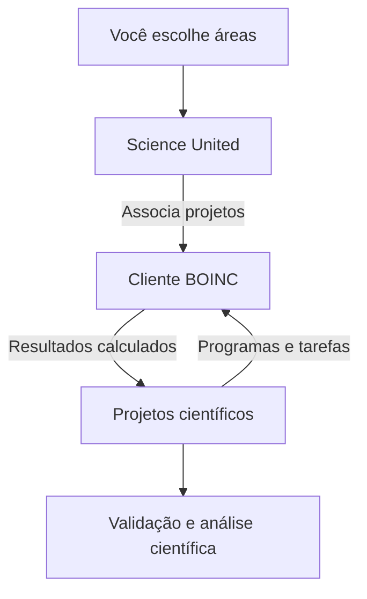

+++
title = "BOINC: doando CPU e GPU para a ciência, com limites no Kubernetes"
description = "Como contribuir com ciência usando BOINC e Science United, resultados publicados, um tutorial de CPU no Kubernetes e a experiência de um piloto com GPU."
language = "pt-BR"
authors = ["Guilherme de Castro"]
publishedAt = "2026-10-29T23:00:00-03:00"
tags = ["boinc", "ciencia", "homelab", "kubernetes", "gpu", "gitops"]
draft = false
cover = "./assets/cover-cartoon.png"
cover_alt = "Mini servidor oferece modelos de um átomo, uma molécula e uma estrela enquanto um radar acompanha a atividade, representando computação doada à ciência sob monitoramento."
margo = { imageViewer = true }
+++

Meu homelab passa o dia guardando fotos, servindo mídia e executando os programas que uso e desenvolvo. Entre essas atividades, sobra capacidade de processamento. Resolvi ceder uma parte dela a pesquisas científicas usando [BOINC](https://boinc.berkeley.edu/).

A ideia é simples. Uma equipe de pesquisa divide um cálculo em tarefas, computadores voluntários processam essas partes e devolvem os resultados. Posso ajudar sem escolher uma pergunta de pesquisa nem escrever uma simulação. Minha contribuição é manter um cliente funcionando, com recursos e tempo suficientes para entregar o trabalho recebido.

No meu caso, isso virou também um exercício de operação no Kubernetes. Quero contribuir, mas os serviços que já uso continuam tendo prioridade. Aqui vou explicar o que essa computação já ajudou a produzir, como começar no computador de casa e como montei uma contribuição limitada de CPU e GPU no cluster.

## BOINC executa as tarefas; Science United escolhe os projetos

BOINC é a plataforma de computação voluntária. O cliente baixa os programas e os dados dos projetos, executa as tarefas e envia os resultados. O BOINC Manager é a interface para acompanhar esse cliente e configurar quando ele pode trabalhar. O código-fonte está no [repositório oficial do BOINC no GitHub](https://github.com/boinc/boinc).

É possível escolher projetos diretamente na [lista oficial](https://www.boinc.org/projects.php). Eles têm objetivos e requisitos diferentes. Um programa pode precisar apenas de CPU; outro, de determinada GPU, sistema operacional ou quantidade de memória. A oferta de tarefas varia conforme a demanda de cada projeto.

Escolhi o [Science United](https://scienceunited.org/), um gerenciador de contas operado pelo projeto BOINC na Universidade da Califórnia em Berkeley. Em vez de selecionar cada projeto, escolho as áreas científicas que quero apoiar. O gerenciador associa o cliente aos projetos conforme essas preferências e a demanda. Essa seleção pode mudar com o tempo, como explica a [introdução do Science United](https://scienceunited.org/intro.php).

Na configuração da conta, é possível marcar as sete áreas oferecidas e deixar a localização das pesquisas sem restrição, para contribuir onde houver trabalho compatível. O gerenciador distribui o trabalho entre os projetos conforme essas preferências e as tarefas disponíveis.



Os projetos conferem os resultados recebidos e os reúnem para análise científica. Cada computador participa de uma parte desse trabalho; o conjunto permite explorar perguntas que exigem muito processamento.

## O que já saiu desse trabalho coletivo

As descobertas são fruto do trabalho das equipes de pesquisa e de seus voluntários. O BOINC fornece a estrutura para distribuir os cálculos. Estes casos mostram o que essa colaboração já ajudou a produzir.

### Encontrar pulsares em dados de telescópios

O [Einstein@Home](https://einsteinathome.org/) usa o BOINC para procurar estrelas em dados de observatórios. Um dos resultados foi a descoberta de dois pulsares, estrelas muito compactas que funcionam como faróis no espaço. A descoberta, feita em dados do telescópio Fermi, foi [publicada em 2018](https://doi.org/10.1126/sciadv.aao7228).

Computadores de dezenas de milhares de voluntários participaram da busca. Eles fizeram os cálculos que permitiram aos pesquisadores encontrar os sinais dessas estrelas, como relata o [estudo](https://arxiv.org/abs/1803.06855).


Ilustração artística de um pulsar. Fonte: [NASA](https://www.nasa.gov/universe/nasas-fermi-telescope-discovers-first-gamma-ray-only-pulsar/).


Fonte: [NASA/Fermi](https://svs.gsfc.nasa.gov/11342/).

### Selecionar substâncias para pesquisar o vírus Zika

O OpenZika usou computadores voluntários do [World Community Grid](https://www.worldcommunitygrid.org/), uma iniciativa que utiliza o BOINC, para ajudar na pesquisa de possíveis tratamentos contra o Zika. A equipe contou com pesquisadores da [Universidade Federal de Goiás](https://ufg.br/).

Os computadores analisaram milhões de substâncias para ajudar a escolher quais testar no laboratório. A equipe selecionou 61 para essa etapa, a partir de quase 404 milhões de resultados de cálculos, segundo o [balanço do projeto](https://worldcommunitygrid.org/about_us/article.s?articleId=779). Essa seleção, [publicada em 2022](https://pubmed.ncbi.nlm.nih.gov/36239304/), deu à equipe pontos de partida para continuar a pesquisa.


Foto de [Laczkowski, via Wikimedia Commons](https://commons.wikimedia.org/wiki/File:Reitoria_da_Universidade_Federal_de_Goi%C3%A1s.jpg), sob licença [CC BY-SA 4.0](https://creativecommons.org/licenses/by-sa/4.0/). Versão reduzida disponibilizada pelo acervo.

### Entender o risco de chuvas e enchentes

O [climateprediction.net](https://climateprediction.net/) usa o BOINC para executar simulações do clima em computadores voluntários. Esse trabalho ajudou a estudar as chuvas e enchentes do inverno de 2013/2014 no sul da Inglaterra.

O [estudo publicado em 2016](https://doi.org/10.1038/nclimate2927) indicou que a influência humana no clima aumentou a chance de chuvas intensas naquela região e período. A contribuição dos voluntários permitiu repetir as simulações muitas vezes para estimar esse risco, como explica a [Universidade de Oxford](https://eng.ox.ac.uk/climateprediction/conduct-a-study/projects/2014-uk-winter-floods).

Esses casos mostram como o processamento cedido por muitas pessoas pode virar uma ferramenta de pesquisa. É uma forma de participar da ciência com um recurso que já temos em casa.

## O que estou doando de verdade

Ao ceder processamento, também reservo energia, memória, disco e rede para a pesquisa. O aumento de atividade produz mais calor e, conforme o equipamento, mais ruído.

Uma conta ilustrativa ajuda a dimensionar. Um acréscimo de 20 W na tomada durante oito horas por dia representaria `0,020 kW × 8 h × 30 dias = 4,8 kWh` no mês. O custo depende da tarifa local e do aumento real de potência. Um medidor na tomada, comparando períodos equivalentes com e sem BOINC, dá uma resposta melhor que o TDP do processador.

Meu ponto de partida é uma parcela pequena de uma máquina que já está ligada. Observo temperatura e uso normal antes de ampliar qualquer coisa. Ajuste o volume de trabalho ao tempo que o computador pode dedicar às tarefas e aos prazos de entrega.

## Começar sem Kubernetes

Para contribuir, basta um computador compatível. GPU e cluster são opcionais.

1. Crie sua conta no Science United e escolha as áreas de interesse. Se quiser escolher projetos individualmente, use a lista do BOINC e siga o cadastro de cada projeto.
2. Baixe o cliente na [página oficial de instalação](https://www.boinc.org/download.php). Instale a versão oferecida para seu sistema.
3. Abra o BOINC Manager. Para uma instalação já existente, use a opção de gerenciador de contas e informe Science United, conforme a [ajuda oficial](https://scienceunited.org/su_help.php).
4. Nas preferências de computação, comece com uma fração dos processadores, suspenda durante o uso do computador e mantenha GPU suspensa enquanto estiver trabalhando. Em notebook, confira também a opção de funcionamento com bateria.
5. Observe uma tarefa real, consumo e temperatura. Ajuste os horários e a parcela de CPU depois desse primeiro teste.

As [preferências do BOINC](https://github.com/BOINC/boinc/wiki/Preferences) distinguem a quantidade de processadores usados da porcentagem de tempo de CPU. Usar metade dos processadores não significa impor metade da potência elétrica. O controle de tempo de CPU alterna períodos de execução e pausa. Nenhuma dessas opções equivale a um limite genérico de utilização da GPU.

Se algo atrapalhar o computador, suspenda a computação pelo Manager. Evite abortar tarefas só para pausar. Elas podem continuar depois, desde que o prazo permita.

## Meu arranjo no homelab

Já descrevi o hardware na [primeira parte da série Homelab K8s](/blogs/homelab-hardware-custos/) e o fluxo de [operação com GitOps](/blogs/homelab-operacao/). Para BOINC, separei dois clientes, cada um com sua identidade e volume persistente.

| Controle | Cliente com GPU | Cliente somente CPU |
| --- | --- | --- |
| Controlador | StatefulSet com uma réplica | Deployment com uma réplica e Recreate |
| Limite do container | 2 CPUs e 2 GiB | 2 CPUs e 2 GiB |
| Request de CPU | 25m | 25m |
| Request de memória | 2 GiB | 2 GiB |
| CPUs anunciadas ao BOINC | 1 | 2 |
| GPU | Um acesso Intel i915 | Desabilitada |
| Volume próprio | 8 GiB | 8 GiB |

Os dois clientes ficam em máquinas distintas, ambas com Intel N100. O cliente com GPU anuncia menos CPU para deixar margem no chip, onde CPU e GPU compartilham recursos térmicos e elétricos. O limite de duas CPUs continua existindo para o container inteiro, incluindo o trabalho auxiliar da aplicação GPU.

A tabela resume a configuração do meu ambiente. O armazenamento e a imagem Intel são escolhas dessa instalação; o tutorial abaixo oferece um exemplo independente para começar com CPU.

### O que cada limite controla

`requests.cpu: 25m` participa da reserva para agendamento e do peso relativo de CPU quando há disputa. Não limita o cliente a 2,5% de um núcleo. `limits.cpu: "2"` impõe uma cota de tempo de CPU pelo mecanismo de controle do runtime.

Memória funciona de outra maneira. O request de 2 GiB entra no orçamento do scheduler, enquanto ultrapassar o limite de 2 GiB pode provocar encerramento por falta de memória no container. Também ajusto o orçamento interno do BOINC, deixando 256 MiB para o próprio cliente. Essa versão do BOINC enxerga a RAM do host. No exemplo abaixo, ajusto a porcentagem nas preferências para que o cliente trabalhe dentro do orçamento do container.

Os pods são Burstable. Uma PriorityClass com valor `-1000` e `preemptionPolicy: Never` reduz a prioridade de agendamento e impede que o BOINC expulse outros pods para conseguir lugar. Ela não retira CPU de um cliente já em execução nem detecta que outro serviço ficou lento.

Também não uso a detecção de atividade do desktop para decidir se um nó Kubernetes está ocioso. Dentro de um container, essa leitura não representa bem o conjunto dos serviços. Aqui a contribuição tem orçamento fixo e exige observação do host.

## Tutorial de um cliente CPU persistente

Preparei um [manifesto completo de exemplo](./assets/boinc-cpu.yaml) para um cliente CPU-only no namespace `boinc-example`. Ele começa menor que meu deployment: uma CPU, 1 GiB de RAM e um PVC de 8 GiB. A memória pode ser insuficiente para alguns projetos; nesses casos, escolha trabalho compatível ou revise o orçamento antes de aumentar.

O exemplo usa o cliente oficial BOINC 8.0.4 fixado por digest e exige um nó Linux AMD64. Ele não depende do runtime OpenCL Intel. Reavalie versão, arquitetura e atualizações de segurança ao adotar a configuração.

Para seguir o tutorial, você precisa de um contexto `kubectl` acessível, Kubernetes 1.32 ou posterior, permissão para criar Namespace e PriorityClass, uma StorageClass capaz de provisionar o volume e acesso à internet para o Science United e os projetos. O comando `kubectl top` é opcional e depende do Metrics Server.

### 1. Ajustar nó, armazenamento e memória

Baixe `boinc-cpu.yaml`. Substitua `REPLACE_WITH_NODE` pelo nó que pode receber a carga e `REPLACE_WITH_STORAGE_CLASS` por uma StorageClass adequada. Confira capacidade livre e permissões do volume para UID 1000.

O cliente guarda identidade, programas, downloads e checkpoints, os pontos de progresso salvos pelas aplicações, em `/var/lib/boinc`. Cada cliente precisa de um diretório persistente exclusivo. Não copie o PVC de um cliente para iniciar outro em paralelo, nem aumente réplicas para compartilhar essa identidade.

O exemplo usa um StatefulSet com uma réplica e volume próprio. A [política de retenção de PVCs](https://kubernetes.io/docs/concepts/workloads/controllers/statefulset/#persistentvolumeclaim-retention) usa `Retain` para conservar o claim ao reduzir réplicas ou excluir o StatefulSet. Isso não protege contra uma exclusão manual do PVC.

No ConfigMap, os campos `ram_max_used_busy_pct` e `ram_max_used_idle_pct` usam a RAM do host como referência. O valor `4.6875` do exemplo corresponde a 768 MiB para tarefas em um host de 16 GiB, deixando 256 MiB do limite de 1 GiB para o cliente. Ajuste ambos os campos para seu nó:

```text
porcentagem = 100 × (limite do container em GiB - 0,25) / RAM do host em GiB
```

Essa preferência orienta o BOINC; o limite de memória do container continua sendo a barreira imposta pelo runtime.

### 2. Aplicar o manifesto

```sh
kubectl --context SEU_CONTEXTO apply -f boinc-cpu.yaml
kubectl --context SEU_CONTEXTO -n boinc-example rollout status statefulset/boinc
kubectl --context SEU_CONTEXTO -n boinc-example get pods,pvc
```

Um init container copia os dois arquivos XML do ConfigMap para o volume antes de o cliente iniciar. O processo principal executa diretamente o BOINC. Namespace, ConfigMap, Service, StatefulSet, PVC, PriorityClass, LimitRange e ResourceQuota são recursos nativos do Kubernetes.

### 3. Associar sua conta ao Science United

Abra um terminal no cliente:

```sh
kubectl --context SEU_CONTEXTO -n boinc-example exec -it boinc-0 -- /bin/bash
```

Dentro dele, informe as credenciais sem gravá-las no manifesto ou no histórico do shell:

```sh
read -r -p "Email do Science United: " BOINC_EMAIL
read -r -s -p "Senha: " BOINC_PASSWORD
printf '\n'
boinccmd --join_acct_mgr https://scienceunited.org/ "$BOINC_EMAIL" "$BOINC_PASSWORD"
unset BOINC_EMAIL BOINC_PASSWORD
exit
```

A associação fica salva no PVC e sobrevive aos reinícios do pod. Trate o conteúdo desse volume como privado, pois ele inclui as credenciais usadas pelo cliente.

### 4. Confirmar trabalho de verdade

Após associar a conta, confira logs, tarefas e consumo:

```sh
kubectl --context SEU_CONTEXTO -n boinc-example get pods,pvc
kubectl --context SEU_CONTEXTO -n boinc-example logs boinc-0
kubectl --context SEU_CONTEXTO -n boinc-example exec boinc-0 -- boinccmd --get_tasks
# Opcional, requer Metrics Server:
kubectl --context SEU_CONTEXTO -n boinc-example top pods
```

Procure associação ao Science United, projetos recebidos e avanço do tempo de CPU. A porcentagem de algumas tarefas avança em saltos. Um pod Ready só confirma a resposta local do cliente; não prova conclusão, envio ou validação de trabalho científico.

O cliente roda sem root, sem token de ServiceAccount, sem capabilities e com raiz somente leitura. O namespace usa [Pod Security Admission em modo restricted](https://kubernetes.io/docs/concepts/security/pod-security-admission/), e o pod define [seccomp RuntimeDefault](https://kubernetes.io/docs/reference/node/seccomp/). Os diretórios de dados e temporários continuam graváveis. Não há Ingress, NodePort ou acesso remoto configurado ao RPC. Projetos que exigem VirtualBox ou containers aninhados não fazem parte desse exemplo restrito.

## GPU exige outro cuidado

Adicionar GPU não é apenas escrever um número no YAML. São necessárias uma GPU suportada pela aplicação científica, acesso ao dispositivo pelo runtime e as bibliotecas de execução corretas dentro do container.

No meu cluster Kubernetes, os nós do BOINC usam o [Talos Linux](https://www.talos.dev/), um sistema operacional feito para executar Kubernetes. Nesses nós, o [Intel GPU device plugin](https://github.com/intel/intel-device-plugins-for-kubernetes/tree/v0.37.1/cmd/gpu_plugin) anuncia `gpu.intel.com/i915`. O cliente Intel usa uma imagem própria com OpenCL e BOINC. O workload pede um acesso:

```yaml
resources:
  requests:
    cpu: 25m
    memory: 2Gi
  limits:
    cpu: "2"
    memory: 2Gi
    gpu.intel.com/i915: "1"
```

Esse trecho pertence ao cliente Intel completo. Não é um patch suficiente para habilitar GPU no exemplo CPU-only. Para usar uma GPU Intel, confira o driver i915 no host, o device plugin e as bibliotecas OpenCL dentro da imagem. A aplicação científica também precisa oferecer uma versão compatível com essa GPU.

A imagem Intel usada no meu teste contém patches locais sobre BOINC 8.0.4. Esse piloto é uma implementação específica do homelab; o exemplo disponível para download neste artigo usa o cliente oficial somente com CPU. Não é a imagem oficial nem uma solução genérica para qualquer GPU. NVIDIA e AMD exigem outros drivers, bibliotecas e recursos; não precisam desse patch Intel por definição.

No meu plugin, os slots são compartilhados. Pedir uma unidade dá acesso ao dispositivo, não uma porcentagem de uso, memória dedicada ou potência reservada. Limitei o cliente a uma tarefa GPU por vez, inclusive entre projetos, com o patch versionado. Essa regra também não impede que outro pod com acesso à mesma GPU concorra com ele.

## Como a contribuição pausa quando o computador esquenta

O manifesto CPU deste tutorial inclui limites de CPU e memória, mas não inclui o supervisor térmico descrito nesta seção. Aplicar o YAML não habilita pausa por temperatura. Esse controle automático é uma camada adicional da minha instalação, específica para sensores Intel.

Limitar o container a duas CPUs não limita a temperatura do processador. No cliente somente CPU, cheguei a observar 96 °C mesmo com essa cota funcionando. Por isso acrescentei uma pausa automática por temperatura à minha instalação.

Esse controle é um programa supervisor que inicia o BOINC e acompanha sua execução. A cada dois segundos, ele consulta os sensores Intel `coretemp` do computador e usa a maior leitura válida entre o pacote do processador e seus núcleos. No N100, CPU e GPU integrada compartilham o mesmo chip. A leitura serve para acompanhar o aquecimento desse conjunto, não para medir apenas o uso da GPU.

Cada cliente tem seu próprio supervisor. Ele envia comandos locais ao BOINC pela interface RPC, a mesma interface de controle usada pelo `boinccmd`. No cliente somente CPU, manda suspender a computação. No cliente com GPU, manda suspender apenas o trabalho da GPU; as tarefas de CPU desse cliente continuam sujeitas ao orçamento configurado.

| Leitura dos sensores | O que o supervisor faz |
| --- | --- |
| 85 °C ou mais | Pausa o trabalho que controla. |
| Acima de 80 °C e abaixo de 85 °C | Mantém o estado anterior, em execução ou pausado. |
| 80 °C ou menos | Libera a retomada, respeitando as demais preferências do BOINC. |
| Sensor ausente ou leitura inválida | Mantém o trabalho pausado. |

Por exemplo, uma tarefa em execução continua aos 83 °C. Ao atingir 85 °C, pausa. Se a leitura cair para 83 °C, ela ainda espera; só recebe autorização para retomar aos 80 °C ou menos. Essa diferença entre os dois patamares, chamada histerese, evita ligar e desligar o trabalho a cada pequena oscilação. Na primeira leitura, a decisão também é conservadora: acima de 80 °C, o supervisor manda manter o trabalho pausado até o computador esfriar.

Pausar não significa apagar o pod, abortar a tarefa ou remover seu volume. Configurei os clientes para manter as aplicações suspensas na memória, de modo que possam continuar do ponto em que pararam. Isso ocupa RAM durante a pausa. Na implementação Intel, o patch do cliente também respeita essa preferência para tarefas GPU, evitando relançar o cálculo a cada ciclo de aquecimento. Um reinício do pod é outra situação: nesse caso, o progresso recuperável depende do último checkpoint salvo pela aplicação científica.

Se uma tentativa de aplicar a pausa ou a retomada falhar por erro ou timeout do RPC, o supervisor encerra o cliente. A intenção é não manter computação ativa sem conseguir pausá-la. Uma leitura inválida, por sua vez, conserva a pausa até haver uma leitura válida que permita a retomada.

O mecanismo reduz a contribuição quando o computador esquenta, mas não impõe um teto físico de 85 °C. Há intervalo entre medir e pausar, o chip demora a esfriar e outros serviços continuam produzindo calor. Nos testes, observei pausa e retomada automáticas, com queda do uso de CPU, mas também picos de 90 °C após retomadas. Esse resultado é o motivo para acompanhar a temperatura do computador e manter margem, mesmo com a pausa automática.

Ao usar o exemplo do tutorial, acompanhe os sensores do host e suspenda a contribuição pelo BOINC se o equipamento aquecer demais.

## Barrar um deploy maior do que o combinado

Limites no template protegem o pod configurado. Para impedir que uma edição futura crie mais clientes ou aumente silenciosamente o orçamento do namespace, adicionei LimitRange e ResourceQuota.

No meu deployment, a quota permite dois pods, soma de limites de quatro CPUs, 4 GiB de memória e uma alocação Intel GPU. O teto de armazenamento inclui três PVCs de 8 GiB porque uma cópia histórica de migração continua retida. Ela não roda outro cliente. O exemplo para download tem orçamento próprio para apenas um cliente.

LimitRange define os máximos por container e por pod, além do tamanho dos claims. ResourceQuota limita o conjunto declarado no namespace. Esses controles são admissão de recursos, não medidores de consumo elétrico. Ao serem adicionados, não reiniciam nem alteram retroativamente os pods existentes.

A quota também bloqueia réplicas temporárias de um rollout com surge. Por isso mantenho o cliente CPU em `Recreate` e o StatefulSet GPU com uma réplica. Durante manutenção, pode ser necessário esperar um pod em encerramento sair da contagem. A solução não é apagar o PVC.

## Monitorar, pausar e retomar

Observo CPU e memória dos pods, memória total do nó, pressão de CPU, temperatura e latência dos serviços que já estavam ali. No Prometheus, duas consultas ajudam a ver o orçamento real:

```promql
sum by (pod) (
  rate(container_cpu_usage_seconds_total{namespace="boinc",container="boinc"}[5m])
)
```

```promql
sum by (pod) (
  container_memory_working_set_bytes{namespace="boinc",container="boinc"}
)
```

As métricas dependem da coleta do seu cluster. No exemplo de download, troque o namespace por `boinc-example`. Uso essas séries junto dos logs e de `boinccmd --get_tasks`, e não como substitutas da observação dos serviços. Para GPU, confira também contadores do dispositivo quando disponíveis. RAM do host importa porque uso de memória pelo driver pode não aparecer da mesma forma no working set do container.

Para suspender os cálculos e manter o cliente e as aplicações na memória, use a interface local do BOINC:

```sh
kubectl --context SEU_CONTEXTO -n boinc-example exec boinc-0 -- boinccmd --set_run_mode never 0
# Execute quando quiser liberar a retomada:
kubectl --context SEU_CONTEXTO -n boinc-example exec boinc-0 -- boinccmd --set_run_mode auto 0
```

O exemplo CPU define `leave_apps_in_memory` como `1` para conservar as aplicações suspensas. Essa suspensão é diferente de parar o pod. Para desligar o cliente e depois iniciá-lo novamente, ajuste as réplicas. Isso encerra os processos; a recuperação do cálculo depende dos checkpoints gravados no volume:

```sh
kubectl --context SEU_CONTEXTO -n boinc-example scale statefulset/boinc --replicas=0
# Execute quando quiser iniciar novamente:
kubectl --context SEU_CONTEXTO -n boinc-example scale statefulset/boinc --replicas=1
```

No meu homelab, gerenciado pelo Argo CD, faço a mesma alteração no Git e deixo o controlador reconciliar. Conserve PVCs e identidades. Os 120 segundos de encerramento permitem ao cliente receber SIGTERM e salvar estado, mas a aplicação científica define seus checkpoints; parte do cálculo desde o último checkpoint pode ser refeita.

Para mudar o orçamento, revise conjuntamente o limite do container, os requests, as preferências internas e as políticas do namespace. No exemplo, a configuração é copiada durante a inicialização. Depois de editar o manifesto, aplique-o novamente. Para carregar mudanças no ConfigMap, confira checkpoints e prazos antes de reiniciar o cliente:

```sh
kubectl --context SEU_CONTEXTO apply -f boinc-cpu.yaml
kubectl --context SEU_CONTEXTO -n boinc-example rollout restart statefulset/boinc
```

Alterar o ConfigMap sozinho não reinicia o pod.

Rollback segue a mesma regra. Reverter uma quota não exige trocar imagem nem dados. Reverter uma imagem usa o PVC atual, com o cliente anterior já parado. Uma cópia antiga de volume não deve voltar a rodar em paralelo. Se desabilitar GPU, tarefas que precisam dela podem ficar sem avançar até recuperar suporte ou vencer o prazo.

Para encerrar participação de vez, deixe o trabalho pendente terminar antes de remover o cliente. Depois de calcular, o BOINC envia os arquivos de resultado e comunica a conclusão ao servidor do projeto, etapa chamada de reporte. O projeto então valida o resultado. Confira essas etapas e o histórico do projeto ou do gerenciador; desaparecer da lista local não comprova validação.

## Uma contribuição que caiba no laboratório

Gosto da possibilidade de um equipamento que já uso participar de uma pesquisa maior. O homelab continua sendo meu espaço de aprender e experimentar, agora com uma parcela de processamento destinada a esses projetos.

Para quem está começando, eu começaria pelo cliente no computador e por um orçamento pequeno. O cluster acrescenta persistência, controle declarativo e observabilidade, mas também acrescenta trabalho de operação. A contribuição só se sustenta se continuar cabendo no equipamento, na conta de energia e no uso diário de quem o mantém.
