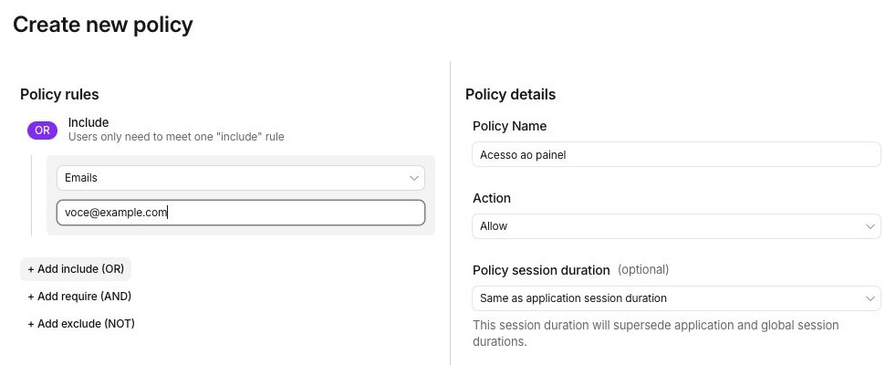

+++
title = "Cloudflare para homelabs, parte 4: Access, rede privada e Gateway"
description = "Login pelo navegador, acesso privado com cliente e filtro de navegação resolvem necessidades diferentes. Onde Access e Gateway ajudam e o que cabe no Zero Trust Free."
language = "pt-BR"
authors = ["Guilherme de Castro"]
publishedAt = "2026-11-01T01:33:22-03:00"
tags = ["cloudflare", "homelab", "zero-trust", "redes"]
draft = false
series = "Cloudflare para homelabs"
seriesPart = 4
cover = "./assets/cover-cartoon.png"
cover_alt = "Uma chave ciano chega a uma porta entreaberta, ao lado da nuvem laranja inspirada na Cloudflare segurando um passe, representando acesso autorizado."
margo = { imageViewer = true }
+++

Uma wiki do grupo precisa abrir no navegador de todo mundo. O painel administrativo do homelab talvez só precise aparecer no seu notebook. E bloquear domínios maliciosos na navegação é uma terceira necessidade.

Os nomes dos produtos da Cloudflare podem fazer tudo parecer uma coisa só. Na [parte 3](/blogs/cloudflare-homelab-tunnel-publicacao-limites/), o Tunnel cuidou do caminho até a aplicação. Agora entram a identidade de quem acessa, as rotas privadas e os filtros de navegação.

## Access coloca uma regra antes da aplicação

O [Cloudflare Access](https://developers.cloudflare.com/cloudflare-one/access-controls/applications/http-apps/self-hosted-public-app/) pode exigir autenticação antes de encaminhar o acesso a uma aplicação web. A pessoa abre o endereço, faz login pelo método escolhido e a política decide se ela pode continuar.

Para uma wiki compartilhada, a regra pode permitir os e-mails de um pequeno grupo. Numa equipe, pode aproveitar um provedor de identidade que as pessoas já usam. O navegador é suficiente nesse tipo de acesso, sem instalar cliente de VPN para cada visitante autorizado.

O endereço continua publicado, mas o conteúdo fica atrás da política de acesso. Isso é útil quando o grupo quer compartilhar um link sem transformar o serviço em algo aberto a qualquer pessoa.

*O exemplo ilustra uma permissão por identidade. O endereço é fictício, e o formulário não foi salvo.*

O Access controla o caminho que passa por ele. Se houver outro endereço que chegue à mesma origem, esse caminho também precisa respeitar o controle de acesso. E as permissões dentro da aplicação, como quem pode editar ou administrar a wiki, continuam sendo uma função dela.

Isso também explica por que Tunnel e Access são peças distintas. O túnel conecta a origem à Cloudflare; o Access avalia quem pode usar a aplicação. Ter o primeiro não ativa automaticamente o segundo.

## Nem todo cliente consegue passar por uma tela de login

Um navegador lida bem com redirecionamento para autenticação. Um aplicativo de celular, uma ferramenta de sincronização ou um emissor de webhook pode não saber o que fazer com essa tela.

Para automações, existem [service tokens](https://developers.cloudflare.com/cloudflare-one/access-controls/service-credentials/service-tokens/). São credenciais para o cliente se apresentar ao Access, com uma política que autorize aquele token. O cliente precisa conseguir enviar a credencial no formato aceito pelo serviço.

Antes de colocar esse login na frente de uma aplicação, vale considerar quem realmente a usa. O acesso pelo navegador pode funcionar, enquanto um aplicativo móvel deixa de sincronizar. Nesse caso, autenticação da própria aplicação ou acesso privado podem combinar melhor com os clientes envolvidos.

## Rede privada para os dispositivos que você controla

No [acesso privado com Cloudflare Tunnel](https://developers.cloudflare.com/cloudflare-one/networks/connectors/cloudflare-tunnel/private-net/), o serviço não precisa de um endereço de aplicação publicado na internet. Um dispositivo inscrito na sua organização usa o Cloudflare One Client para alcançar as rotas internas através da rede da Cloudflare.

Pense num painel de administração acessado apenas pelo seu notebook e celular. Instalar um cliente nesses dois dispositivos pode ser mais conveniente do que preparar cada painel para receber visitas pela internet. Você também pode manter o mesmo cliente para alcançar mais de um serviço interno.

É preciso separar conexão e permissão. [Por padrão, os dispositivos inscritos conseguem alcançar as rotas privadas da organização](https://developers.cloudflare.com/cloudflare-one/access-controls/applications/non-http/). Políticas de Access ou de rede do Gateway delimitam quais usuários e dispositivos podem chegar a cada recurso. O simples fato de instalar o cliente não cria esse recorte de acesso.

Para uso individual ou de poucas pessoas, eu prefiro esse caminho, ou uma rede privada como o [Tailscale](https://tailscale.com/), quando instalar um cliente não é um empecilho. Evitar um endereço público para cada painel reduz o que precisa ficar disponível a visitantes da internet. A escolha depende também dos dispositivos e dos protocolos que você precisa usar.

Isso não obriga todos os serviços a seguirem o mesmo caminho. A wiki do grupo pode usar Access pelo navegador, e os painéis administrativos podem continuar privados.

## Gateway cuida também da navegação para fora

O [Cloudflare Gateway](https://developers.cloudflare.com/cloudflare-one/traffic-controls/dns-policies/common-policies/) permite criar regras para o tráfego dos dispositivos. No filtro DNS, uma consulta pode ser liberada ou bloqueada por domínio, lista ou categoria, como malware.

Aqui o problema é outro. Em vez de perguntar quem pode abrir sua wiki, você decide quais destinos os dispositivos podem consultar ou alcançar. Uma equipe pequena pode manter uma política comum, inclusive para dispositivos que trabalham fora da rede do escritório.

Para isso funcionar, as consultas precisam chegar ao Gateway, por um cliente ou uma configuração de DNS compatível. O filtro não alcança automaticamente consultas que seguem por outro resolvedor. Ele também não substitui o DNS autoritativo que publica os nomes do seu domínio, visto na parte 2.

Para quem já usa um filtro DNS local, como Pi-hole, a diferença pode estar em levar uma política aos dispositivos fora de casa. A resolução de nomes internos e o bloqueio de navegação são funções que você pode organizar de formas distintas.

O Gateway também tem filtros de rede e HTTP. [Inspecionar o conteúdo de conexões HTTPS](https://developers.cloudflare.com/cloudflare-one/traffic-controls/http-policies/tls-decryption/) exige configuração adicional e confiança em um certificado nos dispositivos. Bloquear um domínio pelo DNS é uma função mais simples e não exige essa inspeção de conteúdo.

## O que cabe no Zero Trust Free

O [plano gratuito atende até 50 usuários](https://www.cloudflare.com/plans/), com recursos de Access e Gateway. Para uma pessoa, uma família ou uma equipe pequena, é uma capacidade que pode atender ao uso cotidiano, sem contratar um plano pago só para controlar o acesso a algumas aplicações.

Esses [assentos ativos são compartilhados](https://developers.cloudflare.com/cloudflare-one/faq/getting-started-faq/#how-are-active-seats-measured). O usuário ocupa um assento ao entrar numa aplicação pelo Access ou registrar seu dispositivo no Cloudflare One Client. Não são 50 usuários para cada produto, nem uma franquia de visitantes de um site público sem Access.

O gratuito tem condições próprias. Na comparação atual de planos, o suporte é por comunidade e Discord, e a retenção padrão de logs é de até 24 horas. Necessidades de suporte contratado, histórico mais longo ou recursos adicionais podem mudar o plano adequado. O plano do Zero Trust também é separado do Free do domínio.

## Escolher pelo modo de uso

Se o grupo só quer abrir uma ferramenta web num navegador comum, Access é uma opção prática. Se os dispositivos são seus ou de poucas pessoas e podem usar um cliente, o acesso privado evita publicar cada serviço. Gateway acrescenta filtros de tráfego, sem ser um substituto para o login da aplicação.

Você pode combinar essas peças conforme a necessidade. Uma família que usa uma wiki e dois painéis não precisa adotar uma arquitetura de empresa grande para aproveitar o gratuito. O mais útil é saber quem deve chegar a cada serviço e quais dispositivos precisam participar.

Na parte 5, vamos sair da conexão com o homelab e olhar os pequenos projetos que podem rodar na própria Cloudflare, com Workers, arquivos estáticos, R2 e algumas integrações.

*Referências consultadas em 1º de novembro de 2026. Limites e condições podem mudar.*
