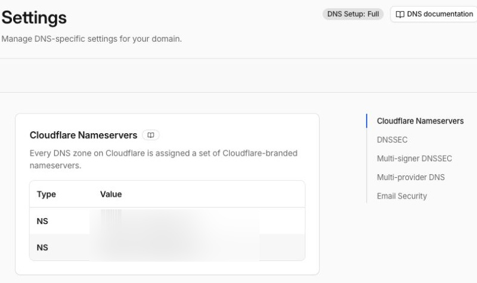

+++
title = "Cloudflare para homelabs, parte 2: domínio, DNS e HTTPS"
description = "Registro do domínio, DNS, proxy, certificado e cache têm funções diferentes. Como a Cloudflare Free participa desse caminho e onde o DDNS se encaixa."
language = "pt-BR"
authors = ["Guilherme de Castro"]
publishedAt = "2026-11-01T01:33:22-03:00"
tags = ["cloudflare", "homelab", "dns", "redes"]
draft = false
series = "Cloudflare para homelabs"
seriesPart = 2
cover = "./assets/cover-cartoon.png"
cover_alt = "Uma tag lilás acena ao lado de um catálogo, enquanto a nuvem laranja inspirada na Cloudflare aponta para ele, representando nomes que ajudam a encontrar serviços."
margo = { imageViewer = true }
+++

Você quer abrir a wiki do grupo em `wiki.example.com`, em vez de decorar um IP. Esse nome pode continuar igual se o servidor mudar de máquina, sair de casa ou passar a usar um túnel. O DNS permite mudar o destino sem mudar o endereço que as pessoas conhecem.

Na [parte 1](/blogs/cloudflared-tunnel-servicos-internet/), vimos os serviços gratuitos da Cloudflare. Agora vamos separar as peças que participam de um endereço web. Entender o papel de cada uma já ajuda a escolher o que usar no homelab, num projeto pessoal ou numa equipe pequena.

## Comprar o nome não hospeda o serviço

O registrar é a empresa em que você registra e renova o domínio, como `example.com`. O provedor de DNS mantém os registros que indicam onde estão os serviços desse domínio. A hospedagem é onde a aplicação e seus dados ficam.

Essas funções podem estar em empresas diferentes. Você pode manter o registro no Registro.br, usar o DNS da Cloudflare e hospedar a wiki num servidor em casa. Também pode apontar o site para uma plataforma de hospedagem e deixar apenas algumas aplicações no homelab.

No [full setup, disponível no Free](https://developers.cloudflare.com/dns/zone-setups/full-setup/), a Cloudflare é o DNS autoritativo. Isso significa que seus servidores de nomes, os nameservers, passam a responder pelos registros do domínio. Trocar essa delegação não transfere a compra nem a renovação do domínio.

Quem usa o [Cloudflare Registrar](https://developers.cloudflare.com/registrar/faq/) já tem registro e DNS integrados e precisa manter os nameservers da Cloudflare. Quem registra em outra empresa pode usar os nameservers da Cloudflare sem transferir o domínio. Existe uma modalidade que mantém outro DNS autoritativo, o partial setup, mas ela exige Business ou Enterprise e fica fora do caminho gratuito comum.

*A tela mostra a Cloudflare como provedora do DNS. Os nomes dos servidores foram desfocados; cada domínio recebe os seus.*

Uma mudança de DNS precisa preservar os registros existentes, inclusive os de e-mail. [DNSSEC também faz parte da migração](https://developers.cloudflare.com/dns/zone-setups/full-setup/setup/), porque valida a autenticidade das respostas. Essa troca merece um procedimento próprio; ter o domínio em outra empresa não obriga a fazê-la às pressas para experimentar um serviço.

## O DNS informa o destino

Alguns registros aparecem com frequência:

| Registro | Para que serve |
|---|---|
| `A` | Associa um nome a um endereço IPv4. |
| `AAAA` | Associa um nome a um endereço IPv6. |
| `CNAME` | Associa um nome a outro nome, em vez de fixar um IP. |
| `MX` | Indica os servidores que recebem e-mail do domínio. |
| `TXT` | Publica informações como verificações de domínio e políticas de e-mail. |

Para a wiki, o importante é saber se o nome leva a um servidor alcançável ou a uma plataforma que recebe o acesso. O registro não instala a aplicação nem cria uma passagem pelo roteador.

As respostas DNS também ficam em cache. O TTL indica por quanto tempo uma resposta pode ser reutilizada antes de nova consulta. Por isso, mudar um registro não faz todos os dispositivos abandonarem o destino anterior no mesmo instante.

## A nuvem laranja muda o caminho do acesso

Em registros compatíveis, a Cloudflare separa [DNS only e Proxied](https://developers.cloudflare.com/dns/proxy-status/). É a diferença entre a nuvem cinza e a laranja no painel.

Com DNS only, a Cloudflare responde à consulta DNS, e o acesso web vai ao destino indicado. O servidor de destino atende o visitante, incluindo seu HTTPS. A Cloudflare não passa a fazer cache desse tráfego só porque administra o domínio.

Com Proxied, a consulta retorna endereços da rede da Cloudflare. O navegador se conecta a ela, que atende a requisição ou a encaminha à origem. É nesse caminho que entram o certificado para o visitante, o cache da CDN e os recursos do proxy.

DNS, proxy e certificado Universal SSL estão disponíveis no [Free para sites](https://www.cloudflare.com/plans/). Isso não transforma qualquer serviço de rede numa aplicação web compatível. Um servidor de e-mail ou uma porta de jogo não ganha suporte pelo simples ato de ativar a nuvem laranja.

## HTTPS tem dois trechos

No acesso web com proxy, há uma conexão do navegador com a Cloudflare e outra dela com a origem. O Universal SSL cobre o primeiro trecho. Para uma origem web convencional, o modo [Full (strict)](https://developers.cloudflare.com/ssl/origin-configuration/ssl-modes/full-strict/) usa HTTPS também no segundo e valida o certificado do servidor.

O certificado do visitante não instala um certificado no servidor de casa. Se o nome está em DNS only, o HTTPS continua dependendo da configuração no destino. O cadeado do navegador também não significa que a aplicação tenha login ou cópias de segurança.

Há uma limitação útil ao escolher nomes. No full setup, o [Universal SSL cobre o domínio e os subdomínios de primeiro nível](https://developers.cloudflare.com/ssl/edge-certificates/universal-ssl/limitations/), como `example.com` e `wiki.example.com`. Um nome como `wiki.casa.example.com` precisa de outra cobertura de certificado. Para um homelab pequeno, nomes simples evitam uma exigência desnecessária.

## O cache poupa a origem, mas não guarda a aplicação inteira

A CDN pode responder com uma cópia de um arquivo sem buscá-lo novamente no seu servidor. Isso ajuda num site com imagens, estilos e scripts que muitos visitantes recebem iguais.

O [comportamento padrão não inclui cache de HTML e JSON](https://developers.cloudflare.com/cache/concepts/default-cache-behavior/). Uma wiki com páginas diferentes para cada usuário ou uma API que consulta dados novos ainda depende da origem. Regras de cache mudam esse comportamento, mas precisam respeitar o que pode ser compartilhado entre visitantes.

Ter CDN não torna um painel dinâmico independente da internet de casa. Hospedar os arquivos de um site estático na própria Cloudflare é outra solução, que veremos na parte sobre Workers.

## DDNS quando o IP público muda

Se o provedor entrega um IP público variável, o [DDNS mantém os registros atualizados](https://developers.cloudflare.com/dns/manage-dns-records/how-to/managing-dynamic-ip-addresses/). Um atualizador no roteador ou numa máquina detecta a mudança e informa o endereço atual à API de DNS. A documentação da Cloudflare inclui essa possibilidade e o uso de clientes como ddclient.

Isso dispensa contratar IP fixo para manter o mesmo nome. Ainda é preciso que as conexões consigam chegar ao serviço. Em IPv4 com NAT no roteador, normalmente há encaminhamento de portas. Se o IPv4 fica atrás do CGNAT do provedor, atualizar o registro não cria a entrada que falta. IPv6 público também depende da conectividade e das permissões de entrada.

DDNS pode acompanhar uma origem que passa pelo proxy ou uma entrada direta. Com proxy, o atualizador altera o IP da origem; o visitante continua chegando primeiro à Cloudflare. O túnel resolve outro problema: recebe requisições por conexões iniciadas de dentro da sua rede, sem depender dessa entrada pública.

## Um nome estável, com o caminho certo por trás

Para um site ou uma wiki pequena, DNS, HTTPS e cache do Free já resolvem bastante. O domínio continua tendo custo de registro, e a aplicação precisa de hospedagem. Se o serviço é importante ao negócio, o Free para sites não inclui SLA de disponibilidade; suporte e continuidade entram na escolha do plano.

O nome pode ficar estável enquanto você decide onde rodar a aplicação e como receber acessos. Quando não há uma entrada pública disponível, ou quando você prefere não administrá-la, entra o Cloudflare Tunnel. Esse é o assunto da parte 3.

*Referências consultadas em 1º de novembro de 2026. Limites e condições podem mudar.*
