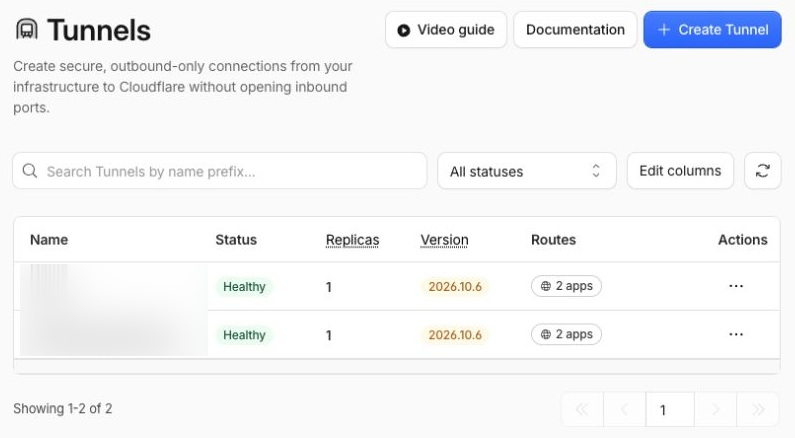

+++
title = "Cloudflare para homelabs, parte 3: Tunnel e seus limites"
description = "Como cloudflared leva requisições até o homelab, quais aplicações combinam com Tunnel e por que publicação web, rede privada e streaming pedem escolhas diferentes."
language = "pt-BR"
authors = ["Guilherme de Castro"]
publishedAt = "2026-11-01T01:33:22-03:00"
tags = ["cloudflare", "cloudflared", "homelab", "redes"]
draft = false
series = "Cloudflare para homelabs"
seriesPart = 3
cover = "./assets/cover-cartoon.png"
cover_alt = "Um pequeno pacote percorre um tubo entre um servidor ciano e a nuvem laranja inspirada na Cloudflare, representando o transporte de requisições."
margo = { imageViewer = true }
+++

O domínio está pronto, mas a wiki continua numa máquina em casa. Se não há IP público disponível, ou se você prefere não administrar uma entrada no roteador, como o navegador de outra pessoa chega até ela?

O [Cloudflare Tunnel](https://developers.cloudflare.com/tunnel/) resolve essa conexão com um programa chamado `cloudflared`. Ele está disponível no Free e mantém a aplicação onde ela já roda. Nesta parte, vamos acompanhar esse caminho e entender quando ele combina com o serviço que você quer compartilhar.

## A conexão começa dentro do homelab

Em uma entrada direta, alguém chega ao IP público da sua conexão e encontra uma porta encaminhada para o servidor. Com Tunnel, o conector inicia conexões de saída para a Cloudflare e as mantém abertas. As requisições voltam por esses canais já estabelecidos.

Imagine `wiki.example.com`. O navegador acessa a Cloudflare por HTTPS. Ela identifica a rota desse nome e encaminha a requisição pelo túnel. O `cloudflared`, que consegue alcançar a wiki na rede local, faz a conexão com a aplicação e devolve a resposta pelo mesmo caminho.

É por isso que funciona atrás de CGNAT, quando o provedor não oferece uma entrada IPv4 pública que você possa encaminhar. O conector precisa conseguir sair para a rede da Cloudflare, mas ela não precisa iniciar uma conexão nova contra o roteador de casa.

O Tunnel é o serviço; `cloudflared` é o programa que participa dessa conexão na sua rede. Ele pode rodar no servidor da aplicação ou em outra máquina que consiga alcançá-la. Não é preciso um conector por aplicação.

## Um endereço pode levar a vários serviços

Um túnel pode receber rotas para diferentes nomes, como `wiki.example.com` e `tarefas.example.com`, com destinos distintos na rede local. O nome público e a aplicação de destino são peças separadas.

Para usar seu domínio no caminho gratuito comum, o DNS fica na Cloudflare, como vimos na [parte 2](/blogs/cloudflare-homelab-dominio-dns-https/). Você não precisa comprar o domínio nela. A rota associa o nome a um serviço que o conector consegue alcançar.

O HTTPS do visitante termina na Cloudflare. O trecho até o conector também é criptografado; entre o conector e a aplicação, vale o protocolo configurado para a origem, HTTP ou HTTPS. Esse desenho usa a Cloudflare como intermediária do tráfego web.

O conector pode usar QUIC ou HTTP/2 para conversar com a Cloudflare. Esses são protocolos do transporte do túnel. Usar QUIC não transforma uma porta UDP de um jogo em uma porta pública compatível.

## A web é o caso mais direto

Uma wiki, um sistema de tarefas, uma API HTTP e uma demonstração de projeto se encaixam bem. Quem acessa pode usar um navegador ou cliente HTTP comum. Webhooks também são um caso útil, desde que a aplicação reconheça e valide os pedidos do serviço que os envia.

Os [protocolos suportados](https://developers.cloudflare.com/cloudflare-one/networks/connectors/cloudflare-tunnel/routing-to-tunnel/protocols/) usam formas diferentes de acesso:

| Serviço | O que esperar |
|---|---|
| HTTP e HTTPS | Acesso web normal pelo nome publicado. |
| WebSocket | Suportado; a aplicação precisa lidar com reconexões. |
| SSH, RDP, SMB e outros serviços TCP | Exigem a modalidade de acesso apropriada, como `cloudflared` no cliente, cliente de rede privada ou recursos de acesso pelo navegador onde disponíveis. |
| UDP de uma aplicação | Não vira uma porta pública pelo cadastro de um hostname. Acesso privado tem outro desenho. |

Um exemplo menos óbvio é [gRPC](https://developers.cloudflare.com/cloudflare-one/networks/connectors/cloudflare-tunnel/use-cases/grpc/). O Tunnel o suporta com roteamento privado de sub-rede, mas não por hostname público. O suporte em outro produto da Cloudflare não garante o mesmo caminho aqui.

Se você quer conectar um cliente nativo sem software adicional, confirme a modalidade antes de escolher Tunnel. Publicar um nome não equivale a encaminhar qualquer porta TCP ou UDP do roteador.

## Streaming e arquivos grandes mudam a escolha

Uma aplicação abrir no navegador não significa que todo o seu uso combine com o proxy público. A interface do Jellyfin pode funcionar, enquanto a reprodução contínua dos filmes é justamente a parte que exige outro caminho.

Nos planos Free, Pro e Business, os [termos da CDN exigem serviços apropriados para entrega de vídeo e arquivos grandes](https://www.cloudflare.com/service-specific-terms-application-services/). A regra também permite limitar o uso por uma proporção desmedida desses conteúdos sem os serviços previstos. A [Cloudflare confirma que isso alcança hostnames públicos do Tunnel](https://developers.cloudflare.com/fundamentals/reference/policies-compliances/delivering-videos-with-cloudflare/).

Streaming público de Plex ou Jellyfin e distribuição de grandes backups são exemplos de usos que não devem tratar o túnel como uma CDN genérica de arquivos. São aplicações da regra ao perfil do tráfego, não uma proibição desses aplicativos por nome. Desligar cache, acrescentar Access ou pagar pelo Pro não elimina essa restrição.

O [FAQ distingue as rotas privadas](https://developers.cloudflare.com/cloudflare-one/faq/cloudflare-tunnels-faq/#large-file-and-streaming-traffic-through-tunnel): elas não publicam a aplicação na internet e essa restrição específica não se aplica. Isso faz diferença para uma biblioteca pessoal acessada pelos seus dispositivos. Continuam valendo as condições do serviço e a capacidade da rede.

Não existe nessa regra uma franquia universal de GB por mês que torne qualquer uso automaticamente permitido. Para entrega pública de mídia ou arquivos, o produto e seu contrato precisam corresponder ao trabalho que será feito.

## O que limita uma aplicação pequena

No proxy web do plano Free, o [máximo de upload é de 100 MB por requisição](https://developers.cloudflare.com/support/troubleshooting/http-status-codes/4xx-client-error/error-413/). É o corpo de cada pedido, não o tamanho total de uma biblioteca. Um aplicativo com upload em partes pode ter outro comportamento, mas isso precisa existir no aplicativo e no cliente.

Também há [timeouts do proxy](https://developers.cloudflare.com/fundamentals/reference/connection-limits/). Uma operação que demora muito para responder pode falhar mesmo com o túnel conectado. Isso pesa em importações, processamento de arquivos e integrações que deixam o pedido aberto por bastante tempo.

Na outra ponta, o servidor, o banco e o upload da conexão de casa continuam contando. Mais conectores podem melhorar a disponibilidade do caminho, mas não tornam a aplicação mais rápida nem compensam a falta de internet em toda a casa.

*Healthy indica que o conector está conectado. Uma aplicação pode continuar falhando por outro motivo, como o banco de dados estar indisponível.*

## Um túnel temporário para demonstrar uma ideia

Os [Quick Tunnels](https://developers.cloudflare.com/tunnel/get-started/quick-tunnels/) oferecem um endereço temporário em `trycloudflare.com`, sem exigir domínio próprio. Servem para uma demonstração ou teste de integração, sem transformar aquele endereço no endereço definitivo do projeto.

Eles mudam de nome a cada criação, não têm garantia de disponibilidade, aceitam até 200 requisições simultaneamente em andamento e não suportam Server-Sent Events, ou SSE. Essas são limitações do Quick Tunnel, não uma quota geral de todos os túneis.

## Publicar ou manter o acesso privado?

Para compartilhar uma ferramenta web por um endereço que funciona num navegador comum, Tunnel é uma opção viável no Free. O túnel não acrescenta login sozinho. A aplicação precisa do controle de acesso adequado ao público que você quer atender.

Para uso individual ou de poucas pessoas, uma rede privada costuma ser uma escolha mais simples quando instalar um cliente é aceitável. Para acesso restrito pelo navegador, o Access pode atender melhor. Na parte 4, vamos separar essas opções e o papel do Gateway.

*Referências consultadas em 1º de novembro de 2026. Limites e condições podem mudar.*
