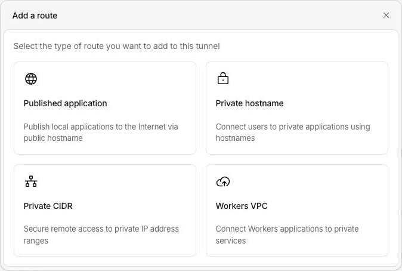

+++
title = "Cloudflare para homelabs, parte 1: o que o Free oferece"
description = "DNS, Tunnel, Access, Gateway, Workers e R2: uma visão geral dos serviços gratuitos da Cloudflare para homelabs, projetos pessoais e pequenas equipes."
language = "pt-BR"
authors = ["Guilherme de Castro"]
publishedAt = "2026-11-01T01:33:22-03:00"
tags = ["cloudflare", "homelab", "self-hosting", "redes"]
draft = false
series = "Cloudflare para homelabs"
seriesPart = 1
cover = "./assets/cover-cartoon.png"
cover_alt = "Mini servidor dentro de uma casa, ligado por um túnel à nuvem laranja inspirada na Cloudflare."
margo = { imageViewer = true }
+++

Uma wiki para o grupo, um site pessoal, um painel do homelab acessível fora de casa. São necessidades pequenas que acabam trazendo perguntas sobre domínio, rede e onde hospedar cada coisa.

A Cloudflare tem serviços gratuitos que ajudam nessas tarefas. Dá para usar só o DNS, conectar uma aplicação que continua rodando em casa ou hospedar um pequeno projeto na própria plataforma. Para indivíduos, homelabs, pequenas empresas e grupos, esse conjunto já pode atender ao uso cotidiano.

Esta é a primeira parte de uma série sobre Cloudflare para homelabs. Vamos conhecer as opções, entender seu funcionamento básico e os limites que pesam na escolha. Os detalhes de cada serviço ficam para as próximas partes.

## DNS, HTTPS e cache para um domínio próprio

O [plano Free para sites](https://www.cloudflare.com/plans/) inclui DNS, CDN e certificado Universal SSL. O DNS indica onde estão os serviços do seu domínio. Nos endereços que passam pelo proxy da Cloudflare, ela recebe o acesso do visitante e se comunica com o servidor que hospeda a aplicação.

Nesse caminho, o certificado atende ao HTTPS do visitante. A CDN pode guardar cópias de imagens e arquivos de estilo, reduzindo o trabalho da origem. Uma página personalizada para quem fez login precisa de outro tratamento. O Free também inclui proteção contra DDoS para o tráfego coberto pelo serviço.

Você pode comprar o domínio na Cloudflare ou mantê-lo no Registro.br e em outros registrars. No uso comum do Free, o DNS autoritativo do domínio fica na Cloudflare, mesmo que registro e renovação continuem em outra empresa. Quem já usa o Cloudflare Registrar tem essa parte integrada. O registro do domínio continua sendo pago.

Se sua conexão tem IP público que muda, [DNS dinâmico, ou DDNS](https://developers.cloudflare.com/dns/manage-dns-records/how-to/managing-dynamic-ip-addresses/), também é uma opção. Um cliente atualiza os registros pela API quando o IP muda. Isso mantém o nome apontando para sua conexão, mas ainda exige uma entrada pública alcançável e, quando necessário, encaminhamento de portas. DDNS não contorna o CGNAT do provedor.

## Tunnel conecta a aplicação que continua em casa

O [Cloudflare Tunnel](https://developers.cloudflare.com/tunnel/) está disponível no Free e oferece outra forma de receber esses acessos. Um programa chamado `cloudflared` roda no servidor, numa máquina virtual ou num container da sua rede e mantém conexões de saída com a Cloudflare.

Quando alguém abre o endereço da aplicação, a Cloudflare recebe a requisição e a encaminha por essas conexões já estabelecidas. O conector entrega a requisição ao serviço local e leva a resposta de volta. Isso funciona sem IP público em casa e sem abrir uma porta de entrada no roteador, inclusive atrás de CGNAT.

Uma wiki, um sistema de tarefas ou uma API web são bons exemplos. A aplicação continua usando seu servidor e sua conexão. Se a internet de casa cair, o Tunnel não mantém a aplicação disponível por conta própria.

O encaixe mais simples é HTTP e HTTPS, com acesso por um navegador comum. [Outros protocolos têm modalidades próprias](https://developers.cloudflare.com/cloudflare-one/networks/connectors/cloudflare-tunnel/routing-to-tunnel/protocols/), algumas com cliente instalado. Publicar um hostname não entrega uma porta TCP ou UDP genérica para qualquer cliente, como um servidor de jogos poderia precisar.

Há dois limites que vale conhecer desde o começo:

- No proxy web do Free, o [upload máximo é de 100 MB por requisição](https://developers.cloudflare.com/support/troubleshooting/http-status-codes/4xx-client-error/error-413/). Isso pode pesar em aplicações que recebem arquivos grandes.
- Hostnames públicos do Tunnel seguem as [regras de distribuição de vídeo e arquivos grandes da Cloudflare](https://developers.cloudflare.com/fundamentals/reference/policies-compliances/delivering-videos-with-cloudflare/). Usá-los como transporte para streaming de Plex ou Jellyfin, ou para distribuir grandes backups, exige outro desenho ou um serviço apropriado. Colocar login na frente não muda essa regra. Essa restrição específica não se aplica às rotas de rede privada.

## Access e rede privada para escolher quem entra

O [Cloudflare Access](https://developers.cloudflare.com/cloudflare-one/access-controls/applications/http-apps/self-hosted-public-app/) permite colocar um login antes de uma aplicação web. Você compartilha o endereço de uma wiki com o grupo, por exemplo, mas só as identidades permitidas conseguem entrar. Para esse uso pelo navegador, as pessoas não precisam instalar uma VPN.

O Free do Zero Trust inclui até 50 assentos de usuários ativos, compartilhados por Access e Gateway. O usuário ocupa um assento ao [entrar numa aplicação ou registrar um dispositivo no Cloudflare One Client](https://developers.cloudflare.com/cloudflare-one/faq/getting-started-faq/#how-are-active-seats-measured). Visitantes de um site público sem Access não entram nessa conta. O plano do site e o do Zero Trust são separados, e ambos têm opção gratuita.

Também existe [acesso à rede privada com o Cloudflare One Client](https://developers.cloudflare.com/cloudflare-one/networks/connectors/cloudflare-tunnel/private-net/). O dispositivo autorizado usa o cliente para alcançar os serviços internos. Para uso individual ou de poucas pessoas, se instalar um cliente for aceitável, eu prefiro esse caminho ou uma VPN como o [Tailscale](https://tailscale.com/). O serviço fica acessível pela rede privada, sem precisar de um endereço de aplicação publicado na internet.

*O painel separa aplicações publicadas e rotas privadas. São formas diferentes de chegar ao serviço, escolhidas conforme quem precisa acessá-lo.*

## Gateway filtra a navegação dos dispositivos

O [Cloudflare Gateway](https://developers.cloudflare.com/cloudflare-one/traffic-controls/dns-policies/common-policies/) permite filtrar consultas DNS, bloqueando domínios por listas ou categorias, como malware. Essa função está disponível no conjunto gratuito do Zero Trust e pode ser útil numa casa, num grupo ou numa equipe pequena.

Aqui a direção é outra: o Gateway ajuda a controlar o que os dispositivos acessam na internet. Ele não publica as aplicações do homelab. Para o filtro valer, as consultas precisam passar pelo Gateway.

## Workers hospeda sites e pequenas funções

Nem todo serviço precisa rodar no servidor de casa. O [Cloudflare Workers](https://developers.cloudflare.com/workers/) executa código na infraestrutura da Cloudflare e pode atender uma pequena API, receber um webhook ou integrar dois serviços.

O [Workers Free](https://developers.cloudflare.com/workers/platform/pricing/) inclui 100 mil requisições por dia e 10 ms de CPU por execução. É espaço útil para funções pequenas; processamento pesado precisa de outra capacidade. Tempo de CPU é o tempo gasto executando código, não todo o tempo de espera por uma resposta de rede.

Para um blog, documentação ou site de um grupo, o [Workers Static Assets](https://developers.cloudflare.com/workers/static-assets/billing-and-limitations/) entrega os arquivos estáticos sem cobrança por requisição. Requisições que executam a função do Worker seguem as quotas dela. São formas de manter um site disponível mesmo quando o homelab está desligado.

## R2 guarda arquivos com uma franquia gratuita

O [R2](https://developers.cloudflare.com/r2/) armazena objetos, como arquivos de uma aplicação ou uma cópia pequena de dados, com uma API compatível com S3. Pode complementar o armazenamento local quando o projeto precisa guardar algo fora de casa.

A [franquia gratuita do armazenamento Standard](https://developers.cloudflare.com/r2/pricing/) inclui 10 GB-mês, além de quotas mensais de operações. Isso equivale, por exemplo, a manter 10 GB durante o mês inteiro. O tráfego de saída do R2 não tem tarifa de transferência, mas armazenamento e operações acima da franquia geram cobrança. Aqui, gratuito significa uma faixa de uso dentro de um serviço medido, e não um disco sem limite.

## Mais duas opções úteis

O [Turnstile](https://developers.cloudflare.com/turnstile/plans/) ajuda a reduzir automação abusiva em formulários e cadastros. Tem plano gratuito e pode ser usado mesmo sem colocar o site atrás do proxy da Cloudflare. Precisa estar integrado à aplicação, incluindo a validação no servidor.

O [Email Routing](https://developers.cloudflare.com/email-service/) encaminha mensagens recebidas num endereço do seu domínio para uma caixa de e-mail que você já usa. Esse encaminhamento é gratuito e serve, por exemplo, para um endereço de contato de um projeto. Não oferece uma caixa postal própria. O envio de e-mails tem recursos e condições separados.

## Como as próximas partes se dividem

Para começar, escolha a necessidade: dar nomes aos serviços, acessar o homelab de fora, compartilhar uma aplicação ou hospedar uma função pequena. Dá para adotar uma dessas peças sem usar o catálogo inteiro.

As próximas partes da série serão:

2. Domínios, DNS e HTTPS. O papel do registrar, o proxy e o cache, com DDNS como opção para conexões de IP variável.
3. Cloudflare Tunnel. O caminho das requisições até o homelab, os protocolos e os limites que definem quais aplicações combinam com ele.
4. Access, rede privada e Gateway. Como escolher quem acessa os serviços, quando usar um cliente de rede privada e o que muda ao filtrar a navegação.
5. Pequenos projetos na Cloudflare. Workers, arquivos estáticos e R2, com espaço para integrações usando Turnstile e Email Routing e seus limites gratuitos.

A maior parte do que foi apresentado aqui já é viável nos planos gratuitos para pequenas escalas. O [Free para sites não inclui SLA de disponibilidade](https://www.cloudflare.com/plans/), um compromisso contratual sobre o tempo no ar. Para serviços importantes ao negócio, avalie também suporte e continuidade.

Servidor, conexão e domínio continuam tendo seus próprios custos, e cada produto tem quotas e condições distintas. As referências foram consultadas em 31 de outubro de 2026; vale conferir os limites atuais quando for escolher o serviço.
