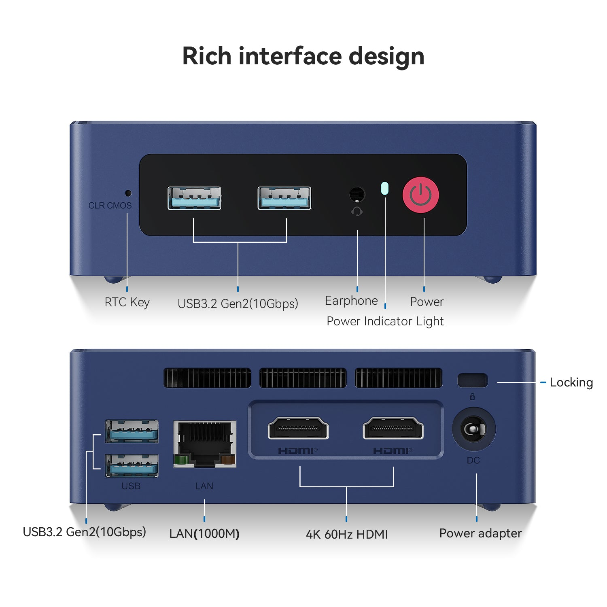
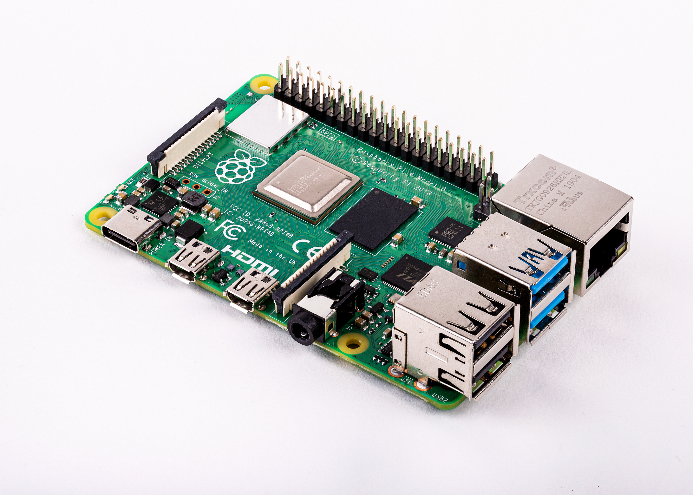
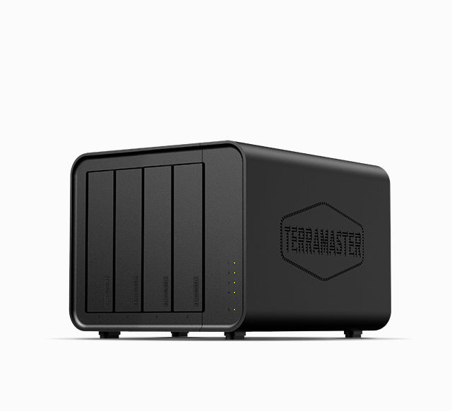
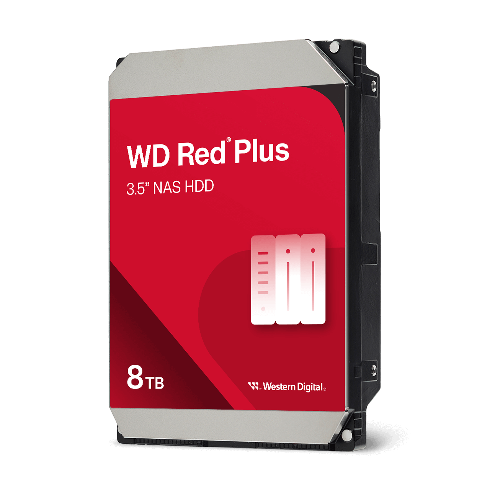
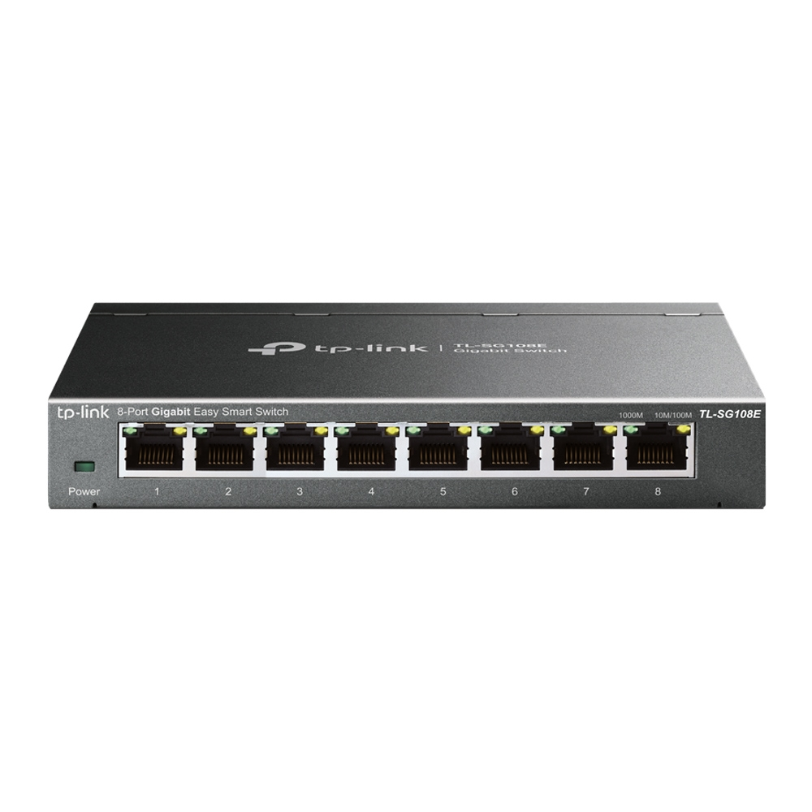

+++
title = "Homelab K8s, parte 1: hardware, armazenamento e custos"
description = "Parte 1 da série Homelab K8s: hardware do cluster Kubernetes, armazenamento com Piraeus, LINSTOR, DRBD e NAS, aquisição e energia."
language = "pt-BR"
authors = ["Guilherme de Castro"]
publishedAt = "2026-10-28T15:46:03-03:00"
tags = ["homelab","kubernetes","hardware","self-hosting","armazenamento"]
draft = false
series = "Homelab K8s"
seriesPart = 1
cover = "./assets/cover-series-v1.jpg"
cover_alt = "Mini servidor e NAS sobre uma bancada, ao lado de um cofrinho, moedas e uma régua de tomadas, representando os custos do homelab."
margo = { imageViewer = true }
+++

Três mini PCs, um Raspberry Pi, um NAS, uma VPS e um switch. Parece muita coisa para guardar fotos, e seria mesmo se o homelab servisse só para isso. Também uso essas máquinas para assistir aos vídeos da minha biblioteca, organizar projetos e compilar os programas que desenvolvo.

As aplicações rodam em um cluster [Kubernetes](https://kubernetes.io/), que distribui o trabalho entre os nós. A série Homelab K8s começa pela estrutura que sustenta esses serviços, com os equipamentos, o armazenamento e os custos de aquisição e energia.

## Os três mini PCs

Uso três [Beelink](https://www.bee-link.com/) Mini S com [Intel N100](https://www.intel.com/content/www/us/en/products/sku/231803/intel-processor-n100-6m-cache-up-to-3-40-ghz/specifications.html). Cada um tem 16 GB de RAM, um SSD M.2 de 500 GB e um SSD SATA de 1 TB. Ao todo, são 48 GB de RAM, compartilhados entre as aplicações e os componentes do próprio Kubernetes.

*Mini S12 Pro N100, modelo de referência para a foto e o orçamento. Imagem de catálogo da Beelink.*[^imagens]

Com três máquinas, posso manter cópias dos dados em nós diferentes. Para isso, preciso de uma solução de armazenamento que gerencie os volumes e a replicação. Vou explicar como faço isso mais adiante.

O [Raspberry Pi 4 Model B](https://www.raspberrypi.com/products/raspberry-pi-4-model-b/) também faz parte do cluster e ajuda no roteamento da rede. Como ele usa a arquitetura ARM64 e os mini PCs usam AMD64, preciso conferir se a imagem de cada container é compatível com a máquina em que vai rodar.

*Raspberry Pi 4B. Foto publicada no [anúncio do fabricante](https://www.raspberrypi.com/news/raspberry-pi-4-on-sale-now-from-35/).*

## Os arquivos maiores ficam no NAS

O [TerraMaster F4-424](https://www.terra-master.com/products/f4-424-nas) abriga quatro HDs [Western Digital Red Plus WD80EFPX de 8 TB](https://www.westerndigital.com/en-gb/products/internal-drives/wd-red-plus-sata-3-5-hdd?sku=WD80EFPX), em RAID. Os quatro discos somam 32 TB de capacidade bruta. O espaço útil para arquivos é menor e depende da configuração do RAID e da formatação.

*TerraMaster F4-424. Imagem de catálogo da TerraMaster.*

*WD Red Plus de 8 TB. Imagem de catálogo da Western Digital.*

Fotos e vídeos ocupam bastante espaço, por isso ficam no NAS, acessível às aplicações pela rede. Nos mini PCs, os SSDs M.2 de 500 GB recebem o sistema operacional. Os SATA de cerca de 1 TB sustentam o armazenamento replicado das aplicações, com cópias em mais de um nó. São dois tipos de armazenamento, com usos diferentes.

O último equipamento da lista é o [TP-Link TL-SG108E](https://www.tp-link.com/br/business-networking/soho-switch-easy-smart/tl-sg108e/), um switch com oito portas Gigabit. Ele conecta os equipamentos por cabo. Mesmo que uma máquina tenha uma placa de rede mais rápida, cada conexão a uma porta desse switch fica limitada a 1 Gbit/s.

*TP-Link TL-SG108E. Imagem de catálogo da TP-Link.*

Para acessar os serviços pela internet, uso uma VPS da [Hostinger](https://www.hostinger.com/br/servidor-vps), com 2 vCPUs e 8 GB de RAM. Esse servidor virtual alugado fora de casa também é um nó do Kubernetes. Recebe as conexões públicas e as encaminha para as aplicações em casa por uma VPN. O Raspberry Pi ajuda a manter o acesso desse nó à API do Kubernetes. Vou explicar essa ligação na [parte 3](/blogs/homelab-rede/).

## Como gerencio o armazenamento no Kubernetes

Quando uma aplicação como o [Immich](https://immich.app/) precisa guardar dados, ela solicita um volume persistente ao Kubernetes. A classe de armazenamento escolhida define como esse volume será criado. Para manter cópias em vários nós, é preciso instalar uma solução que faça a replicação.

Nos SSDs, uso [Piraeus](https://piraeus.io/), [LINSTOR](https://linbit.com/linstor/) e [DRBD](https://linbit.com/drbd/). Cada um tem uma função. Piraeus integra a solução ao Kubernetes. LINSTOR gerencia os recursos de armazenamento. DRBD replica os dados em bloco entre máquinas.

O driver CSI, sigla de Container Storage Interface, liga o Kubernetes ao sistema de armazenamento e permite solicitar esses volumes. Na configuração da aplicação, basta pedir o espaço necessário, sem escolher manualmente um disco e um caminho em cada servidor. As classes de armazenamento replicado pedem duas cópias totais de cada volume, em nós diferentes. Um volume de 10 GB ocupa cerca de 20 GB somando as duas cópias, além dos metadados. Por isso, a soma da capacidade dos SSDs não equivale ao espaço útil para as aplicações.

Para acessar os arquivos maiores, os serviços montam compartilhamentos do NAS via [NFS](https://docs.kernel.org/admin-guide/nfs/index.html) e leem os arquivos pela rede. Já o [RustFS](https://rustfs.com/) oferece uma API compatível com S3 para aplicações que trabalham com objetos. Ele também usa o NAS como base de armazenamento.[^rustfs]

No Immich, os arquivos originais ficam na biblioteca do NAS, montada por NFS. O [PostgreSQL](https://www.postgresql.org/) usa volumes próprios, separados dessa biblioteca. Preciso recuperar as duas partes juntas: o banco contém as referências e informações das fotos, mas não substitui os arquivos originais.

Replicação pode manter uma cópia disponível quando um disco falha. A proteção oferecida pelo RAID depende do nível escolhido. Nenhum dos dois substitui backup. Se eu apagar um arquivo, essa exclusão também pode ser replicada. Na parte 4, explico como faço os backups e os testes de restauração.

## Uma estimativa de compra no varejo brasileiro

Com exceção dos HDs, dos SSDs e do switch, importei os equipamentos da China. Na época das compras, paguei entre 10% e 20% menos do que os preços praticados pelos varejistas brasileiros.

A tabela combina preços de lojas brasileiras consultados em **27 de outubro de 2026**, com pagamento no Pix, e o valor que paguei pelo NAS importado. É uma referência para montar um conjunto parecido.[^cotacoes]

| Equipamento | Valor |
| --- | --- |
| 3 Beelink N100, 16 GB e M.2 de 500 GB, [Juliartheshop no Magalu](https://www.magazineluiza.com.br/beelink-microcomputador-12-pro-500gb-16gb/p/ad2ca5a7jc/in/mipc/?seller_id=juliartheshop) | R$ 12.819,60 |
| 3 SSDs SATA de 1 TB, referência Crucial BX500, [TEITEC no KaBuM](https://www.kabum.com.br/produto/167492/ssd-crucial-bx500-1tb-sata-6gb-s-2-5-leitura-540-mb-s-escrita-500-mb-s-preto-ct1000bx500ssd1) | R$ 2.997,00 |
| 1 Raspberry Pi 4B, referência de 4 GB, [DR. Eletrônico](https://www.dreletronico.com.br/produto/raspberry-pi-4-modelo-b-1-5ghz-4/) | R$ 700,00 |
| 1 TerraMaster F4-424 sem discos, valor pago na importação | R$ 3.200,00 |
| 4 WD Red Plus WD80EFPX de 8 TB, [WAZ](https://www.waz.com.br/hd-8tb-sata3-western-digital-red-plus-wd80efpx-3-5pol-6gb-s-7-200-rpm-256mb-cache-cmr-129928-html/p) | R$ 10.399,96 |
| 1 TP-Link TL-SG108E, [LIZ Telecom](https://www.liztelecom.com.br/switch-gigabit-easy-smart-8-portas-tl-sg108e-tp-link) | R$ 255,14 |
| **Total estimado** | **R$ 30.371,70** |

O conjunto fica em cerca de **R$ 30,4 mil, incluindo o NAS e seus quatro HDs**. Os mini PCs e os HDs são os itens mais caros.

Os valores da tabela ajudam a ter uma ideia do investimento para montar um conjunto parecido. Não foi esse o valor que paguei: as compras aconteceram em outros momentos, e parte dos equipamentos veio da China.

## E a conta de luz?

Manter os equipamentos de casa ligados o tempo todo deve acrescentar cerca de **R$ 60 a R$ 100 por mês** à conta de luz. A estimativa vem do consumo esperado do hardware, sem medição na tomada.[^energia]

Para chegar a esse valor, considerei estas faixas de potência média:

| Equipamentos | Potência adotada para a estimativa |
| --- | --- |
| 3 mini PCs, já com seus SSDs | 45 a 75 W no total |
| NAS com os quatro HDs | 30 a 50 W |
| Raspberry Pi 4B | 3 a 7 W |
| Switch | 3 a 5 W |
| **Total dos equipamentos em casa** | **Aproximadamente 80 a 140 W** |

Uso **R$ 1 por kWh** como valor aproximado da tarifa residencial da [Celesc](https://www.celesc.com.br/tarifas-de-energia).[^tarifa] Se o consumo médio ficar em 120 W, serão aproximadamente 86 kWh em 30 dias, com tudo ligado 24 horas por dia. Arredondando, dá os R$ 90 por mês.

Cada 10 W a mais de consumo contínuo acrescentam cerca de R$ 7 por mês. Um mini PC sozinho gasta pouco, mas a soma dos computadores, dos quatro HDs e dos demais equipamentos começa a pesar quando tudo fica ligado o tempo inteiro.

Montei esse conjunto como um laboratório para aprender e desenvolver meus projetos. É um hobby: escolher os equipamentos, experimentar configurações e entender o que acontece quando algo falha também fazem parte do interesse. Os valores acima mostram o tamanho desse compromisso com hardware e energia.

Na [próxima parte](/blogs/homelab-plataforma-pessoal/), vou mostrar o que roda nessas máquinas e o que esses serviços me permitem fazer, das fotos e anotações aos projetos de software.

[^imagens]: As imagens são de catálogo dos fabricantes. O Mini S12 Pro representa a linha N100 usada no orçamento; as fotos não são registros da instalação.

[^rustfs]: Uso um servidor e um volume no RustFS. Essa camada não acrescenta replicação entre servidores de objetos. O armazenamento local da VPS é separado e atende aos serviços executados naquele nó.

[^cotacoes]: Para o TerraMaster F4-424, sem cotação equivalente no varejo brasileiro, a referência é o valor aproximado de R$ 3.200 que paguei na importação, sem os discos. Os demais preços são referências da data da consulta, sem frete e acessórios. O anúncio do Beelink inclui RAM e SSD M.2 de 500 GB, já contados no preço. O Crucial BX500 e o Raspberry Pi de 4 GB são referências para o orçamento; a marca dos SSDs e a memória do Pi podem diferir das unidades do laboratório. O orçamento não inclui cabos, fontes ou acessórios avulsos, nobreak e despesas recorrentes. A diferença de 10% a 20% se refere às minhas compras importadas na época, não a um desconto sobre os preços desta tabela.

[^energia]: As faixas são estimativas da potência média dos equipamentos, com uma margem para os componentes e as perdas nas fontes. Não medi esses valores, e o consumo pode ficar fora dessas faixas. O N100 tem potência base de processador de 6 W, que não representa o mini PC inteiro; a TerraMaster informa 22 W em um teste com outros HDs; a TP-Link informa consumo máximo de 3,68 W para o switch. O consumo varia conforme o uso das máquinas. A energia da VPS está incluída no serviço contratado e não entra na conta de luz de casa.

[^tarifa]: Em 27/10/2026, a Celesc publica R$ 0,75975/kWh para B1 residencial convencional, antes de tributos. R$ 1/kWh é uma aproximação com margem para tributos, usada apenas para estimar o gasto adicional do laboratório.
