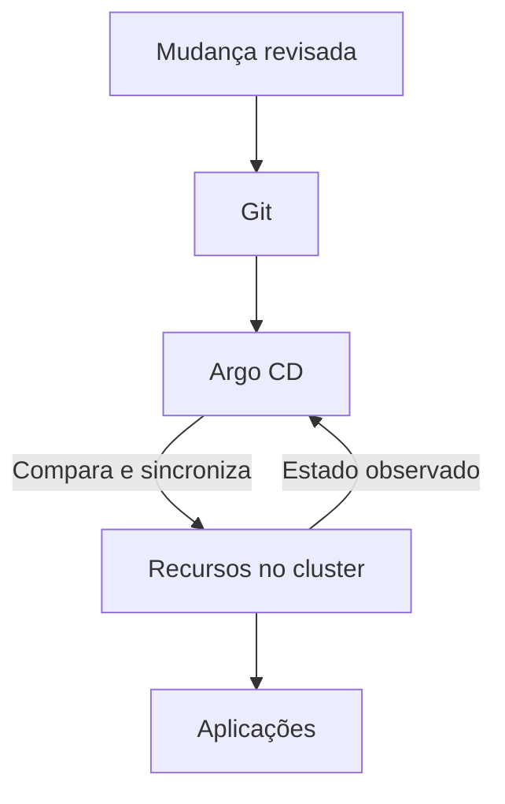
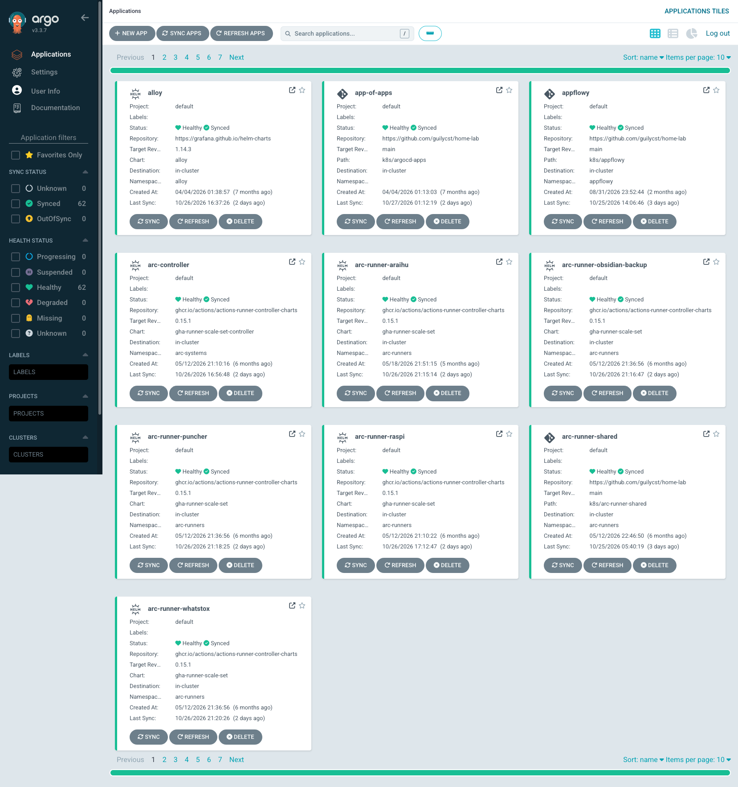
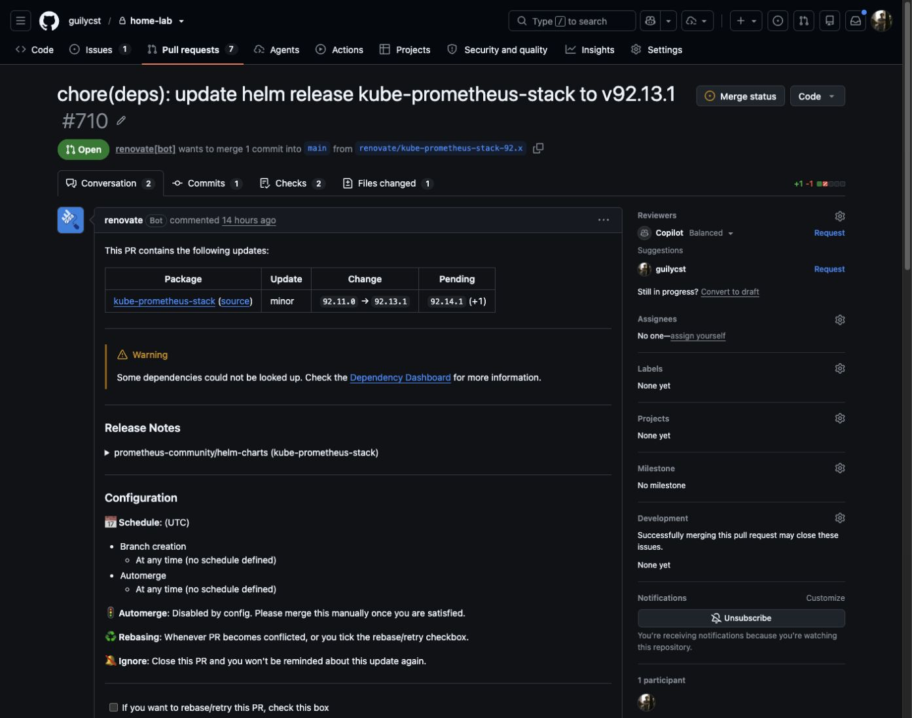
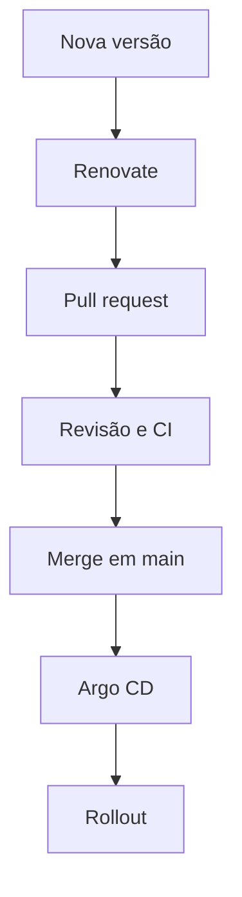
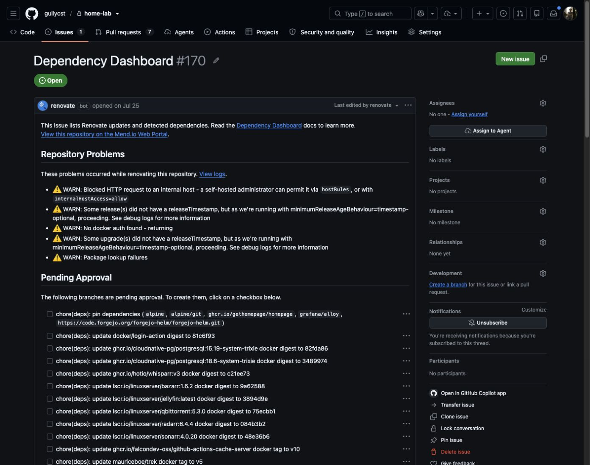
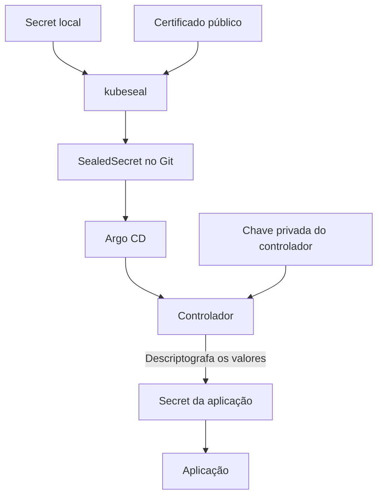
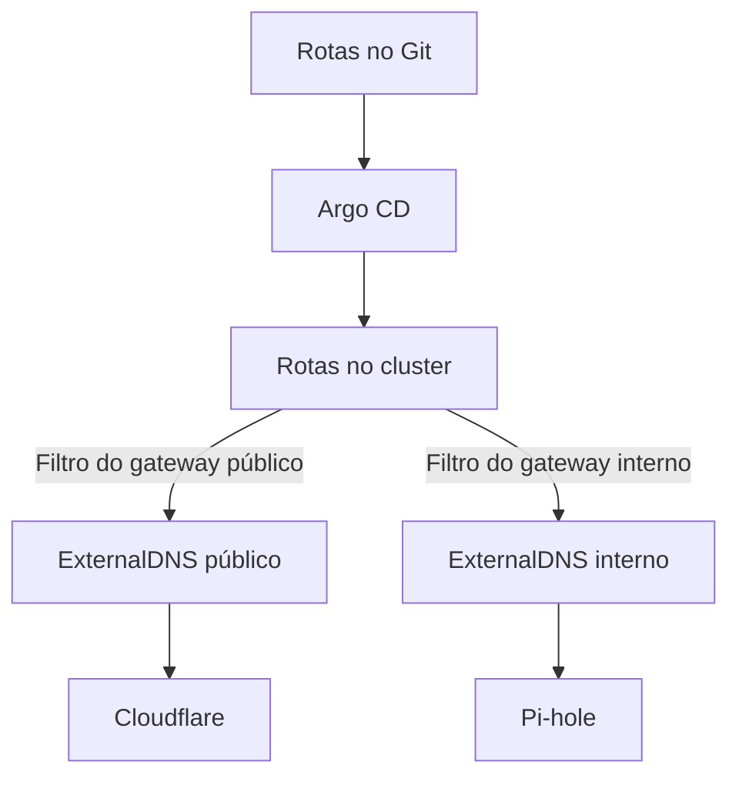
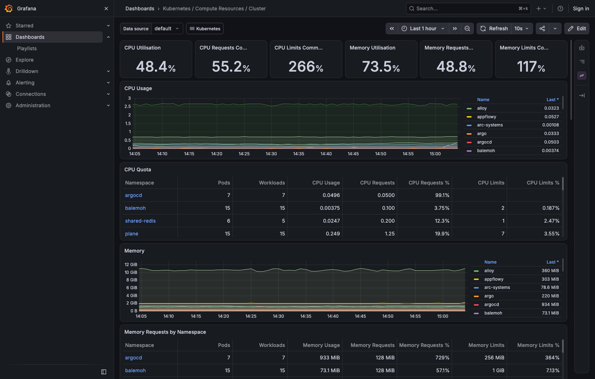
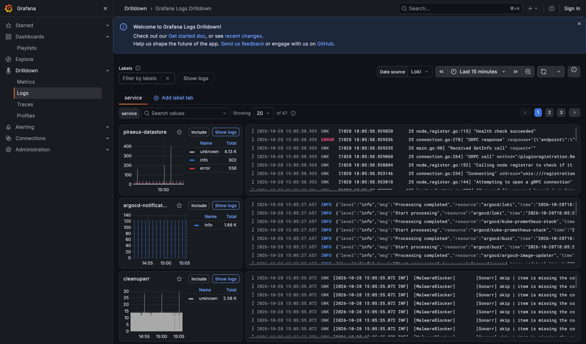
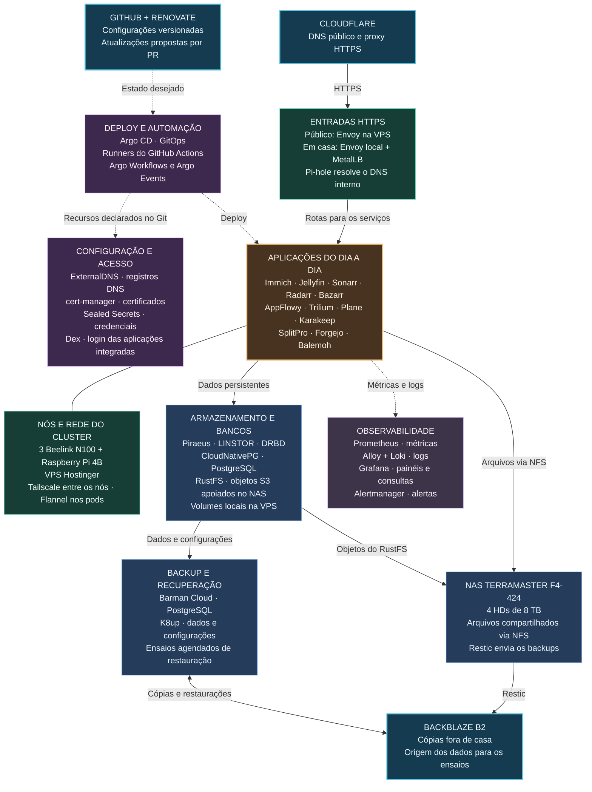

+++
title = "Homelab K8s, parte 4: gerenciamento e operação"
description = "GitOps com Argo CD, ExternalDNS e cert-manager no deploy declarativo. Atualizações, segredos, VPN, observabilidade e backups na operação do homelab."
language = "pt-BR"
authors = ["Guilherme de Castro"]
publishedAt = "2026-10-28T15:46:03-03:00"
tags = ["homelab","kubernetes","gitops","self-hosting"]
draft = false
series = "Homelab K8s"
seriesPart = 4
cover = "./assets/cover-series-v1.jpg"
cover_alt = "Robô operador confere uma lista entre uma pasta Git e um mini servidor, representando a aplicação das configurações do homelab."
margo = { imageViewer = true }
+++

Colocar uma aplicação para rodar costuma ser a parte mais rápida. Depois é preciso atualizar versões, trocar credenciais, cuidar do espaço em disco e conferir se os backups continuam funcionando.

No homelab, essa manutenção combina configurações versionadas no Git, atualizações propostas pelo [Renovate](https://docs.renovatebot.com/), monitoramento e rotinas de backup. É o trabalho que mantém os serviços em uso enquanto continuo experimentando no laboratório.

## O deploy começa no Git

Guardo no [Git](https://git-scm.com/) a configuração desejada para cada serviço. Os arquivos dizem qual imagem executar, quantas réplicas manter, quais volumes montar e quais rotas publicar. O [Argo CD](https://argo-cd.readthedocs.io/en/stable/) acompanha o repositório e compara essa configuração com o que existe no [Kubernetes](https://kubernetes.io/).

Quando encontra uma diferença, o Argo pode aplicar a configuração do repositório, conforme as regras de sincronização de cada aplicação. Essa comparação acontece continuamente. É assim que uso GitOps: versiono a configuração no Git, e o controlador cuida de mantê-la aplicada no cluster.



Para atualizar uma imagem, por exemplo, começo alterando sua versão no repositório. A proposta passa por revisão e verificações. Depois do merge, o Argo detecta a mudança. Se a sincronização automática estiver habilitada para aquela Application, aplica a nova configuração; caso contrário, a sincronização precisa ser acionada. O Kubernetes conduz o rollout e verifica as condições de prontidão configuradas nos pods.

A integração contínua, ou CI, executa as verificações antes do merge. Depois, o Argo aplica a configuração aprovada conforme a política de sincronização. O histórico do Git permite consultar o que mudou e qual versão foi escolhida para o serviço.

### Como organizo as aplicações no Argo

No Argo, cada recurso do tipo `Application` define o que deve ser sincronizado a partir de uma fonte. Uso o padrão app of apps: uma Application principal acompanha as definições das demais aplicações no Git. Cada uma aponta para manifestos, charts e arquivos de valores do [Helm](https://helm.sh/), ou configurações do [Kustomize](https://kustomize.io/).



*No Argo CD, cada aplicação reúne a origem da configuração e os indicadores de sincronização e saúde dos recursos.*

Assim, a Application principal mantém a lista de aplicações do Argo atualizada. Cada aplicação, por sua vez, controla a sincronização dos recursos do serviço pelo qual é responsável.

Na aplicação principal, a sincronização automática usa `selfHeal` e `prune`. O primeiro corrige divergências em relação ao Git. O segundo permite remover recursos que saíram da configuração gerenciada. Apagar um trecho do repositório pode, portanto, apagar um recurso real. As demais aplicações também têm suas próprias regras de sincronização.

Reverter um commit é útil quando uma configuração nova dá errado. Isso não desfaz uma migração de banco nem recupera um arquivo apagado. Para esses casos, preciso dos backups dos dados.

## Renovate avisa quando há atualizações

Com tantas aplicações, acompanhar as versões de cada uma dá trabalho. O [Renovate](https://docs.renovatebot.com/) procura atualizações nas dependências declaradas e abre pull requests com as mudanças.

No homelab, ele verifica imagens de containers, charts e versões definidas em manifestos Kubernetes, arquivos do Helm e do Kustomize, Dockerfiles e automações. As propostas de atualização chegam ao mesmo repositório usado pelo Argo.



*O [PR do Renovate](https://github.com/guilycst/home-lab/pull/710) reúne a versão atual, a proposta de atualização e as notas de versão. É onde reviso a mudança e acompanho as verificações antes de integrá-la ao repositório.*



O merge automático está desativado. O Renovate abre a proposta, mas ela ainda precisa passar pela revisão e pelas verificações da CI antes de ser aplicada pelo Argo. Também limito a quantidade de pull requests e a frequência das atualizações.[^renovate]



*O [Dependency Dashboard](https://github.com/guilycst/home-lab/issues/170) é uma issue que o Renovate mantém atualizada com as dependências detectadas, os PRs abertos e as atualizações pendentes. Os avisos ajudam a identificar o que ele não conseguiu consultar; as aprovações controlam quais propostas podem virar PRs.*

Algumas dependências precisam ser atualizadas juntas, como os componentes do [AppFlowy](https://appflowy.io/) e do [RustFS](https://rustfs.com/). Outras ficam em uma linha de versões específica, como a versão de suporte prolongado, LTS, do [Forgejo](https://forgejo.org/). Essas regras permitem atualizar cada serviço de acordo com suas necessidades.

Também posso fixar uma imagem pelo digest, o identificador do seu conteúdo. Isso é mais específico do que uma tag, que pode passar a apontar para outra imagem. O Renovate acompanha essas referências e propõe alterações, deixando registrado exatamente qual imagem o cluster deve executar.

Assim, reviso as atualizações junto com as outras mudanças do homelab. Ainda preciso conferir a compatibilidade, as migrações necessárias e como voltar à versão anterior se houver problemas. Pelo menos não preciso visitar a página de cada projeto para descobrir se saiu uma versão nova.

### Builds e automações também rodam aqui

Também uso o homelab para compilar e testar software. Tenho runners próprios do [GitHub Actions](https://docs.github.com/en/actions), que executam os jobs das automações, além do Forgejo, de um registro de imagens de containers e de cache para os builds. Outras tarefas usam [Argo Workflows](https://argoproj.github.io/workflows/) e [Argo Events](https://argoproj.github.io/events/).

Uso as mesmas máquinas para hospedar os aplicativos e desenvolver meus projetos. Isso me dá um lugar para experimentar pipelines de build e acompanhar como uma alteração no código chega a uma aplicação em execução.

## Como guardo senhas, tokens e outras credenciais

A configuração das aplicações inclui senhas de banco, tokens de APIs e outras credenciais que não posso deixar expostas no Git. Colocar esses valores em um Secret do Kubernetes não basta. Qualquer pessoa com acesso ao manifesto de um Secret consegue decodificar seus valores em base64.

Para guardar essas credenciais no repositório, uso [Sealed Secrets](https://github.com/bitnami/sealed-secrets). Preparo o Secret localmente e uso `kubeseal` para criptografá-lo com o certificado público do controlador. O arquivo resultante, um SealedSecret, pode ser versionado junto dos manifestos.

Quando o Argo aplica esse recurso no cluster, o controlador usa sua chave privada para descriptografar os valores e criar o Secret que a aplicação vai usar.



O conteúdo criptografado fica vinculado ao nome do Secret e ao namespace, a divisão do cluster em que ele será criado. Para mudar esse destino, preciso gerar uma nova versão criptografada.

Os arquivos com os valores originais ficam fora do Git. Só adiciono ao repositório a versão criptografada e confiro o conteúdo do commit antes de enviá-lo.[^segredos]

Nem todas as credenciais são criadas manualmente. O [operador de Dex do araihu](https://github.com/araihu/dex-operator) gerencia os clientes configurados e gera os Secrets usados pelas aplicações. Automações com [OpenTofu](https://opentofu.org/) também integram credenciais e criam recursos usados por aplicações. O arquivo de estado dessas automações fica armazenado em um Secret do Kubernetes.

Se eu precisar reconstruir o cluster, tenho que recuperar a chave privada do Sealed Secrets e o estado do OpenTofu. Sem a chave, os arquivos criptografados do Git não bastam. Sem o estado, as automações perdem o registro dos recursos que administram. Um backup dessas informações só resolve se eu conseguir recuperá-las sem depender do cluster original.[^recuperacao-chaves]

Para trocar uma credencial, preciso gerar um novo valor no serviço de origem, atualizar as aplicações que o usam e revogar o anterior. Criptografar o mesmo token de novo não faz essa troca.

## DNS e HTTPS fazem parte do deploy

Para colocar uma aplicação em uso, preciso executar seus containers, publicar uma rota e disponibilizar um nome com HTTPS. Essas configurações também ficam declaradas no Git. O Argo aplica os recursos, e os controladores responsáveis cuidam de transformar essa configuração em acesso à aplicação.

### ExternalDNS mantém os nomes atualizados

Na [parte 3](/blogs/homelab-rede/), expliquei como acesso as aplicações. Agora imagine que eu precise mudar uma rota do [Immich](https://immich.app/). Altero a configuração no Git, o Argo aplica o recurso no cluster e o [ExternalDNS](https://kubernetes-sigs.github.io/external-dns/) atualiza o provedor correspondente.

Uma instância acompanha o gateway público e atualiza os registros na [Cloudflare](https://www.cloudflare.com/). A outra acompanha o gateway interno e atualiza o [Pi-hole](https://pi-hole.net/).



Uma rota do Immich fica assim. O domínio `fotos.example.com` é ilustrativo; o gateway e o Service já existem no cluster.

```yaml
apiVersion: gateway.networking.k8s.io/v1
kind: HTTPRoute
metadata:
  name: immich
  namespace: immich
  annotations:
    external-dns.alpha.kubernetes.io/cloudflare-proxied: "true"
spec:
  parentRefs:
    - name: public-vps-gateway
      namespace: default
  hostnames:
    - fotos.example.com
  rules:
    - backendRefs:
        - name: immich-server
          port: 2283
```

Esse YAML é a caixa "Rotas no Git" do diagrama. Depois da revisão e do merge, o Argo aplica a `HTTPRoute` no cluster. O campo `parentRefs` liga a rota ao gateway público; `hostnames` define o nome atendido; e `backendRefs` encaminha as requisições ao Service `immich-server`, na porta 2283, dentro do namespace `immich`.

A instância pública do ExternalDNS observa essa rota e, se o domínio estiver dentro dos filtros configurados, mantém o registro na Cloudflare usando o destino definido no gateway. A anotação pede que o registro use o proxy da Cloudflare. No caminho interno do diagrama, a rota aponta para `internal-gateway`, e a outra instância do ExternalDNS mantém o registro no Pi-hole. O HTTPS usa o certificado configurado no gateway, que precisa cobrir o nome da rota.

Os filtros de gateway e domínio delimitam os registros administrados por cada controlador. Os dois verificam mudanças a cada minuto. Ambos usam uma política que permite criar, atualizar e excluir registros dentro desse escopo. Na Cloudflare, registros TXT identificam o controlador responsável. No Pi-hole, não uso esse registro de propriedade; os filtros delimitam o conjunto que a automação pode administrar.

Com isso, não preciso cadastrar os registros manualmente no painel de DNS. Se uma alteração não funcionar, confiro se o recurso foi aplicado no cluster, se o ExternalDNS atualizou o registro e se o servidor DNS retorna o endereço esperado.

### cert-manager cuida dos certificados HTTPS

O [cert-manager](https://cert-manager.io/docs/usage/certificate/) automatiza a emissão e a renovação dos certificados. Declaro quais nomes o certificado precisa cobrir, qual emissor deve ser usado e em qual Secret o resultado será guardado. O controlador solicita o certificado e mantém esse Secret atualizado, renovando-o antes do vencimento.

Os gateways usam esses Secrets para atender às conexões HTTPS. Ao adicionar um nome para uma aplicação, também preciso garantir que ele esteja coberto pelo certificado usado na entrada correspondente. Criar o registro DNS e a rota, por si só, não inclui um nome novo no certificado.

ExternalDNS e cert-manager são partes essenciais desse deploy declarativo. Um mantém os registros que levam ao serviço; o outro cuida dos certificados usados pelo gateway. Com os emissores e as credenciais dos provedores configurados, posso revisar no Git as mudanças de aplicação, rota e certificado, sem cadastrar cada registro em um painel ou renovar certificados manualmente.

### A VPN conecta a VPS ao cluster em casa

O [Tailscale](https://tailscale.com/) mantém a VPS e as máquinas de casa na mesma rede privada. O [Flannel](https://github.com/flannel-io/flannel), responsável pela rede dos pods, usa essa conexão para transportar o tráfego entre os nós. A [parte 3](/blogs/homelab-rede/) mostra como essa rede se combina com o DNS e os gateways para dar acesso às aplicações.

## O que os painéis conseguem mostrar

[Prometheus](https://prometheus.io/) coleta métricas, e [Grafana](https://grafana.com/oss/grafana/) oferece os painéis. [Alloy](https://grafana.com/oss/alloy/) coleta os logs e os envia ao [Loki](https://grafana.com/oss/loki/), que os armazena para consulta. O [Alertmanager](https://prometheus.io/docs/alerting/latest/alertmanager/) organiza os alertas.



*Este painel mostra o consumo de CPU e memória por namespace e permite compará-lo com os recursos solicitados e os limites configurados para as aplicações. Assim, consigo identificar quais serviços consomem mais recursos e onde vale revisar essas configurações.*



*No Logs Drilldown, filtro os registros armazenados no Loki por serviço e período. Os gráficos mostram quando o volume de mensagens muda, e os logs ao lado ajudam a investigar o que aconteceu naquele intervalo.*

Os alertas complementam os painéis: avisam quando uma condição monitorada precisa de atenção, sem que eu tenha que acompanhar os gráficos o tempo todo. A partir do alerta, consulto as métricas e os logs para investigar a causa.

Quando o problema é de acesso, começo pelo DNS. Confiro qual servidor respondeu à consulta e qual endereço retornou. Depois verifico a conexão HTTPS e o certificado do gateway, o encaminhamento até a aplicação e o login. Se tudo isso funcionar, confiro o acesso aos dados. Seguir essa ordem evita mudar várias configurações ao mesmo tempo sem saber onde está a falha.

## Backups fora de casa e ensaios de restauração

Faço backup de quase tudo no homelab, com cópias externas no [Backblaze B2](https://www.backblaze.com/cloud-storage). Também tenho ensaios de restauração para quase todos os serviços. Tanto o envio dos backups quanto esses testes fazem parte das rotinas automatizadas do laboratório.

Acompanho falhas e atrasos nessas rotinas com alertas próprios. Uma aplicação pode continuar funcionando mesmo quando seu backup falha, por isso monitoro também a execução das cópias e dos ensaios de restauração.

A estratégia acompanha os tipos de armazenamento da [parte 1](/blogs/homelab-hardware-custos/). Cada um guarda dados de uma forma, e a aplicação precisa voltar a acessá-los depois da restauração.

| Onde estão os dados | O que a aplicação precisa para acessá-los |
| --- | --- |
| Volumes gerenciados por [Piraeus](https://piraeus.io/) e [LINSTOR](https://linbit.com/linstor/), replicados com [DRBD](https://linbit.com/drbd/) | Réplicas íntegras e um volume que o nó consiga montar |
| Compartilhamentos do NAS via [NFS](https://docs.kernel.org/admin-guide/nfs/index.html) | Arquivos disponíveis e compartilhamento acessível pela rede |
| Armazenamento local da VPS | Dados no mesmo nó em que o pod vai rodar |
| RustFS apoiado no NAS | RustFS em funcionamento, com acesso ao volume que guarda os objetos |

[CloudNativePG](https://cloudnative-pg.io/) administra os bancos [PostgreSQL](https://www.postgresql.org/), e o [Barman Cloud](https://pgbarman.org/) envia seus backups para o B2. Outras rotinas usam [K8up](https://k8up.io/) para copiar dados e configurações das aplicações. No NAS, uso [Restic](https://restic.net/) para enviar ao B2 os arquivos do Immich, documentos e dados dos volumes persistentes.

Replicação e níveis de RAID com redundância ajudam quando um dispositivo falha. As cópias no B2 permitem recuperar versões anteriores dos dados e mantêm os backups fora de casa, separados dos equipamentos que executam os serviços.

### Os ensaios fazem parte da rotina

Os ensaios agendados recuperam os backups em ambientes separados dos usados pelas aplicações. As verificações variam conforme o serviço. No Pi-hole, o teste confere a integridade dos bancos SQLite e as tabelas esperadas. No banco do Immich, restaura uma instância de PostgreSQL e consulta estruturas como fotos, usuários e migrações. O NAS também tem sua própria rotina de restauração e validação dos arquivos.

Esses testes exercitam o caminho de volta dos dados. Um backup concluído mostra que a cópia terminou; restaurá-lo e consultar seu conteúdo ajuda a verificar se ele serve para a recuperação. No Immich, o banco e os arquivos originais têm rotinas próprias, porque a biblioteca depende dos dois.

## O homelab por inteiro

Ao juntar as quatro partes, dá para ver como uma mudança pequena depende de vários componentes. Publicar uma aplicação envolve o Git, o Argo CD, uma rota, DNS, certificado e armazenamento. Depois vêm as atualizações, os alertas e os backups. O diagrama reúne essas peças e as ligações com os serviços externos.



*Os blocos agrupam os componentes por função dentro do Kubernetes. GitHub, Cloudflare, NAS e B2 são as integrações externas. As setas contínuas mostram o acesso e o movimento dos dados; as tracejadas, configuração e telemetria. O Pi-hole responde às consultas DNS, mas o tráfego HTTPS passa pelo Envoy. ExternalDNS atualiza os registros tanto na Cloudflare quanto no Pi-hole. O NAS fica fora do cluster.*

Gosto de ter fotos, mídia e ferramentas de uso diário rodando em uma estrutura que posso entender e modificar. Quando experimento uma configuração, consigo acompanhar o efeito nos serviços, investigar pelos logs e testar como recuperar os dados. O uso cotidiano dá propósito aos experimentos.

O homelab é um hobby que me permite explorar Kubernetes, redes e armazenamento com aplicações que fazem parte da minha rotina. As quatro partes desta série mostram onde cheguei até aqui. O próximo experimento pode mudar uma escolha ou trazer outra ferramenta, e descobrir o que funciona para mim faz parte da graça.

[^renovate]: Os limites reduzem o volume de propostas, mas não substituem a revisão de compatibilidade. Uma atualização do banco pode exigir uma migração que impede voltar apenas trocando a imagem do container.

[^segredos]: A criptografia protege o conteúdo versionado. Depois de descriptografado, o Secret continua acessível a quem possui as permissões necessárias no cluster. Proteger essas permissões e a chave do controlador faz parte da mesma responsabilidade.

[^recuperacao-chaves]: O backup do [etcd](https://etcd.io/) inclui os recursos do Kubernetes, entre eles os Secrets. Recuperar a chave do Sealed Secrets e o estado do OpenTofu exige conseguir extrair esses dados e usá-los na reconstrução do cluster. Testar a restauração de um banco ou de arquivos não valida essa etapa.
