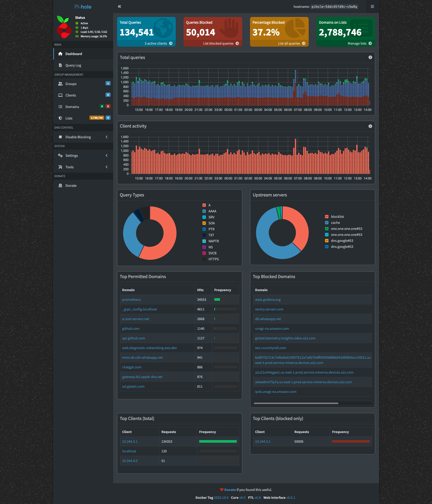
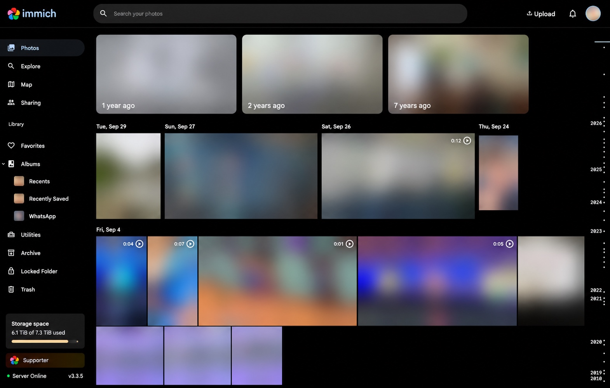
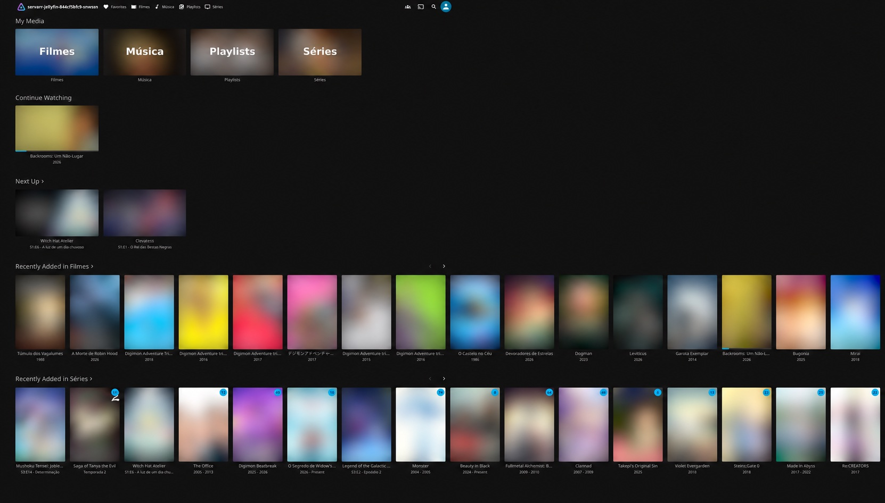
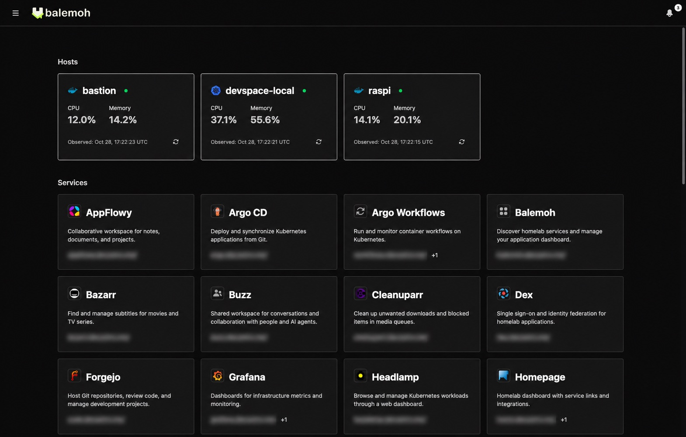

+++
title = "Homelab K8s, parte 2: aplicações no dia a dia"
description = "Pi-hole, fotos, mídia, notas e projetos no homelab. Os benefícios de hospedar meus serviços e o que aprendo ao cuidar deles."
language = "pt-BR"
authors = ["Guilherme de Castro"]
publishedAt = "2026-10-28T15:46:03-03:00"
tags = ["homelab","self-hosting","kubernetes","aplicacoes"]
draft = false
series = "Homelab K8s"
seriesPart = 2
cover = "./assets/cover-series-v1.jpg"
cover_alt = "Álbum de fotos, claquete e mini servidor em uma sala, representando os aplicativos de fotos e mídia hospedados em casa."
+++

Na [parte 1](/blogs/homelab-hardware-custos/), mostrei os equipamentos que sustentam o homelab. Agora é hora de abrir os aplicativos. São eles que dão uso às máquinas: encontrar uma foto, assistir a um vídeo, guardar uma ideia ou acompanhar um projeto.

O homelab é um hobby e um espaço para aprender. Gosto de experimentar ferramentas e entender como elas funcionam por dentro. Hospedar serviços que uso dá um propósito concreto a essa curiosidade: uma configuração de armazenamento passa a cuidar das minhas fotos, e uma mudança na rede precisa deixar os aplicativos acessíveis.

O [Kubernetes](https://kubernetes.io/) mantém esses serviços rodando nas máquinas do laboratório.

## Pi-hole no dia a dia da rede

O [Pi-hole](https://pi-hole.net/) é um dos serviços mais usados por todos na minha rede. Ele trabalha em segundo plano, respondendo às consultas DNS dos dispositivos, mesmo quando ninguém abre sua interface.

Uso o Pi-hole para bloquear domínios de anúncios, jogos de azar e outros domínios maliciosos. Nos dispositivos que usam esse DNS, as listas de bloqueio filtram os domínios consultados. Posso administrar essas regras em um só lugar e ajustar o que quero permitir ou bloquear na rede.

*O painel do Pi-hole reúne as consultas DNS e os bloqueios da rede.*

Ele também participa da estratégia de split DNS do homelab, resolvendo os nomes internos dos serviços para o endereço do gateway de casa. Assim, ajuda tanto na navegação cotidiana quanto no acesso aos aplicativos que hospedo. Na parte 3, explico como essa resolução se relaciona com o DNS público e os caminhos de acesso.

## Fotos e vídeos com Immich

O [Immich](https://immich.app/) organiza a biblioteca de fotos e vídeos. Ele permite navegar pelas fotos e pelos vídeos guardados no homelab sem precisar procurar os arquivos manualmente em pastas.

*Biblioteca do Immich, com as fotos, os vídeos e os avatares desfocados.*

Para exibir uma foto, o Immich consulta o banco de dados e lê o arquivo correspondente. Por isso, o backup precisa incluir tanto o banco quanto os arquivos originais. Recuperar um sem o outro pode deixar a biblioteca incompleta.

Hospedar o Immich em casa me permite escolher onde guardar a biblioteca e como fazer os backups. Também fico responsável por manter o serviço funcionando, instalar atualizações e recuperar os dados se algo der errado. Vou falar disso na parte 4.

## Filmes e séries com Jellyfin

O [Jellyfin](https://jellyfin.org/) cuida da reprodução da biblioteca de mídia. [Sonarr](https://sonarr.tv/) gerencia séries, [Radarr](https://radarr.video/) gerencia filmes e [Bazarr](https://www.bazarr.media/) busca e organiza legendas. Os arquivos maiores ficam no NAS, de onde as aplicações os acessam pela rede.

*As bibliotecas e os itens recentes no Jellyfin, com as capas desfocadas.*

O benefício é ter uma interface para navegar e reproduzir a minha coleção, enquanto os arquivos ficam reunidos no NAS. Não preciso guardar uma cópia completa em cada mini PC. Essa separação também torna o funcionamento mais fácil de entender: o Jellyfin apresenta a biblioteca e reproduz o conteúdo; o NAS guarda os arquivos.

## Notas, documentos e projetos

O [Trilium](https://github.com/TriliumNext/Trilium) guarda notas. O [AppFlowy](https://appflowy.io/) oferece documentos e espaços de trabalho. O [Plane](https://plane.so/) ajuda a acompanhar tarefas e projetos.

Algumas funções se repetem entre essas ferramentas. Ainda assim, anotar uma ideia, organizar documentos e acompanhar tarefas são necessidades diferentes. Uso esse conjunto para experimentar formas de organizar o trabalho e ver o que funciona melhor em cada caso.

Experimentar ferramentas parecidas faz parte da graça do laboratório. Posso comparar como cada uma organiza a informação e decidir o que quero continuar usando. Cada instalação também traz uma oportunidade de entender seus requisitos, suas integrações e a forma de guardar os dados. Não preciso transformar todo experimento em um serviço permanente.

## Links salvos e contas divididas

O [Karakeep](https://karakeep.app/) reúne links e conteúdo salvo. Uso esse tipo de ferramenta para guardar referências que quero consultar depois, sem misturá-las às minhas próprias anotações.

O [SplitPro](https://splitpro.app/) organiza despesas compartilhadas. Como outras pessoas também precisam acessá-lo, não adianta funcionar só na minha rede. O endereço e o login precisam funcionar para todos os participantes, e os registros dos gastos precisam continuar disponíveis depois das atualizações.

## Código e um lugar para encontrar os serviços

O [Forgejo](https://forgejo.org/) hospeda repositórios e faz parte das ferramentas de desenvolvimento do laboratório. Além da interface para trabalhar com o código, o laboratório tem automações para executar builds. Vou explicar essa parte no artigo sobre operação.

O [araihu/balemoh](https://github.com/araihu/balemoh) reúne o catálogo de serviços, telemetria e notificações. Com tantos serviços, fica mais fácil encontrar o que preciso quando os links e as informações estão reunidos em um só lugar. O Balemoh terá um post próprio, com espaço para explicar a arquitetura e as decisões de implementação.

*O Balemoh reúne informações dos hosts e atalhos para os serviços. Endereços desfocados.*

## Como acesso os aplicativos

Em casa, o Pi-hole resolve os nomes internos e indica o endereço do gateway local. Para acessar pela internet, a conexão passa pelo gateway da VPS, que se comunica com os nós de casa pela rede privada do [Tailscale](https://tailscale.com/).

Quem acessa um endereço público não precisa instalar a VPN. Ela conecta as máquinas do laboratório entre si. Nos serviços integrados ao [Dex](https://dexidp.io/), ele participa da autenticação dos usuários.

No Immich, uso um nome para o acesso pela internet e outro para o acesso interno. Ambos levam ao mesmo serviço e à mesma biblioteca.

## O que aprendo mantendo esses serviços

Escolher onde ficam as fotos, como organizar os documentos e quais ferramentas usar já traz benefícios para o dia a dia. Hospedar tudo também me permite acompanhar o caminho inteiro entre abrir um aplicativo e acessar seus dados. O que aparece como uma tela simples depende de rede, autenticação, armazenamento e processos que precisam trabalhar juntos.

Isso dá contexto aos estudos. Com o Immich, a diferença entre salvar arquivos e salvar o banco deixa de ser abstrata. Com o SplitPro, o acesso de outras pessoas exige pensar além da rede de casa. Com o Forgejo e os builds, posso experimentar automações nos meus próprios projetos.

É essa mistura de utilidade e curiosidade que me interessa. Algumas ferramentas ficam, outras servem para um experimento. O laboratório me dá espaço para escolher, testar e aprender com as decisões, sem precisar transformar cada instalação em uma solução definitiva.

Na [parte 3](/blogs/homelab-rede/), vou detalhar como acesso esses serviços dentro e fora de casa. Uso o Immich como exemplo para explicar o caminho da conexão, da consulta ao DNS até a aplicação.
