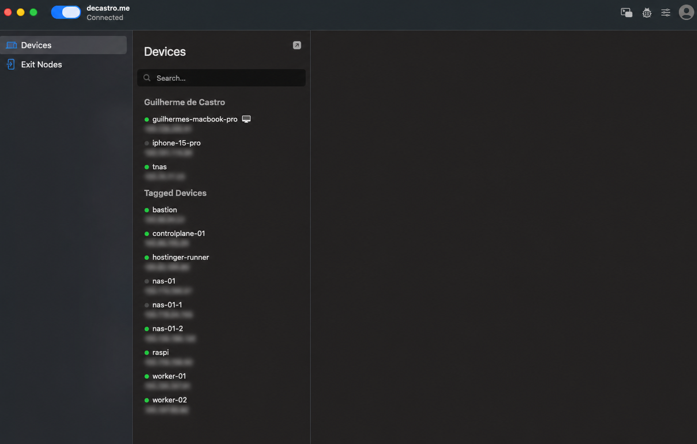
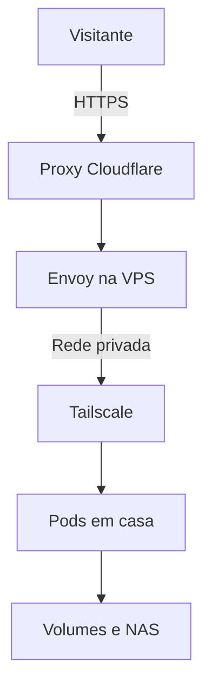
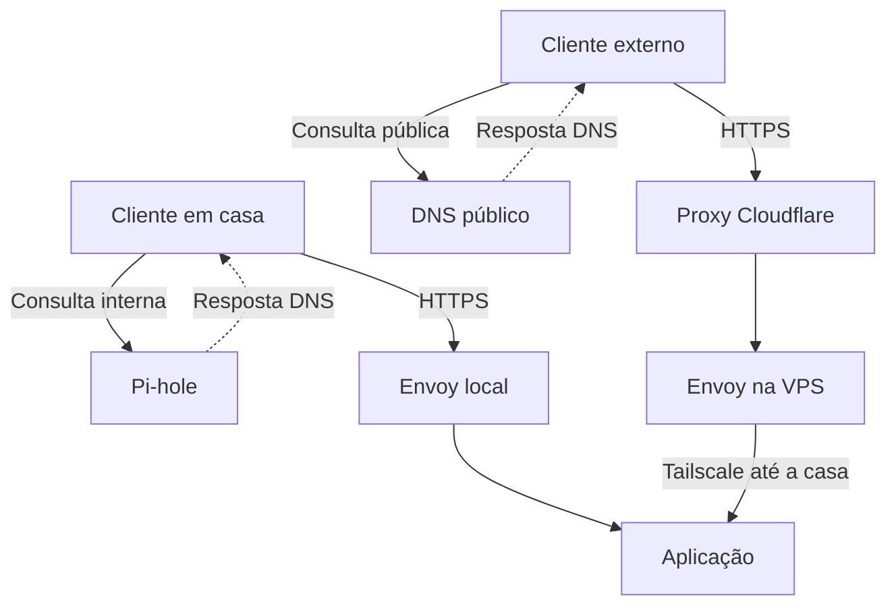

+++
title = "Homelab K8s, parte 3: rede, split DNS e acesso"
description = "Como a VPS recebe tráfego público, Tailscale liga os nós e ExternalDNS mantém Cloudflare e Pi-hole alinhados às rotas do Kubernetes."
language = "pt-BR"
authors = ["Guilherme de Castro"]
publishedAt = "2026-10-28T15:46:03-03:00"
tags = ["homelab","redes","dns","tailscale","kubernetes"]
draft = false
series = "Homelab K8s"
seriesPart = 3
cover = "./assets/cover-series-v2.jpg"
cover_alt = "Nuvem sorridente com uma mão apoiada no roteador, ao lado de uma casa e de placas de direção."
+++

Para abrir sua biblioteca de fotos, basta digitar o endereço no navegador. Parece simples, mas o caminho da conexão muda conforme o local de acesso. Em casa, ela passa pelo gateway local. Pela internet, o caminho inclui a entrada pública na VPS e uma VPN até os equipamentos de casa.

O cluster [Kubernetes](https://kubernetes.io/) tem nós em casa e na VPS. O acesso ao [Immich](https://immich.app/) ajuda a entender como esses ambientes se conectam, desde a consulta ao DNS até a leitura de uma foto no NAS.

## O acesso pela internet passa pela VPS

A VPS é um servidor virtual alugado e também um nó do cluster. Uso [Envoy Gateway](https://gateway.envoyproxy.io/) para configurar a entrada pública nela e a entrada interna nos nós de casa. Os proxies Envoy recebem conexões HTTPS, encerram o TLS e encaminham as requisições conforme as rotas de cada aplicação.

As fotos ficam em casa. Para encaminhar a conexão até a aplicação, a VPS precisa se comunicar com os nós locais. Uso [Tailscale](https://tailscale.com/) para fazer essa ligação. Ele cria uma rede privada entre os dispositivos, chamada tailnet, com tráfego criptografado por [WireGuard](https://www.wireguard.com/).

*O cliente Tailscale reúne os dispositivos da rede privada. Endereços IP desfocados.*

Quem acessa um serviço publicado na internet não precisa entrar na VPN. No caso do Immich, há uma etapa antes da VPS: o proxy da [Cloudflare](https://www.cloudflare.com/). O navegador se conecta à Cloudflare, que encaminha o acesso à entrada pública na VPS. Dali, a requisição segue pela rede privada até a aplicação.

Esse é o caminho do Immich, cuja biblioteca fica em casa. A VPS também executa outros serviços do cluster e pode guardar dados em seu próprio disco. Ela não funciona apenas como um roteador.[^caminho]

## A rede dos nós e a rede dos pods

O Tailscale conecta as máquinas de casa e a VPS em uma rede privada. Dentro do Kubernetes, o [Flannel](https://github.com/flannel-io/flannel) cuida da comunicação entre pods que rodam em máquinas diferentes. No meu homelab, ele usa essa conexão privada para transportar o tráfego entre os nós.

Os Services oferecem às aplicações um endereço estável de acesso, mesmo quando os pods mudam. O Tailscale conecta as máquinas; os componentes do Kubernetes cuidam da rede dos pods e do encaminhamento dos Services.

O Raspberry Pi tem outro papel nessa ligação: anuncia a rota da rede local no Tailscale e hospeda o balanceador usado para acessar a API do Kubernetes. A VPS usa esse caminho para falar com a API. Já o tráfego do Envoy até os pods usa a rede do Flannel entre os nós, sem exigir que o Pi seja um salto intermediário em toda requisição.

Dentro de casa, os equipamentos se conectam pela rede cabeada, que inclui o [TP-Link TL-SG108E](https://www.tp-link.com/br/business-networking/soho-switch-easy-smart/tl-sg108e/). Suas oito portas são Gigabit. Quando o tráfego passa por esse switch, cada porta limita a conexão a 1 Gbit/s, mesmo quando uma das máquinas tem uma placa de rede mais rápida.[^switch]

## DNS interno e DNS público

Antes de enviar a requisição, o navegador precisa descobrir o endereço do serviço. Dentro de casa, o [Pi-hole](https://pi-hole.net/) resolve os nomes internos. Para os nomes públicos, uso Cloudflare.

No acesso interno, a resposta do DNS aponta para o Envoy local. Pela internet, aponta para o proxy da Cloudflare, que encaminha a conexão à VPS. Os dois caminhos chegam ao Immich e à mesma biblioteca de fotos.

O DNS informa ao cliente onde se conectar. Depois da resposta, o cliente abre a conexão HTTPS com o Envoy local ou com a Cloudflare. O arquivo da foto não passa pelo Pi-hole.

Na rede de casa, o [MetalLB](https://metallb.io/) permite que o gateway seja acessível por um endereço da rede local. O [cert-manager](https://cert-manager.io/) emite e renova os certificados usados pelos gateways nas conexões HTTPS. Na [parte 4](/blogs/homelab-operacao/), mostro como a emissão de certificados e a atualização do DNS participam do deploy declarativo das aplicações.

## ExternalDNS atualiza os registros automaticamente

Manter os registros internos e públicos manualmente daria trabalho. Toda aplicação nova exigiria configurar o DNS em outro painel. O [ExternalDNS](https://kubernetes-sigs.github.io/external-dns/) automatiza essa tarefa a partir dos recursos do Kubernetes.

Ele acompanha as rotas configuradas no cluster e usa seus nomes e endereços para atualizar o DNS. Tenho uma instância responsável pela Cloudflare e outra pelo Pi-hole. Cada uma acompanha o gateway correspondente, com filtros que definem quais registros pode alterar.

O ExternalDNS atua quando há uma mudança na configuração. Quem responde às consultas continua sendo o Pi-hole ou o DNS público; os gateways recebem e encaminham as requisições das aplicações. Na parte 4, mostro como uma alteração feita no Git chega ao cluster e atualiza esses registros.

## O caminho de uma requisição ao Immich

No acesso interno, o cliente consulta o Pi-hole, recebe o endereço local e se conecta ao gateway. A rota leva ao serviço do Immich, que consulta seu banco e lê os arquivos da biblioteca.

No acesso pela internet, o DNS devolve o endereço do proxy da Cloudflare. Ele recebe a conexão e encaminha a requisição ao gateway da VPS, que a encaminha pela rede privada até a aplicação em casa. Os dois caminhos usam o mesmo banco e os mesmos arquivos.

Depois de chegar à aplicação, o usuário ainda precisa se autenticar e ter permissão para acessá-la. O Immich está integrado ao [Dex](https://dexidp.io/) por [OpenID Connect](https://openid.net/developers/how-connect-works/). Ao escolher esse login, o usuário é encaminhado ao Dex para se autenticar e depois retorna ao Immich. O DNS apenas informa o endereço do serviço.

Separar essas etapas ajuda a investigar problemas. Se o computador consulta apenas um servidor DNS público, não vai encontrar um nome que só existe no Pi-hole. A aplicação pode estar funcionando normalmente, mas o navegador não sabe onde encontrá-la.

Se o DNS retorna o endereço esperado, confiro a conexão HTTPS e o certificado da entrada. Depois verifico o encaminhamento até o serviço, o login e o acesso aos dados. Assim, evito alterar a aplicação quando a falha está na resolução do nome.

## O que acontece quando a conexão falha

Em casa, acesso os serviços pelo gateway local. Pela internet, dependo da VPS e da conexão dela com a rede de casa. Se essa ligação cair, a VPS pode continuar acessível, mas não conseguirá encaminhar as requisições às aplicações.

O cache do DNS também pode causar confusão. Mesmo depois de atualizar um registro, alguns dispositivos continuam usando a resposta anterior até ela expirar. Isso ajuda a explicar por que um endereço funciona em um aparelho e falha em outro logo após uma mudança.

Com os caminhos de acesso definidos, falta cuidar da manutenção. Na [parte 4](/blogs/homelab-operacao/), vou explicar como uso GitOps para aplicar mudanças, como guardo as credenciais e como acompanho os serviços e seus backups.

[^caminho]: Os diagramas mostram o caminho lógico da requisição, sem desenhar cada interface ou encapsulamento. Tailscale pode usar conexão direta ou retransmissão, conforme a conectividade. A VPS recebe os serviços publicados, mas não é o ponto de saída de toda a navegação da casa.

[^switch]: Gigabit é a velocidade nominal por porta. A velocidade real depende do restante da rede, dos discos e do uso das máquinas.
