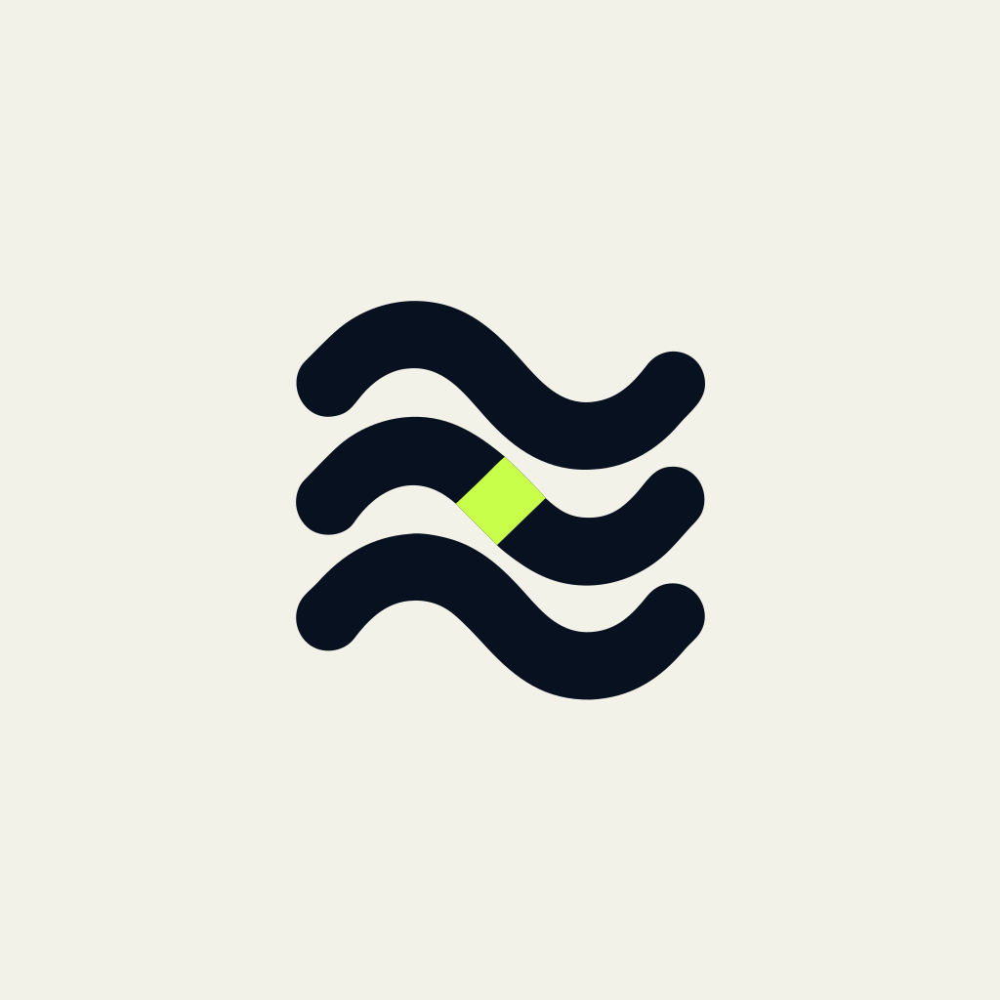
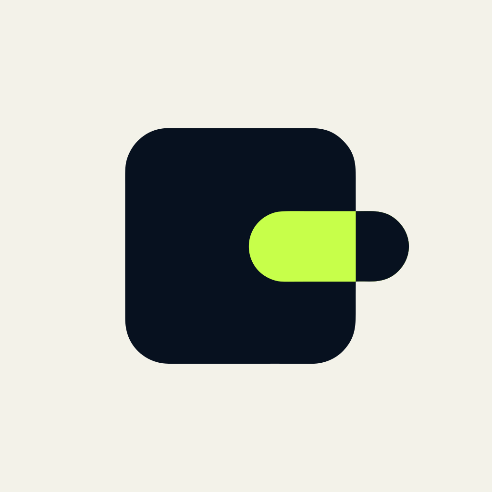

+++
title = "Projetos"
description = "Projetos de Guilherme de Castro e da organização Araihu: interfaces em Go, publicação, infraestrutura e ferramentas para desenvolvedores."
language = "pt-BR"
+++
Uma seleção dos projetos que construo e mantenho. O fio condutor é Go, software livre e ferramentas que simplificam o trabalho de quem desenvolve e opera sistemas.

## Na Araihu

Sou mantenedor da [Araihu](https://github.com/araihu), organização onde desenvolvemos bibliotecas e aplicações em Go. Estes são alguns dos destaques da organização.

<ul class="guigoes-projects" aria-label="Projetos da Araihu">
<li>

<h3><a href="https://github.com/araihu/goshtoso">Goshtoso</a></h3>
<a class="guigoes-project-version" href="https://github.com/araihu/goshtoso/releases/tag/v0.4.5" aria-label="Release v0.4.5 · beta de Goshtoso">v0.4.5 · beta</a>

Interfaces web · Go, templ, HTMX

Biblioteca de componentes para aplicações que renderizam HTML no servidor. Integra templ, HTMX e Alpine.js, com estilos e assets distribuídos junto da biblioteca. A API ainda está em evolução.

<a href="https://goshtoso.araihu.com/" aria-label="Site oficial de Goshtoso">Site oficial</a> · <a href="https://github.com/araihu/goshtoso" aria-label="Repositório de Goshtoso no GitHub">GitHub</a>

</li>
<li>

<h3><a href="https://github.com/araihu/goshtoso-charts">Goshtoso Charts</a></h3>
<a class="guigoes-project-version" href="https://github.com/araihu/goshtoso-charts/releases/tag/v0.0.4" aria-label="Release v0.0.4 · alpha de Goshtoso Charts">v0.0.4 · alpha</a>

Visualização de dados · Go, templ, SVG

Componentes de gráficos para aplicações Go com Goshtoso. Renderiza SVG no servidor ou gráficos interativos no navegador, com configurações tipadas, temas compartilhados e recursos de acessibilidade.

<a href="https://goshtoso.araihu.com/modules/charts" aria-label="Site oficial de Goshtoso Charts">Site oficial</a> · <a href="https://github.com/araihu/goshtoso-charts" aria-label="Repositório de Goshtoso Charts no GitHub">GitHub</a>

</li>
<li>

<h3><a href="https://github.com/araihu/muamba">Muamba</a></h3>
<a class="guigoes-project-version" href="https://github.com/araihu/muamba/releases/tag/v0.0.6" aria-label="Release v0.0.6 · alpha de Muamba">v0.0.6 · alpha</a>

Assets e builds · Go, SHA-384, lockfiles

Baixa arquivos remotos e registra seus hashes em um lockfile para verificar cópias locais e restaurar arquivos que correspondam ao conteúdo registrado. Confia no primeiro download: detecta mudanças posteriores, mas não autentica o autor do arquivo.

<a href="https://muamba.araihu.com/" aria-label="Site oficial de Muamba">Site oficial</a> · <a href="https://github.com/araihu/muamba" aria-label="Repositório de Muamba no GitHub">GitHub</a>

</li>
<li>

<h3><a href="https://github.com/araihu/margo">Margo</a></h3>
<a class="guigoes-project-version" href="https://github.com/araihu/margo/releases/tag/v0.0.25" aria-label="Release v0.0.25 · alpha de Margo">v0.0.25 · alpha</a>

Publicação · Markdown, HTML, PDF

Transforma Markdown em páginas HTML, sites estáticos, PDFs e apresentações. Pode ser usado pela linha de comando ou como biblioteca Go. É o motor de publicação deste blog.

<a href="https://margo.araihu.com/" aria-label="Site oficial de Margo">Site oficial</a> · <a href="https://github.com/araihu/margo" aria-label="Repositório de Margo no GitHub">GitHub</a>

</li>
<li>

<h3><a href="https://github.com/araihu/manja">Manja</a></h3>
<a class="guigoes-project-version" href="https://github.com/araihu/manja/releases/tag/v0.1.17" aria-label="Release v0.1.17 · beta de Manja">v0.1.17 · beta</a>

Documentação de APIs · OpenAPI, Goshtoso

Renderiza e publica documentação OpenAPI com busca por operações e schemas. Exporta um site estático que funciona sem servidor Manja e também oferece execução como servidor de documentação.

<a href="https://manja.araihu.com/" aria-label="Site oficial de Manja">Site oficial</a> · <a href="https://github.com/araihu/manja" aria-label="Repositório de Manja no GitHub">GitHub</a>

</li>
<li>

<h3><a href="https://github.com/araihu/balemoh">Balemoh</a></h3>
<a class="guigoes-project-version" href="https://github.com/araihu/balemoh/releases/tag/v0.0.8" aria-label="Release v0.0.8 · alpha de Balemoh">v0.0.8 · alpha</a>

Infraestrutura · Kubernetes, Docker, Podman

Descobre serviços e organiza uma página inicial com os que interessam. Combina catálogo persistente, revisão das descobertas e uma interface em Go, com plugins para integrar outras ferramentas.

<a href="https://balemoh.araihu.com/" aria-label="Site oficial de Balemoh">Site oficial</a> · <a href="https://github.com/araihu/balemoh" aria-label="Repositório de Balemoh no GitHub">GitHub</a>

</li>
<li>

<h3><a href="https://github.com/araihu/talaria-mem">Talaria-Mem</a></h3>
Sem release

Memória para agentes · Go, SQLite, MCP

Serviço de memória local para o Codex, separado por workspace. Guarda contexto persistente e oferece consulta por CLI e MCP. Está em desenvolvimento; a implementação atual ainda não é uma versão lançada.

</li>
</ul>

## Na minha conta

Ferramentas e experimentos publicados em [guilycst](https://github.com/guilycst).

<ul class="guigoes-projects" aria-label="Projetos de Guilherme de Castro">
<li>

<h3><a href="https://github.com/guilycst/lazy-dvc">lazy-dvc</a></h3>
<a class="guigoes-project-version" href="https://github.com/guilycst/lazy-dvc/releases/tag/2026.03.16-cd6269d" aria-label="Release 2026.03.16-cd6269d de lazy-dvc">2026.03.16-cd6269d</a>

Dados e identidade · DVC, SSH, GitHub

Usa as chaves SSH e a participação em organizações e times do GitHub para autenticar o acesso a um remote DVC. Aproxima o acesso aos dados do fluxo que o time já usa para código.

<a href="/blogs/lazy-dvc-github-ssh-dvc-storage/">Leia o artigo sobre lazy-dvc</a>

</li>
<li>

<h3><a href="https://github.com/guilycst/gitmeout">gitmeout</a></h3>
<a class="guigoes-project-version" href="https://github.com/guilycst/gitmeout/releases/tag/v0.0.1-beta.1" aria-label="Release v0.0.1-beta.1 · alpha de gitmeout">v0.0.1-beta.1 · alpha</a>

Portabilidade · GitHub, Forgejo, Codeberg

CLI em Go para espelhar repositórios do GitHub em instâncias Forgejo ou Codeberg. Permite selecionar contas, organizações ou repositórios e trabalhar com espelhos por push ou pull.

</li>
</ul>
