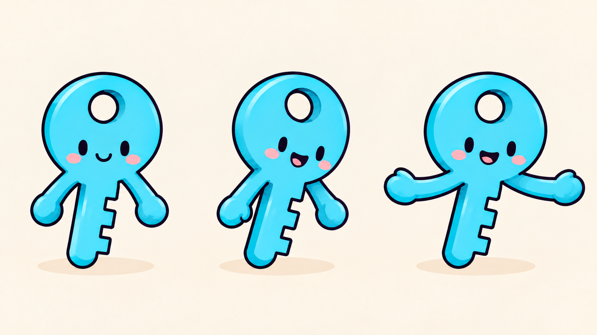
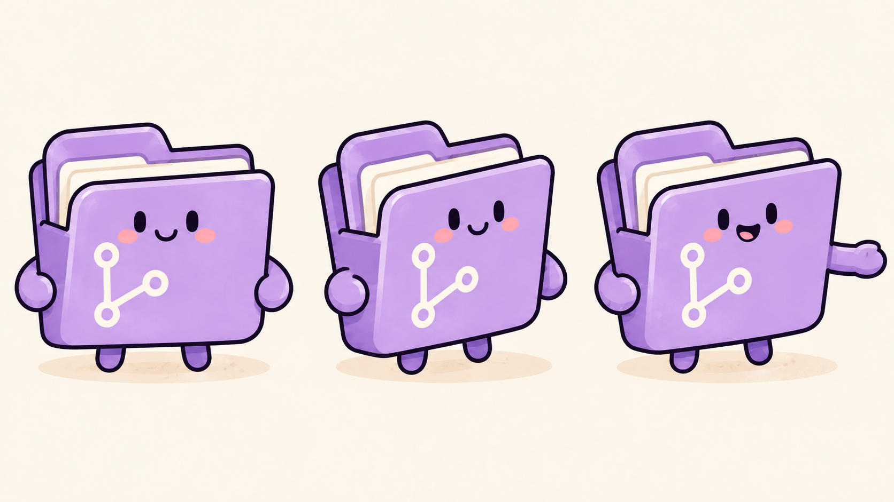
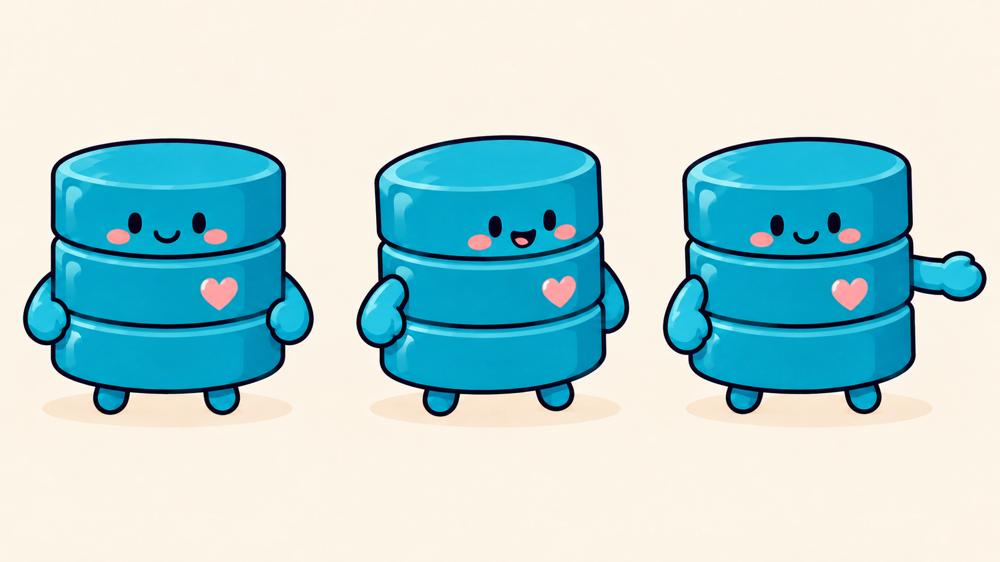
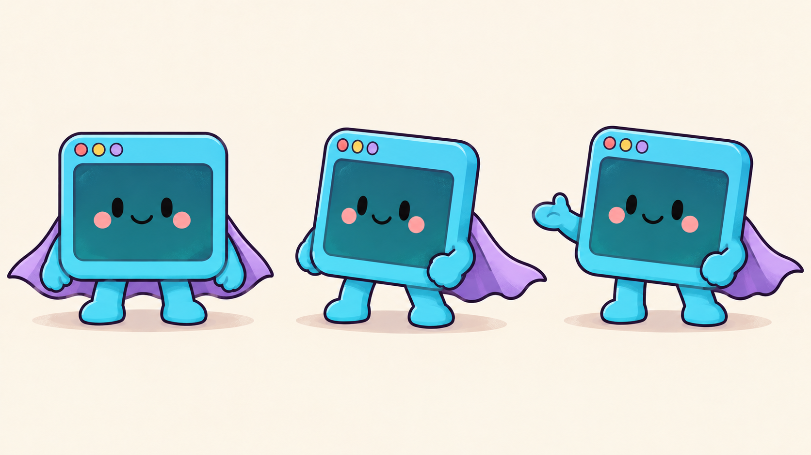
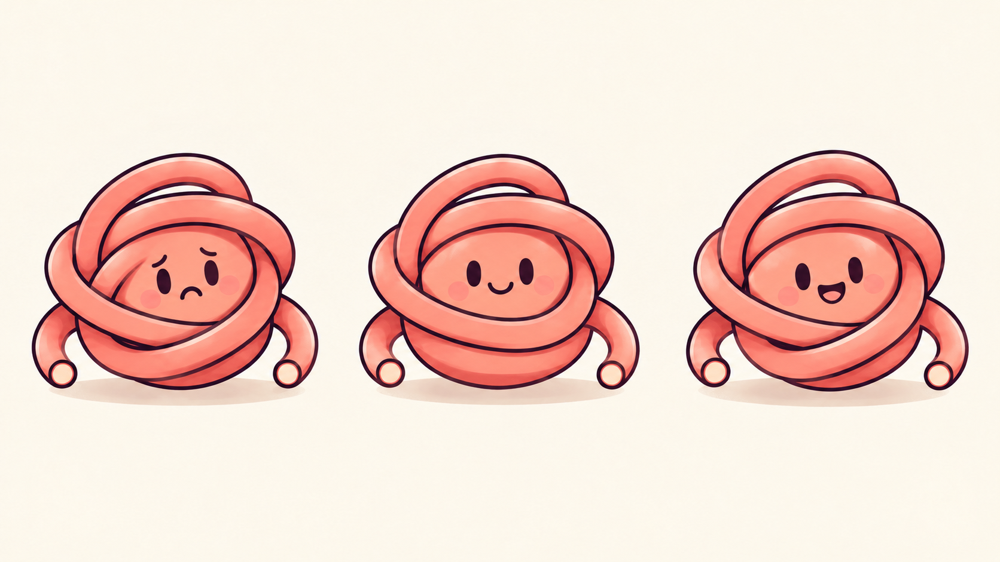
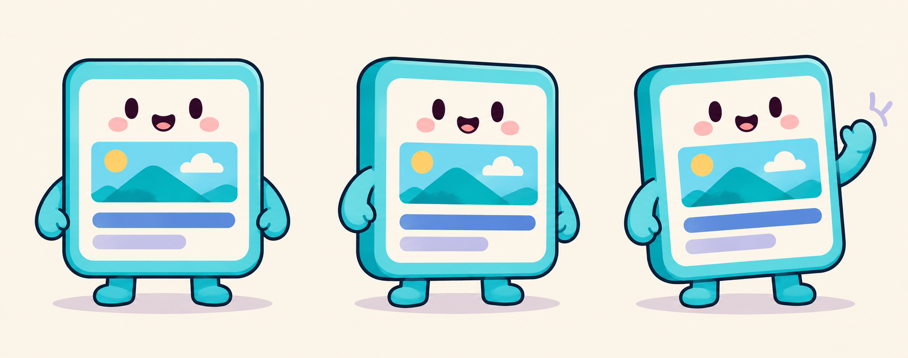
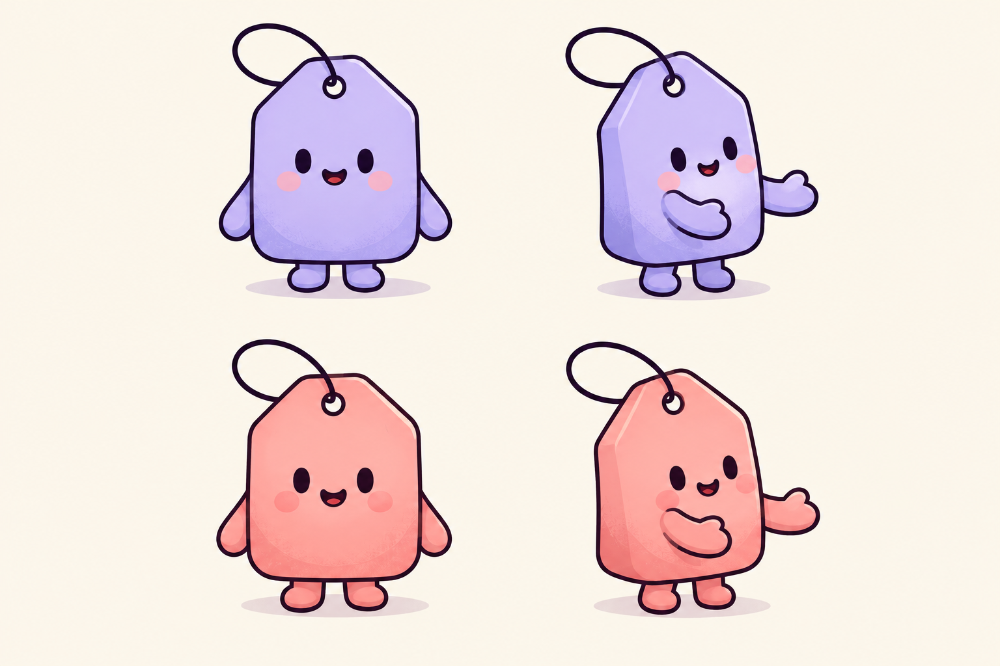
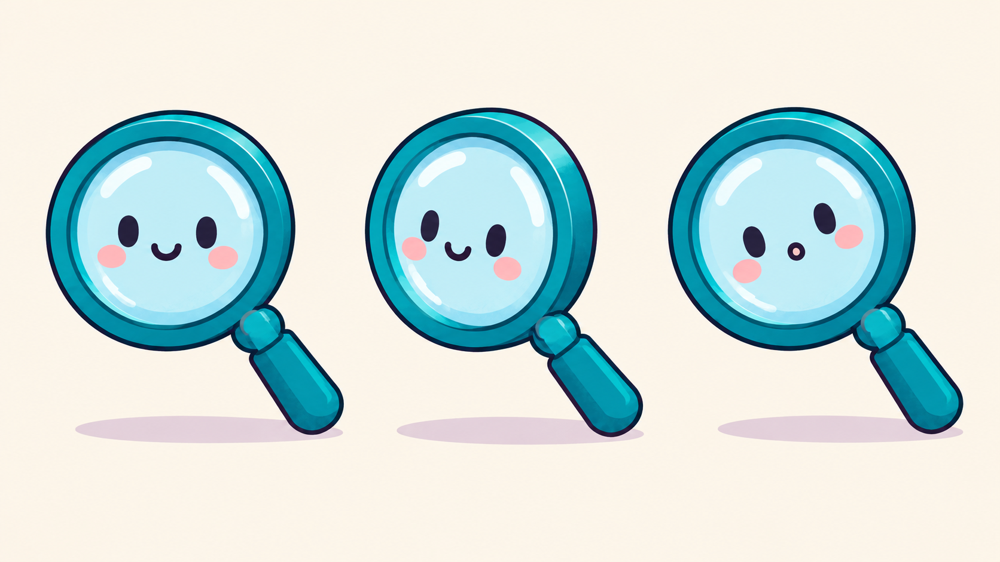
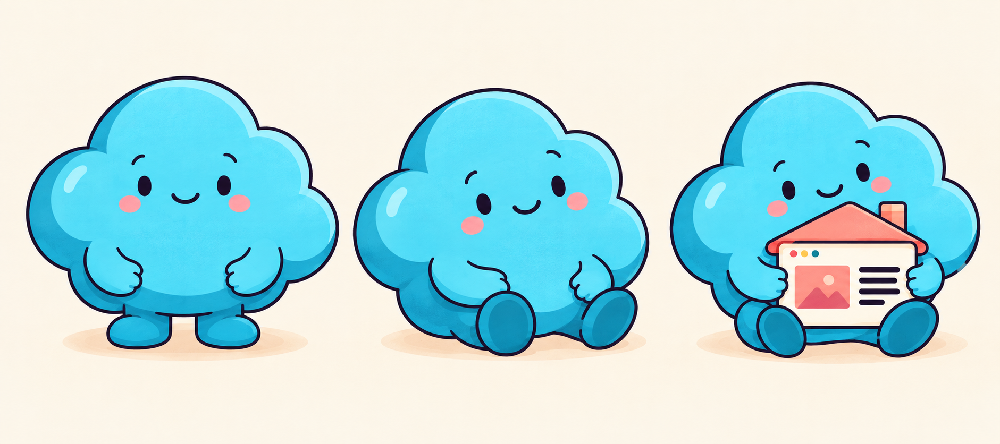
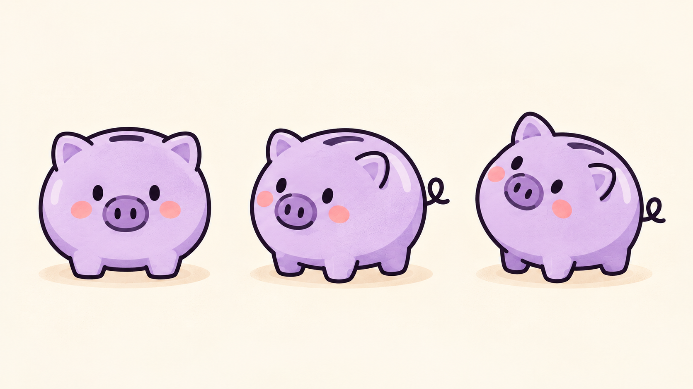

# Personagens do Guigoes

Biblioteca visual v1, criada em 27/10/2026 a partir das quatro capas do blog, incluindo a capa aprovada do lazy-dvc com os personagens de mãos dadas. São 22 fichas, com duas variantes de cor na ficha das tags: as dez originais abaixo e [doze personagens de self-hosting e projetos](self-hosting.md).

As fichas fixam a identidade visual. Pose, expressão e cenário podem variar; silhueta, paleta, símbolos e anatomia permanecem. Os personagens representam conceitos técnicos, não Guilherme nem os mascotes oficiais dos projetos.

## Escolher pelo assunto

A [bio](../../../content/about/index.md) trata de Go, plataforma, Kubernetes, automação, homelab e operação. Os [projetos](../../../content/projects/index.md) acrescentam interfaces no servidor, publicação, APIs, assets, dados e memória. Use estas associações editoriais conforme o artigo:

| Assunto | Elenco sugerido | Metáfora |
|---|---|---|
| SSH, identidade, lazy-dvc | Chave, pasta e banco | Acesso compartilhado, cooperação, mãos dadas |
| Git, GitOps, gitmeout | Pasta e terminal | Organizar, sincronizar e transportar código |
| Go, CLI, automação, DX, Hyperscript | Terminal e novelo | Executar uma tarefa, desfazer complexidade |
| HTMX, Goshtoso, Margo, Manja | Página e terminal | Transformar conteúdo ou contratos em interface |
| Metadados, SEO, busca, descoberta, Balemoh | Tags, página e lupa | Descrever, encontrar e inspecionar |
| Kubernetes, operadores, cloud e homelab | Operador, mini servidor, container e nuvem | Operar serviços e aplicar configuração |
| Bancos, DVC, memória, Talaria-Mem | Banco, caderno de memória e lupa | Guardar, recuperar e consultar |
| Assets, builds reproduzíveis, Muamba | Pacotinho, pasta e lupa | Organizar arquivos e conferir conteúdo |
| Visualização de dados, Goshtoso Charts | Página e banco | Apresentar dados; gráfico pode ser um acessório |
| Custo de infraestrutura, serverless | Nuvem e cofrinho | Hospedar com economia |

Estas associações não são exclusivas. Escolha poucos personagens para uma ação compreensível. Não acrescente logos, chapéus ou emblemas para transformar o personagem em uma marca. Gráficos que comunicam dados reais precisam de valores corretos; desenhos decorativos não devem sugerir resultados medidos.

## Fichas e anatomia

As contagens abaixo são por personagem, não por ficha. Uma oclusão pode esconder um membro; não desenhe membros extras para completar a contagem na imagem. Mãos são simples e arredondadas.

| ID e ficha | Identidade fixa | Anatomia | Pode variar |
|---|---|---|---|
| [key](v1/key.png) | Ciano; cabeça circular com um furo acima do rosto; uma haste com três dentes curtos de um lado | Dois braços saindo da base da cabeça; nenhuma perna ou pé | Inclinação da haste, expressão e gesto dos braços |
| [folder](v1/folder.png) | Lilás; aba superior à esquerda; papéis creme; símbolo claro de três nós e duas conexões na frente | Dois braços laterais e dois pés curtos | Pose e abertura moderada; símbolo sempre legível |
| [database](v1/database.png) | Teal; três camadas cilíndricas; rosto na superior; coração coral na camada central | Dois braços e dois pés | Ângulo e gesto; camadas continuam unidas |
| [terminal](v1/terminal.png) | Moldura ciano; tela teal escura; três controles coral, amarelo e lilás; capa lilás | Dois braços, duas pernas curtas e dois pés; capa é tecido | Pose, expressão e dobra da capa |
| [cable](v1/cable.png) | Novelo coral; rosto central; poucas voltas largas e duas pontas com corte circular | Sem braços, mãos, pernas ou pés; pontas são cabo | Expressão e grau de enrolamento; sem bifurcações |
| [page](v1/page.png) | Cartão vertical; moldura ciano; interior creme; rosto acima da miniatura; duas barras abaixo | Dois braços e dois pés | Gesto; conteúdo da miniatura pode acompanhar o tema |
| [tags](v1/tags.png) | Lilás ou coral; cantos superiores chanfrados; um furo no alto e uma alça de cordão | Dois braços e dois pés por tag; alça não é membro | Cor entre as duas variantes, pose e expressão |
| [magnifier](v1/magnifier.png) | Aro teal; lente ciano clara com rosto; um cabo diagonal contínuo | Nenhum braço, mão, perna ou pé | Inclinação e expressão; nunca um segundo cabo |
| [cloud](v1/cloud.png) | Ciano; silhueta de nuvem com domo central alto; sobrancelhas suaves | Dois braços e dois pés | Em pé ou sentada; pode segurar um acessório |
| [piggy-bank](v1/piggy-bank.png) | Lilás; corpo arredondado; duas orelhas; duas narinas; fenda dorsal; um rabo enrolado | Quatro patas na anatomia; duas ou três visíveis nas poses da ficha; sem braços humanos | Ângulo e inclinação do corpo |

A casinha na terceira pose da nuvem é um acessório sem rosto ou membros. A capa do terminal também é acessório. Nenhum deles vira personagem adicional automaticamente.

O novelo é uma metáfora editorial de complexidade, não um diagrama de conexão. Na nova referência, as voltas foram simplificadas para reduzir cruzamentos ambíguos. Não copie a geometria confusa da capa antiga.

## Como usar na próxima geração

1. Leia o artigo e escolha a ação e os IDs necessários. Abra as fichas em tamanho original.
2. Anexe os PNGs correspondentes como referências visuais à ferramenta integrada de imagens. Só citar o caminho no prompt não transmite a imagem.
3. Identifique cada entrada pelo nome: por exemplo, imagem 1 = key, imagem 2 = folder, imagem 3 = database. Para ferramenta com caminhos locais, use os caminhos absolutos em `referenced_image_paths`.
4. Diga explicitamente que são referências de identidade, não um layout para copiar. Peça uma única cena e uma única instância de cada personagem escolhido, salvo repetição intencional.
5. Descreva o contato físico. Para mãos dadas, diga qual mão se une a qual personagem e onde cada braço começa. Proíba membros extras e fusões.
6. Preserve a paleta e a anatomia desta tabela. A escala dentro das fichas não determina a escala entre personagens; use a capa original como referência de proporção quando necessário.
7. Abra o resultado em tamanho original, confira os pontos de contato e faça a revisão de [mídia](../../media-style.md). Capas precisam também da verificação em miniatura, nos recortes e temas do site.

Se houver limite de referências, simplifique a cena ou prepare uma referência composta com a ferramenta de imagens. Não descarte silenciosamente a referência de um personagem. Se as fichas não estiverem no checkout, procure a versão no repositório ou em outro worktree do mesmo remoto antes de redesenhar de memória.

### Exemplo de prompt de capa

```text
Use the attached images as character identity references:
Image 1 = key, image 2 = folder, image 3 = database.
Create ONE Guigoes editorial cover scene, not a reference sheet.
Include exactly one instance of each of these three characters.
Preserve their silhouettes, proportions, colors, facial style and symbols.
The lavender folder stands left, cyan key in the center, teal database right.
Folder's right hand holds key's left hand; key's right hand holds database's left hand.
Exactly two handholding connections. Arms must attach to the correct bodies.
Key: one circular head and hole, one toothed shaft, two arms, zero legs or feet.
Folder: two arms, two feet, three-node branch symbol, no keyhole.
Database: three cylinder tiers, two arms, two feet, coral heart, no keyhole.
Warm cream background, plum outlines, subtle paper texture, simple shadows.
Landscape 16:9 with generous crop-safe margins and no words, logos or watermark.
Do not copy the multiple poses or repeated characters from the reference sheets.
```

## Revisão e manutenção

As 22 fichas foram abertas em resolução original e revisadas visualmente: silhueta, símbolos, membros, mãos, encaixes e bordas. O novelo recebeu uma edição para simplificar os cruzamentos. A [expansão](self-hosting.md) registra a anatomia e as observações das doze novas fichas. As fichas não substituem a revisão de cada nova cena, principalmente contatos entre personagens e oclusões.

Estas imagens são referências de produção fora de `content/` e `assets/`; não são novas capas nem precisam ser publicadas no site. Não houve teste de uma nova capa composta a partir das fichas nesta etapa.

Os [prompts originais](v1/prompts.md) e [prompts da expansão](v1/expansion-prompts.md) registram as entradas e a ferramenta usada, imagegen integrado. A paleta e o acabamento seguem o [guia de mídia](../../media-style.md). Guarde evoluções em `v2/` quando a identidade mudar; não substitua referências estáveis silenciosamente.

## Galeria

### Chave



### Pasta



### Banco de dados



### Terminal



### Novelo



### Página



### Tags



### Lupa



### Nuvem



### Cofrinho


