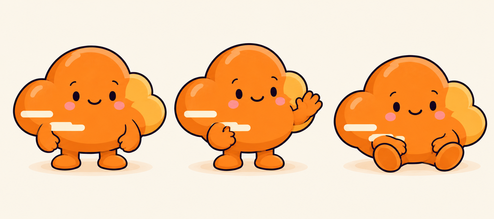

# Cloudflare editorial character

Added on October 31, 2026 at the author's request. This is an original Guigoes editorial interpretation inspired by the Cloudflare icon and its orange/gold colors, not an official Cloudflare mascot or an endorsement.

Reference sheet: [v1/cloudflare.png](v1/cloudflare.png). Keep the generic cyan `cloud` character unchanged.

## Identity

- Orange cloud body, high central dome, broad low base and a smaller golden group of lobes on the right.
- Two short cream airflow markings at lower left. These are body graphics, not limbs.
- Plum outlines, small dark eyes, eyebrows, smile and blush, matching the existing Guigoes drawing style.
- Exactly two arms, two hands and two feet per pose. Feet may face forward when seated. No additional faces on the lobes.
- The sheet shows three poses of the same character. Covers normally use one instance.

The palette requested orange `#f6821f` and gold `#fbad41`; the generated texture includes tonal variation. The official [press kit](https://www.cloudflare.com/press/press-kit/) supplied the icon reference. The cyan cloud sheet supplied drawing style only.

## Generation

Generated with the integrated image tool. Inputs were the official icon reference, kept outside published content, and `v1/cloud.png`.

```text
Use case: illustration-story. Generate ONE Guigoes character identity sheet for a NEW editorial Cloudflare-inspired character. Image 1 is the official Cloudflare logo, reference ONLY for orange-and-gold colors and distinctive cloud silhouette with a broad low horizontal base, high central dome and smaller golden puff on its right. Image 2 is the existing Guigoes cyan cloud character sheet, reference ONLY for drawing language: cute 2D rounded technology objects, dark plum #292331 outlines, tiny oval eyes and small smile, subtle paper grain and simple shadows. Create a distinct orange cloud character, NOT a recolor of the cyan cloud. Main body rich orange #f6821f, smaller right puff golden #fbad41, one short cream horizontal airflow notch at lower left as a graphic body marking, no wordmark. Show three poses side by side on warm cream #f8f3e8: standing front with arms relaxed, three-quarter wave with ONE raised hand, seated relaxed. Each pose has exactly two orange arms, two simple rounded hands, and two short feet. Feet are anatomical feet, never extra cloud puffs. Small eyebrows, dark eyes and friendly smile; no gloves, no badge, no clothes, no tools. Preserve identical character anatomy and palette across poses. No multiple faces on cloud lobes. Plenty of space between poses, no text, no labels, no title, no logo wordmark, no watermark. Original editorial interpretation for a technology blog, not an official brand mascot. Wide horizontal reference sheet, around 2:1 aspect.
```

## Inspection

The full-size sheet was opened and inspected. Each of its three poses has two arms/hands and two feet, without detached or duplicated limbs. The golden lobes and cream markings remain graphic parts of the body. The generated two cream markings are the accepted identity, superseding the prompt's request for one. Inspect contacts again in every composed cover.


