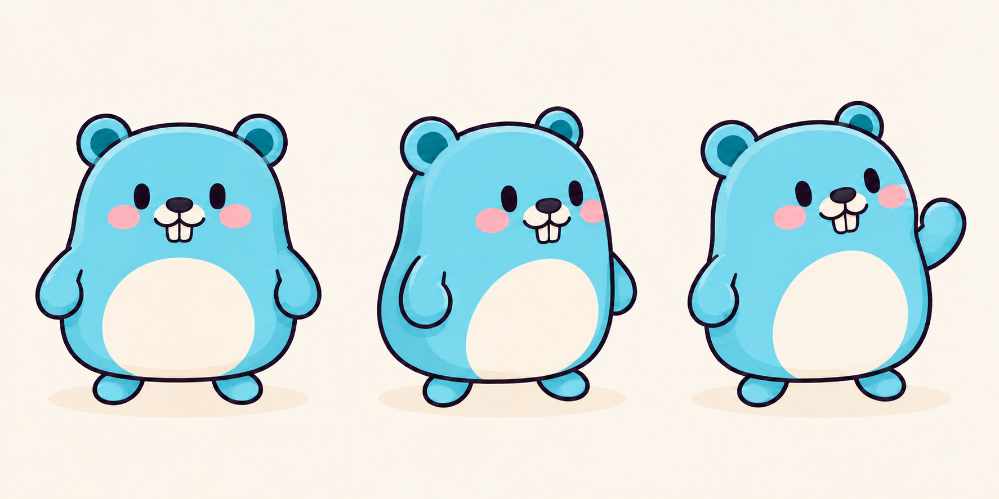
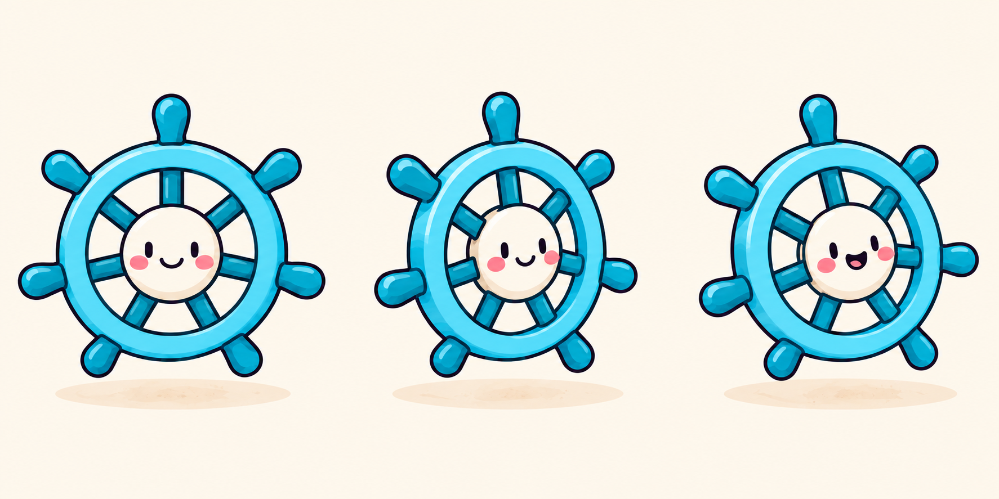

# Go and Kubernetes characters

Added on November 1, 2026 with the integrated image-generation tool. Both sheets use [folder](v1/folder.png) and [database](v1/database.png) as drawing-style references. They are Guigoes editorial interpretations, not official project mascots or endorsements.

## Identity and anatomy

| ID and sheet | Fixed identity | Anatomy |
|---|---|---|
| [gopher](v1/gopher.png) | Cyan pear-shaped rodent, two round ears with teal interiors, small dark eyes and nose, cream muzzle and belly, two cream front incisors | Two short arms with rounded paws and two feet; no visible tail, whiskers, clothes or accessories |
| [kubernetes-wheel](v1/kubernetes-wheel.png) | Cyan circular ship's wheel, cream face hub, seven teal spokes and seven matching outer handles | No arms, hands, legs, feet or stand; all seven handles are structural parts |

Each sheet shows three poses of the same character. Use one instance per cover unless repetition is intentional. Preserve the gopher's two incisors when changing its expression. Preserve the wheel's seven spoke-to-handle alignments; never add a bottom-center handle without a spoke.

## Choosing a character

- Use the gopher for Go, CLI development and Go libraries. Pair with terminal, folder or API contract when the article needs a concrete action.
- Use the wheel for Kubernetes, cluster orchestration and reconciliation. Pair with container, mini server or operator. It complements the existing operator rather than replacing it.

Attach the PNGs as identity references in later generations, following the [catalog workflow](README.md). The references remain outside published content; they do not change existing covers.

## Inspection

Both final PNGs were opened at full resolution. Each gopher pose has two ears, two arms, two feet and two incisors. The first generation omitted the waving pose's teeth; a local image edit restored them. That edit also closed its mouth, which is the accepted final expression.

Each final wheel pose has seven spokes and seven outer handles, no anatomical limbs and one continuous rim. The first generation added an eighth, bottom-center handle in every pose; a local image edit removed those three redundant handles. The final wheel floats slightly above its ground shadow rather than balancing on a handle.

No text, cropped body parts or detached limbs were found in this inspection. These sheets have not been tested in a composed cover or the site's responsive crops and themes. Recheck anatomy, contacts and thumbnail readability when creating a cover.

Exact generation and correction prompts are in [v1/platform-prompts.md](v1/platform-prompts.md).

## Gallery

### Go gopher

### Kubernetes wheel

