# Elenco de self-hosting e projetos

Doze fichas adicionadas em 27/10/2026. Junto às dez do [catálogo principal](README.md), formam a biblioteca de 22 fichas. São personagens editoriais do Guigoes, sem substituir marcas ou mascotes dos projetos.

## Escolha por tema

| Personagem | Assuntos e projetos |
|---|---|
| Mini servidor | Self-hosting, homelab, computação local, provisionamento e MAAS |
| NAS | Armazenamento, volumes, backups, restauração e dados sob seu controle |
| Roteador | Rede doméstica, DNS, Pi-hole, acesso e conectividade |
| Container | Containers, imagens, builds e runners próprios |
| Operador | Kubernetes, GitOps, reconciliação e Dex Operator |
| Cofre | Segredos, credenciais e Moco |
| Radar | Monitoramento, disponibilidade, alertas e Xisnove |
| Pacotinho | Assets, dependências, integridade e Muamba |
| Caderno de memória | Memória de agentes, recuperação de contexto e Talaria-Mem |
| Contrato | OpenAPI, validação, geração de clientes e oapi-cli-gen |
| Claquete | Bibliotecas de mídia, automação e Mastarr |
| Álbum | Fotos pessoais, preservação e Immich no homelab |

Estas associações orientam a composição; não afirmam suporte, integração ou estágio de lançamento dos projetos.

## Identidade e anatomia

As contagens são por personagem. Oclusões podem esconder membros; nunca acrescentar outro para compensar.

| ID e ficha | Identidade fixa | Anatomia e peças |
|---|---|---|
| [mini-server](v1/mini-server.png) | Gabinete baixo ciano, painel frontal teal com rosto, dois LEDs amarelos e três aberturas laterais | Dois braços e dois pés; painel não é tela de terminal |
| [nas](v1/nas.png) | Torre lilás, rosto acima de duas gavetas verticais, cada uma com puxador escuro e LED ciano | Dois braços e dois pés; gavetas pertencem ao gabinete |
| [router](v1/router.png) | Gabinete baixo creme e ciano, faixa teal com rosto, três LEDs amarelos | Duas antenas traseiras ameixa com pontas coral; nenhum braço, mão, perna ou pé |
| [container](v1/container.png) | Caixa retangular teal, topo lilás, quatro relevos verticais frontais, marcas de portas na lateral estreita | Dois braços e dois pés; portas e relevos não são membros |
| [operator](v1/operator.png) | Cabeça creme, visor ciano, discos laterais e juntas lilás, torso teal com um botão coral | Dois braços, duas mãos, duas pernas e duas botas; prancheta é acessório removível |
| [safe](v1/safe.png) | Cofre lilás, uma porta frontal, duas dobradiças à direita, disco amarelo com um ponteiro | Dois braços e dois pés; maçaneta/disco não é mão |
| [radar](v1/radar.png) | Corpo circular teal, tela ciano com arcos, setor de varredura e três pontos amarelos; rosto abaixo | Um pedestal e uma base oval contínua; nenhum membro |
| [parcel](v1/parcel.png) | Caixa amarela, fita coral sobre o topo e a parte superior da frente, etiqueta lateral creme sem texto | Dois braços e dois pés; fita e etiqueta não são membros |
| [memory-notebook](v1/memory-notebook.png) | Livro vertical lilás, lombada teal, três abas laterais coral/ciano/amarela, etiqueta creme | Dois braços e dois pés; uma fita coral inferior com corte em V, nunca um terceiro pé |
| [api-contract](v1/api-contract.png) | Prancheta creme, um clipe amarelo, três blocos ciano ligados por duas linhas teal, marca coral de aprovação | Dois braços e dois pés; desenho é símbolo decorativo, não um contrato real |
| [clapperboard](v1/clapperboard.png) | Corpo coral, duas barras creme, haste superior listrada ameixa/creme | Dois braços e dois pés; uma dobradiça no alto à esquerda, uma haste móvel e borda fixa de contato |
| [photo-album](v1/photo-album.png) | Álbum coral quase quadrado, lombada lilás, páginas creme, foto de montanhas e sol presa por quatro cantoneiras | Dois braços e dois pés; foto e cantoneiras pertencem à capa |

Pose e expressão podem variar. Preserve as diferenças entre mini servidor e NAS, entre caderno e álbum, e entre a prancheta-personagem e a prancheta sem rosto segurada pelo operador.

## Uso e revisão

Siga o [procedimento do catálogo](README.md#como-usar-na-próxima-geração): abra e anexe os PNGs escolhidos, identifique cada personagem e peça uma única cena. As três poses representam o mesmo personagem.

As doze fichas foram abertas em resolução original e inspecionadas quanto a membros, silhuetas, encaixes, acessórios, texto acidental e cortes. Não foram identificados membros extras nessa revisão. Antenas do roteador, pedestal do radar, marcador do caderno e haste da claquete permanecem peças dos objetos.

Diferenças aceitas em relação aos prompts: o container tem quatro relevos frontais; o álbum ficou quase quadrado; o marcador do caderno chega à linha dos pés e mantém o corte em V. Use a aparência revisada das fichas como referência, sem tentar compensar essas diferenças adicionando peças.

Os [prompts exatos](v1/expansion-prompts.md) registram a geração. Nenhuma capa composta foi testada com este novo elenco; revise novamente mãos, oclusões e recortes a cada cena.

## Galeria

### Mini servidor

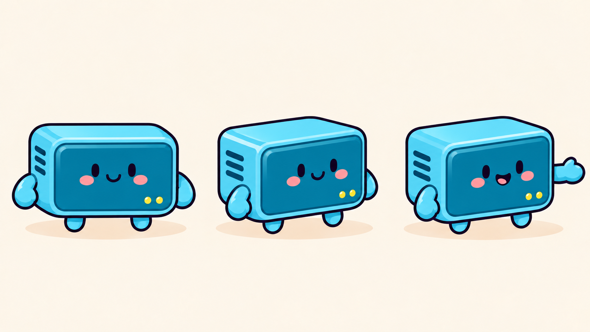

### NAS

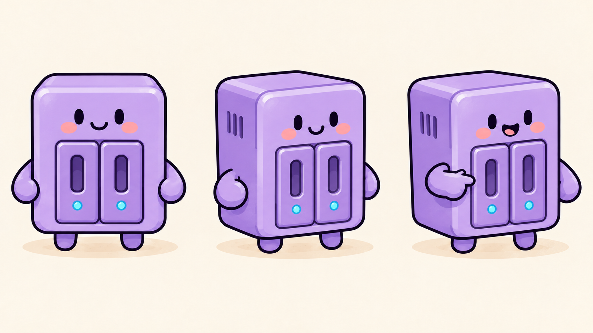

### Roteador

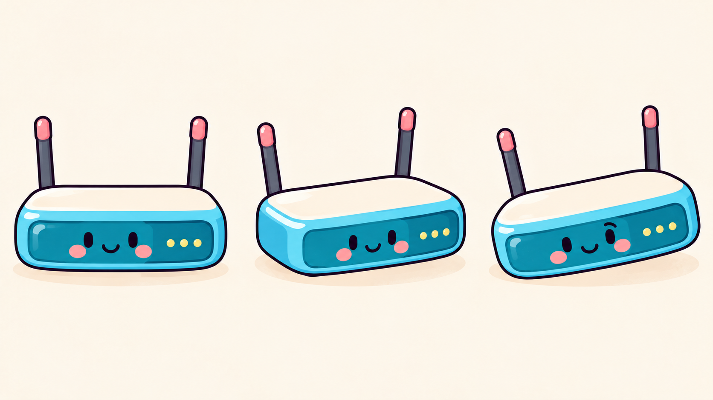

### Container

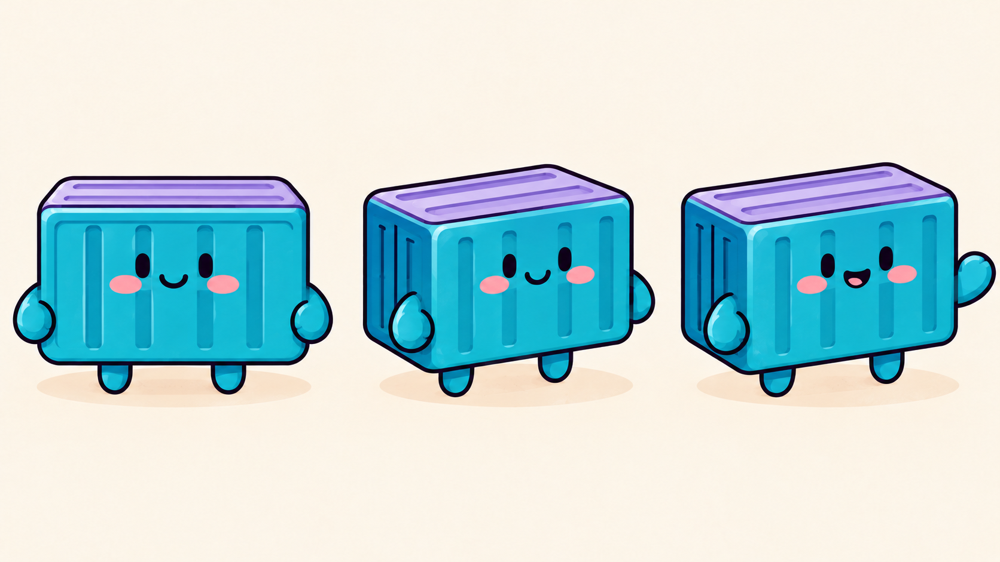

### Operador

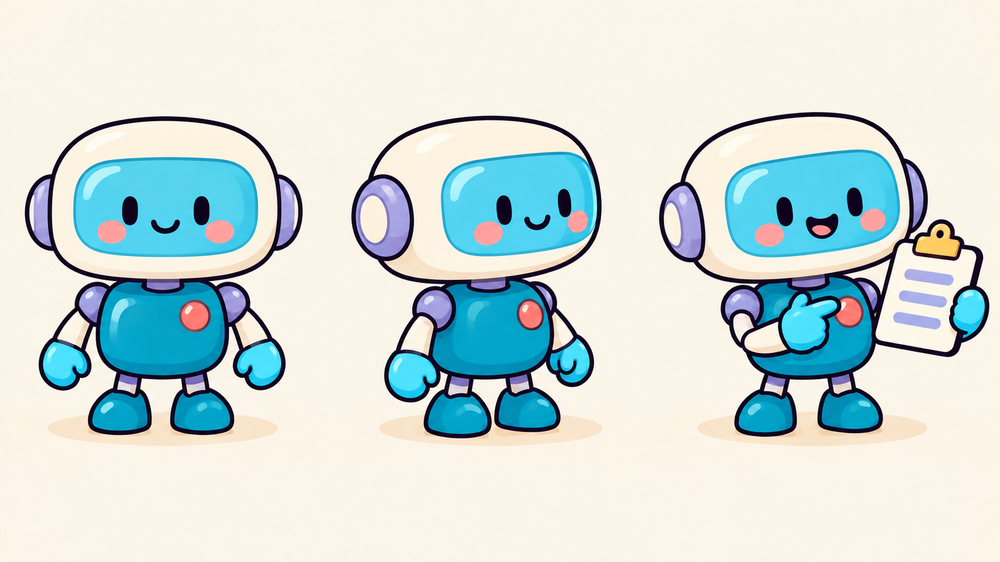

### Cofre

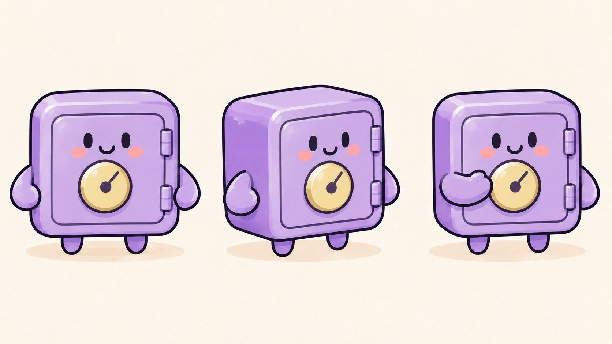

### Radar

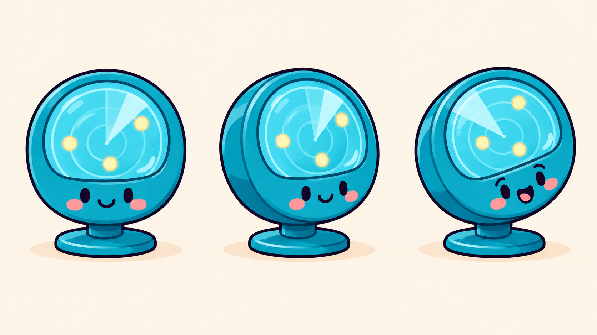

### Pacotinho

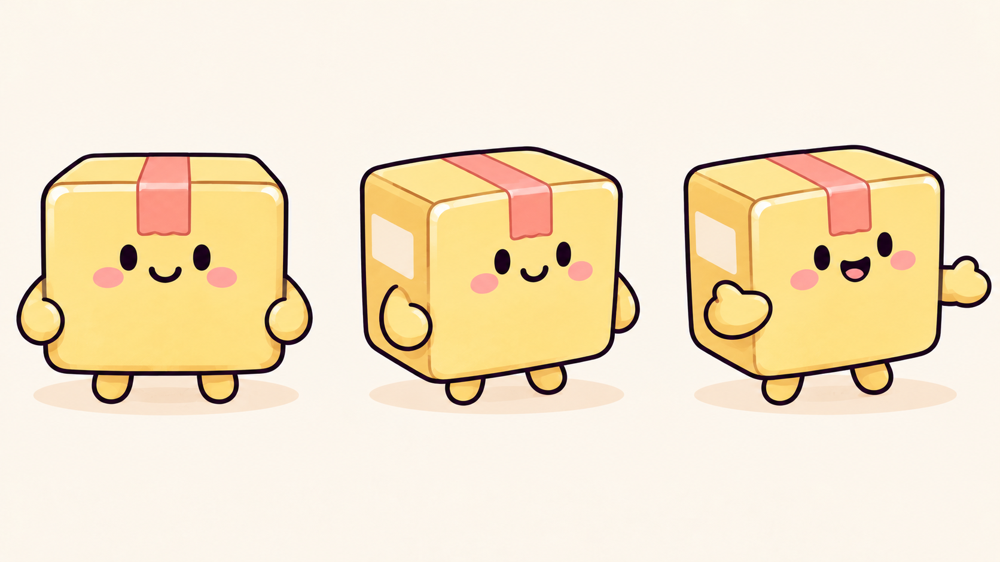

### Caderno de memória

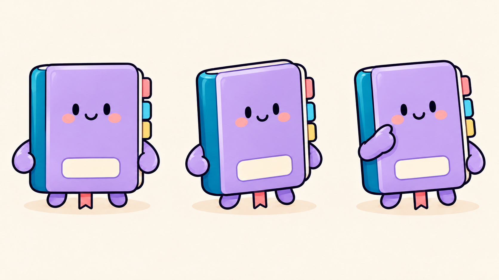

### Contrato

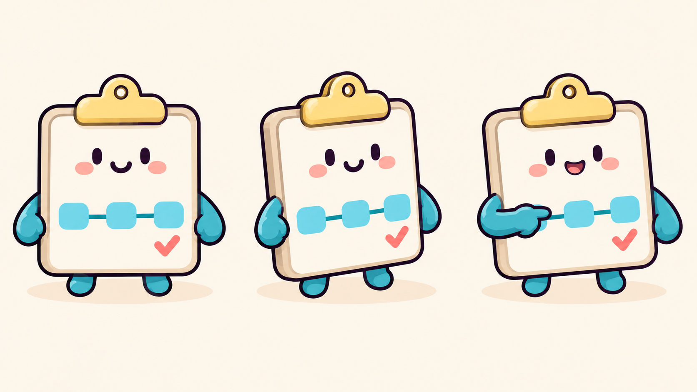

### Claquete

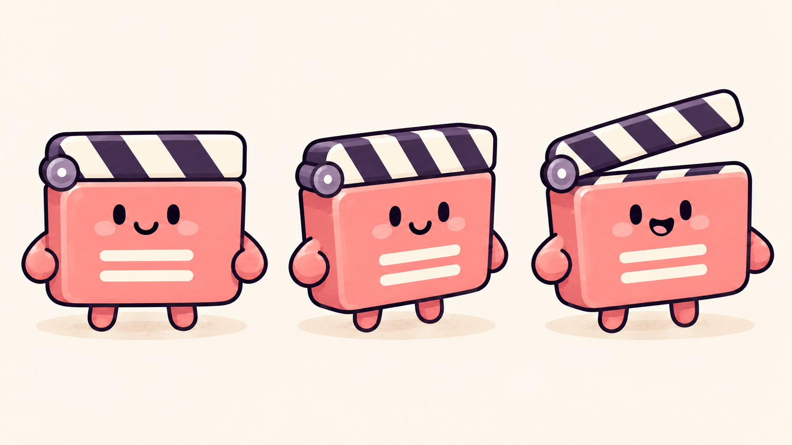

### Álbum

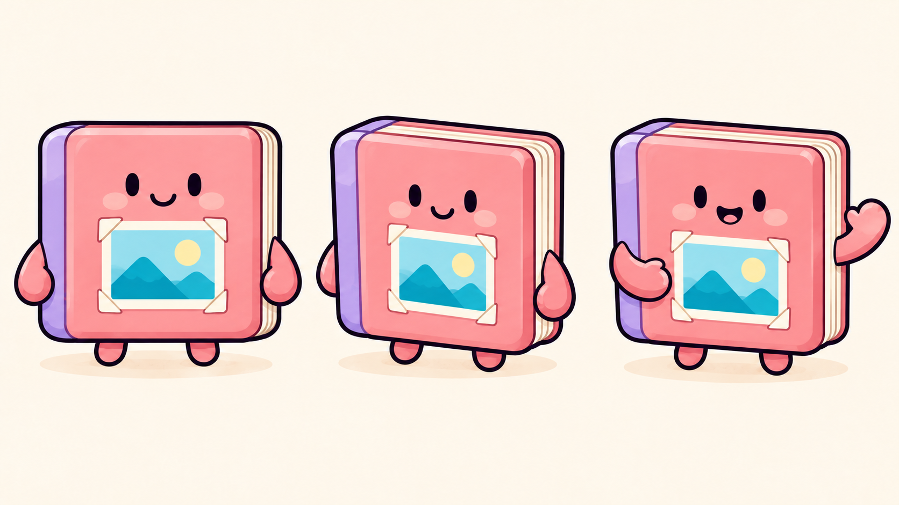
